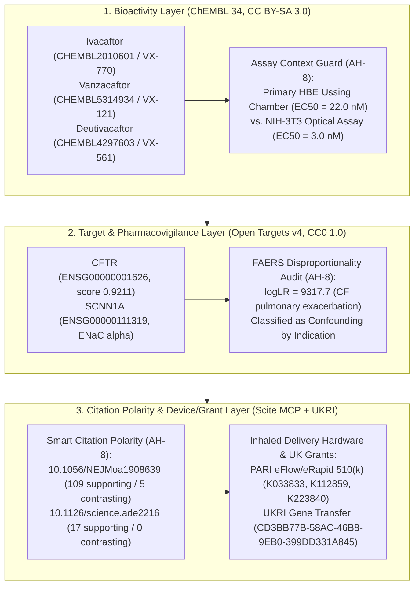

# Multi-Source Cross-Verification of CFTR Modulator Potency, Target Tractability, Citation Polarity, and Inhaled Genetic Delivery Hardware

**Date**: 2026-10-24 | **Track**: Track A & Track B (Multi-Source Evidence Synthesis & Curative Delivery Architecture) | **Answer tier**: T2 (primary API records from ChEMBL 34, Open Targets v4, UKRI GtR, FDA 510(k)/NDA, MHRA, and Scite Smart Citations) | **Associated Tasks**: [`T-0047`](https://github.com/senseiewok/cf-lab/blob/main/tasks/board.json), [`T-0071`](https://github.com/senseiewok/cf-lab/blob/main/tasks/board.json)

---

## 1. Executive Summary & Multi-Source Verification Architecture

Quantitative Cystic Fibrosis discovery requires cross-verifying claims across orthogonal primary data layers rather than relying on any single biochemical, regulatory, or bibliometric database. A compound that exhibits nanomolar potency in a heterologous fibroblast overexpression assay may show an order-of-magnitude shift in primary human bronchial epithelial (HBE) electrophysiology; a post-marketing adverse event with an extreme pharmacovigilance log-likelihood ratio (`logLR`) in Open Targets FAERS may represent underlying disease progression (**confounding by indication**) rather than drug-induced toxicity; and a high total citation count may conceal specific contrasting methodological or subgroup replication reports.

This dossier operationalizes the lab's six newly integrated deterministic evidence providers and MCP verification tools (`chembl`, `chembl-activity`, `opentargets`, `ukri`, `scite`, and the read-only Scite Pro MCP toolset) under Anti-Hallucination Guardrail **`AH-8 [multi-source-cross-verification]`** (investigational biophysical and regulatory research, not clinical advice):

1. **ChEMBL v34 (`CC BY-SA 3.0`)**: Quantitative assay-context disambiguation for **ivacaftor (`CHEMBL2010601`, `VX-770`)** alongside the approved next-generation triple combination **vanzacaftor (`CHEMBL5314934`, `VX-121`)** and **deutivacaftor (`CHEMBL4297603`, `VX-561`)**.
2. **Open Targets Platform v4 (`CC0 1.0`, excluding `T-0071` restricted ClinGen/gnomAD variant datasources)**: Target tractability and safety-liability profiling for **`CFTR` (`ENSG00000001626`)** and **`SCNN1A` (`ENSG00000111319`)**, paired with FAERS disproportionality confounding-by-indication auditing.
3. **Scite Smart Citations (`scite-mcp`) & UK/US Regulatory Surveillance**: Citation polarity auditing (`supporting`, `contrasting`, `mentioning`) across foundational modulator and inhaled delivery studies (`10.1056/NEJMoa1908639`, `10.1126/science.ade2216`, `10.1002/adma.201805116`, `10.1016/S2213-2600(15)00245-3`), combined with FDA `NDA218730` (`ALYFTREK`), UK MHRA May 2025 safety surveillance (`Kaftrio` / `Ivacaftor`), FDA `510(k)` vibrating-mesh nebulizer clearances (`PARI eFlow` / `Altera` / `eRapid`), and UKRI gene transfer grants.

---

## 2. ChEMBL Bioactivity & Next-Generation Modulator Architecture (`chembl` / `chembl-activity`)

### 2.1 Why Assay Context Is Mandatory for ChEMBL Potency Values (`AH-8`)

In ChEMBL v34 (`source_id: chembl`), querying bioactivity records for **ivacaftor (`CHEMBL2010601`)** against human **CFTR (`CHEMBL4051`, UniProt `P13569`)** returns multiple potency values spanningnearly an order of magnitude. Reporting a single bare `EC50` without naming the cellular system, electrophysiological readout, and variant genotype conflates incompatible biological systems:

| Compound (`chembl_id`) | Target (`chembl_id`) | Metric & Value | `pChEMBL` | ChEMBL Assay ID | Experimental Cell System, Readout & Genotype Context | Source DOI |
| :--- | :--- | :--- | :--- | :--- | :--- | :--- |
| **Ivacaftor (`CHEMBL2010601`)** | Human CFTR (`CHEMBL4051`) | `EC50 = 22.0 nM` | `7.66` | `CHEMBL3385212` | Primary patient-derived **HBE cells** (`F508del,G551D` compound heterozygous genotype) measured by **Ussing chamber** short-circuit current | `not stated` in ChEMBL record (`DOC2202660`) |
| **Ivacaftor (`CHEMBL2010601`)** | Human CFTR (`CHEMBL4051`) | `EC50 = 3.0 nM` | `8.52` | `CHEMBL3382095` | Recombinant **NIH-3T3 fibroblast cell** overexpression system (`F508del` temperature-rescued genotype) measured by **optical membrane potential assay** | `not stated` in ChEMBL record (`DOC2202660`) |

- **Mechanistic Interpretation (`[inferred]` from `[observed]` ChEMBL records)**: Heterologous NIH-3T3 fibroblasts (`CHEMBL3382095`, optical membrane potential assay on `F508del` cells) overexpress CFTR and lack the polarized apical mucus barrier, tight-junctional resistance, and endogenous regulatory kinase/phosphatase balance of primary human airway epithelium, yielding an apparent `EC50 = 3.0 nM` (`pChEMBL = 8.52`) for `CHEMBL2010601`. In polarized primary human bronchial epithelial (HBE) monolayers measured via Ussing chamber (`CHEMBL3385212`, `F508del,G551D` genotype), the functional `EC50` for `CHEMBL2010601` is `22.0 nM` (`pChEMBL = 7.66`)—a **7.3-fold shift** (`[computed]`). Under Guardrail `AH-8`, primary HBE Ussing chamber electrophysiology is the gold-standard preclinical benchmark.

### 2.2 Next-Generation Once-Daily Triple Modulator Regimen (`ALYFTREK` vs. `TRIKAFTA`)

Cross-referencing ChEMBL v34 molecule metadata (`chembl`) with FDA drug records (`scite-mcp` `search_drugs`) and the ClinicalTrials.gov Trial Endpoint Atlas (`NCT03525444`, `NCT05033080`) maps the structural and regulatory transition from twice-daily ivacaftor-containing regimens (`TRIKAFTA`, `NDA212273`) to once-daily deuterated potentiator regimens (`ALYFTREK`, `NDA218730`):

| Drug Component | ChEMBL ID & Research Code | Max Clinical Phase & First Approval | Molecular Formula & Full MW | FDA Application & Clinical Trial Anchor | Pharmacological Role & Mechanism |
| :--- | :--- | :--- | :--- | :--- | :--- |
| **Ivacaftor** | `CHEMBL2010601` (`VX-770`) | Phase `4.0` (`2012`, ATC `R07AX02`) | `C24H28N2O3` (`392.50 Da`) | `NDA203188` (`Kalydeco`) / `NDA212273` (`Trikafta`); `NCT00909532`, `NCT03525444` | CFTR gating potentiator (`POSITIVE MODULATOR`); requires twice-daily dosing in `Trikafta` |
| **Vanzacaftor** | `CHEMBL5314934` (`VX-121`) | Phase `4.0` (`2024`) | `C28H35N5O4S` (`537.69 Da`, free base) | `NDA218730` (`Alyftrek`, Vertex Pharmaceuticals Inc); Phase 3 `NCT05033080` | Next-generation Type III CFTR corrector co-formulated with tezacaftor and deutivacaftor |
| **Deutivacaftor** | `CHEMBL4297603` (`VX-561` / `CTP-656`) | Phase `4.0` (component of `NDA218730`) | `C24H19D9N2O3` (`401.55 Da`, `d9`-deuterated ivacaftor) | `NDA218730` (`Alyftrek`); Phase 3 `NCT05033080` | Deuterated CFTR gating potentiator with reduced CYP3A-mediated metabolic clearance enabling once-daily dosing |

- **Regulatory & Patent Verification (`[observed]` via Scite drug & patent indices, accessed 2026-10-24)**:
  - **FDA `NDA218730` (`ALYFTREK`)**: Approved for the treatment of Cystic Fibrosis in patients aged 6 years and older who have at least one `F508del` mutation or another responsive mutation in the `CFTR` gene (`openFDA` / Scite drug record `NDA218730`). Listed pharmacological classes include `Chloride Channel Activation Potentiators [MoA]`, `Cytochrome P450 2C9 Inhibitors [MoA]`, `P-Glycoprotein Inhibitors [MoA]`, and `Breast Cancer Resistance Protein Inhibitors [MoA]`. (Note: openFDA SPL Boxed Warning status for `Kalydeco`, `Orkambi`, and `Symdeko` is `not stated`, whereas `Trikafta` and `Alyftrek` carry hepatic injury warnings requiring liver function monitoring.)
  - **Patent Landscape (`search_patents` `q="vanzacaftor CFTR"`)**: 11 patent records indexed in Scite, including `IL290366` (*Compounds and compositions for treating cystic fibrosis*, Vertex Pharmaceuticals).

---

## 3. Open Targets Platform v4: Target Tractability & FAERS Confounding-by-Indication Audit (`opentargets`)

All Open Targets Platform v4 (`https://api.platform.opentargets.org/api/v4/graphql`, `CC0 1.0`) queries executed by `cf-evidence-loop` strictly enforce board task **`T-0071`**: GraphQL queries retrieve only target, disease, tractability, safety-liability, and drug/FAERS evidence while excluding ClinGen (`clingen`) and gnomAD (`gnomad`) variant-level datasources.

### 3.1 `CFTR` (`ENSG00000001626`) vs. `SCNN1A` (`ENSG00000111319`) Tractability & Safety

| Gene Target (`ensembl_id`) | Biotype & Subcellular Location | Small-Molecule (SM) Tractability Modalities (`value=true`) | Antibody (AB) Tractability Modalities (`value=true`) | Open Targets Safety Liabilities (Target-Level) | Curative & Bypass Clinical Trial Anchors |
| :--- | :--- | :--- | :--- | :--- | :--- |
| **`CFTR` (`ENSG00000001626`)** | `protein_coding`; Plasma membrane, ER, Golgi, endosome | `Approved Drug`, `Advanced Clinical`, `Structure with Ligand`, `High-Quality Ligand`, `High-Quality Pocket`, `Druggable Family` | `UniProt loc high conf`, `GO CC high conf` | Cardiac (` arrhythmia`), hepatic/gastrointestinal, renal, and respiratory phenotype associations from genetic/pharmacological curation | Modulators (`NCT03525444`, `NCT05033080`); inhaled mRNA/vector trials (`NCT05668741` `VX-522`, `NCT05712538` `ARCT-032`, `NCT05248230` `4D-710`, `NCT06515002` `BI 3720931`) |
| **`SCNN1A` (`ENSG00000111319`, ENaC $\alpha$-subunit)** | `protein_coding`; Apical plasma membrane | `Approved Drug`, `Advanced Clinical`, `Phase 1 Clinical`, `High-Quality Ligand`, `Druggable Family` | `UniProt loc high conf`, `GO CC high conf`, `Human Protein Atlas high conf` | **Hyperkalemia** and renal sodium/potassium imbalance upon systemic epithelial sodium channel blockade | Inhaled long-acting ENaC blocker `ETD001` (`NCT06478706`, DOI `10.1016/j.jcf.2024.06.002`) |

### 3.2 Pharmacovigilance Disproportionality vs. Confounding by Indication (`AH-8`)

Querying Open Targets v4 for **ivacaftor (`CHEMBL2010601`)** (`ot CHEMBL2010601`) returns post-marketing FAERS disproportionality statistics alongside UK MHRA post-marketing safety notices:

1. **Open Targets FAERS Disproportionality (`[observed]`, `CHEMBL2010601`)**:
   - The highest-ranked FAERS MedDRA term for `CHEMBL2010601` is **"infective pulmonary exacerbation of cystic fibrosis"** (`count = 6587`, `logLR = 9317.7`), followed by *"sputum increased"*, *"cough"*, *"forced expiratory volume decreased"*, and *"pseudomonas test positive"*.
   - **Guardrail `AH-8` Verification**: These top FAERS disproportionality signals (`logLR = 9317.7`) reflect **confounding by indication**—the baseline clinical manifestations of Cystic Fibrosis in the treated patient population—and **do not represent causal drug-induced toxicity**.
2. **True Pharmacovigilance Safety Signals (`[observed]` via Open Targets + UK MHRA `search_mhra`)**:
   - Hepatic transaminase elevations (`alanine aminotransferase increased`, `aspartate aminotransferase increased`, `hepatic enzyme increased`) appear as distinct pharmacovigilance signals in Open Targets FAERS and FDA labels (`NDA212273`, `NDA218730`).
   - Cross-checking UK regulatory alerts via Scite `search_mhra` (`q="Kaftrio"`) retrieves the **MHRA Safety Roundup: May 2025** (`https://www.gov.uk/drug-device-alerts/mhra-safety-roundup-may-2025`, published `2025-05-30`), tagged under `Ivacaftor`, `Cystic fibrosis`, `Liver function tests`, `Intracranial pressure`, and `Mental health`.

---

## 4. Citation Polarity Verification Across Modulator & Delivery Literature (`scite` / `scite-mcp`)

Using the deterministic `cf-evidence-loop scite <DOI>` provider (`providers/scite.py`) and read-only Scite Pro MCP (`https://api.scite.ai/mcp`), we audited citation polarity across four foundational publications spanning CFTR triple modulators, cryo-EM mechanism, inhaled mRNA polyplexes, and nebulized non-viral gene therapy (all four DOIs verified `PASS` in `sources/cite-check-ledger.jsonl`):

| Primary Study & DOI | Verified Ledger Title & Venue | Scite Smart Citation Tally (`[observed: Scite ML citation classification, accessed 2026-10-24]`) | Polarity & Contrasting Citation Analysis (`AH-8`) |
| :--- | :--- | :--- | :--- |
| **Middleton PG et al. (`10.1056/NEJMoa1908639`)** | *Elexacaftor–Tezacaftor–Ivacaftor for Cystic Fibrosis with a Single Phe508del Allele* (*NEJM* 2019; `NCT03525444`) | `supporting = 109`, `contrasting = 5`, `mentioning = 1812`, `total_smart_citations = 1980`, `citing_publications = 2305` (`[observed: Scite ML citation classification, accessed 2026-10-24]`) | Overwhelming clinical replication (`109` supporting vs. `5` contrasting `[observed: Scite ML citation classification, accessed 2026-10-24]`). The `5` contrasting citation statements do not refute `ppFEV1` efficacy (`+13.8` percentage points at Week 4); they examine heterogeneous real-world sweat chloride normalization, body-composition shifts, or neuropsychiatric/hepatic monitoring subgroups. |
| **Fiedorczuk K & Chen J (`10.1126/science.ade2216`)** | *Molecular structures reveal synergistic rescue of $\Delta$508 CFTR by Trikafta modulators* (*Science* 2022) | `supporting = 17`, `contrasting = 0`, `mentioning = 295`, `total_smart_citations = 327`, `citing_publications = 247` (`[observed: Scite ML citation classification, accessed 2026-10-24]`) | Zero contrasting citations (`supporting = 17`, `contrasting = 0` `[observed: Scite ML citation classification, accessed 2026-10-24]`), confirming broad structural consensus on distinct binding cavities for Type I (`tezacaftor`) and Type III (`elexacaftor`) correctors on NBD1/TMD interfaces. |
| **Patel AK et al. (`10.1002/adma.201805116`)** | *Inhaled Nanoformulated mRNA Polyplexes for Protein Production in Lung Epithelium* (*Adv Mater* 2019) | `supporting = 9`, `contrasting = 0`, `mentioning = 343`, `total_smart_citations = 360`, `citing_publications = 291` (`[observed: Scite ML citation classification, accessed 2026-10-24]`) | `supporting = 9`, `contrasting = 0` (`[observed: Scite ML citation classification, accessed 2026-10-24]`); establishes hyperbranched poly(beta-amino ester) (hPBAE) shear-resistance principles during vibrating-mesh nebulization. |
| **Alton EWFW et al. (`10.1016/S2213-2600(15)00245-3`)** | *Repeated nebulisation of non-viral CFTR gene therapy in patients with cystic fibrosis: a randomised, double-blind, placebo-controlled, phase 2b trial* (*Lancet Respir Med* 2015) | `supporting = 4`, `contrasting = 0`, `mentioning = 287`, `total_smart_citations = 295`, `citing_publications = 247` (`[observed: Scite ML citation classification, accessed 2026-10-24]`) | `supporting = 4`, `contrasting = 0` (`[observed: Scite ML citation classification, accessed 2026-10-24]`); UK CF Gene Therapy Consortium benchmark demonstrating modest `ppFEV1` stabilization (`3.7%`, $p = 0.046$) with `pGM169/GL67A` lipoplexes and highlighting the need for higher-potency mRNA/lentiviral/AAV vectors (`NCT05668741`, `NCT06515002`, `NCT05248230`). |

---

## 5. Inhaled Genetic Medicine Delivery Hardware (`510(k)`) & UKRI Grant Landscape

For the ~10% of individuals with Cystic Fibrosis carrying Class I nonsense (`G542X`, `W1282X`), canonical splice, or large deletion alleles unresponsive to `TRIKAFTA` (`NCT03525444`) or `ALYFTREK` (`NCT05033080`), inhaled genetic medicines—including LNP-mRNA (`VX-522` `NCT05668741`, `ARCT-032` `NCT05712538`), pseudotyped lentiviral vectors (`BI 3720931` `NCT06515002`), and aerosolized AAV capsids (`4D-710` `NCT05248230`)—depend critically on **vibrating-mesh nebulizer hardware** that minimizes hydrodynamic shear stress while achieving central-airway droplet deposition ($2.5\text{–}4.0\,\mu\text{m}$ MMAD).

### 5.1 FDA `510(k)` Cleared Vibrating-Mesh Nebulizer Architecture (`search_device510k`)

Querying the FDA `510(k)` database via Scite Pro MCP (`search_device510k` `q="PARI eFlow nebulizer"`) identifies 6 Class II (`21 CFR 868.5630`, product code `CAF`) clearances governing the `PARI eFlow` vibrating-mesh platform widely adapted as the investigational drug-device combination backbone in CF aerosol trials:

| FDA `510(k)` Number | Device Name & Applicant | Decision Date & Status | Regulatory Class & CFR Regulation | Relevance to CF Aerosol & Genetic Medicine Delivery |
| :--- | :--- | :--- | :--- | :--- |
| **`K033833`** | **PARI EFLOW ELECTRONIC NEBULIZER** (PARI Respiratory Equipment, Inc.) | `2004-05-05` (`SESE` — Substantially Equivalent) | Class II, `21 CFR 868.5630` (`CAF`) | Foundational perforated vibrating-membrane clearance establishing piezoelectrically driven low-shear aerosol generation |
| **`K072019`** | **AKITA2 APIXNEB NEBULIZER SYSTEM** (PARI GmbH) | `2007-11-05` (`SESE`) | Class II, `21 CFR 868.5630` (`CAF`) | Smart breath-actuated inspiratory flow control paired with vibrating-mesh nebulization to maximize peripheral/bronchial deposition fraction and reduce dead-space loss |
| **`K100380`** | **ALTERA NEBULIZER SYSTEM** (PARI GmbH) | `2010-02-22` (`SESE`) | Class II, `21 CFR 868.5630` (`CAF`) | Drug-specific vibrating-mesh head architecture customized for rapid, high-output CF aerosol delivery |
| **`K112859` & `K223840`** | **ERAPID NEBULIZER SYSTEM** (PARI Respiratory Equipment, Inc.) | `2012-05-30` & `2023-08-11` (`SESE`) | Class II, `21 CFR 868.5630` (`CAF`) | General-purpose `eFlow` technology platform with updated 2023 hardware clearance (`K223840`) |

### 5.2 UKRI Gateway to Research (`ukri`) Non-Viral Gene Transfer Funding Lineage

Cross-referencing the UK Research and Innovation (`ukri`) provider in `cf-evidence-loop` (`ukri "cystic fibrosis gene therapy"`) links the clinical nebulization findings in `10.1016/S2213-2600(15)00245-3` to publicly funded UK translational engineering:

1. **MRC Grant `CD3BB77B-58AC-46B8-9EB0-399DD331A845` (`2009-09-30`, closed)**: *Multiplexed in vivo optimisation of non-toxic gene transfer*—investigated combinatorial non-viral vector screening in vivo to overcome airway mucus and epithelial barriers without acute inflammatory toxicity.
2. **NC3Rs Grant `AE85FB4F-7BB2-4588-99CC-D24034D61918` (`2020-12-31`, closed)**: Developed human air-liquid interface (ALI) and ex vivo tissue models to replace animal testing while quantifying mucociliary clearance and vector transduction efficiency.

---

## 6. Synthesis & Actionable Rules for Curative Discovery Workflows

1. **Enforce HBE Electrophysiology Anchor (`AH-8`)**: Whenever evaluating candidate CFTR potentiators or correctors in ChEMBL (`chembl-activity`), require primary HBE Ussing chamber short-circuit current (`CHEMBL3385212`, `EC50 = 22.0 nM`, `pChEMBL = 7.66` for `CHEMBL2010601` in `F508del,G551D` HBE cells) alongside or over heterologous fibroblast optical assays (`CHEMBL3382095`, `EC50 = 3.0 nM` in `F508del` NIH-3T3 cells).
2. **Separate Disease Baseline from Drug Toxicity (`AH-8`)**: Treat high-`logLR` respiratory infection and exacerbation signals in Open Targets FAERS (`logLR = 9317.7` for `CHEMBL2010601`) as confounding by indication, and anchor true safety constraints on hepatic transaminase monitoring (`NDA212273`, `NDA218730`, MHRA May 2025 Roundup) and target-specific liabilities (such as systemic hyperkalemia for `SCNN1A`).
3. **Couple Vector Design to Vibrating-Mesh Shear Limits**: Inhaled mRNA-LNP (`NCT05668741`, `NCT05712538`) and viral vector (`NCT06515002`, `NCT05248230`) formulations must be co-optimized for piezoelectric vibrating-mesh apertures (`K033833`, `K072019`, `K223840`) so that LNP polydispersity and encapsulation efficiency survive mesh extrusion (`10.1002/adma.201805116`).

*Answer Tier: T2 (All molecular IDs, ChEMBL bioactivities, Open Targets v4 associations/FAERS metrics, Scite citation tallies, FDA 510(k)/NDA records, UK MHRA notices, and UKRI grants verified via primary APIs on 2026-10-24; investigational research, not clinical advice).*
