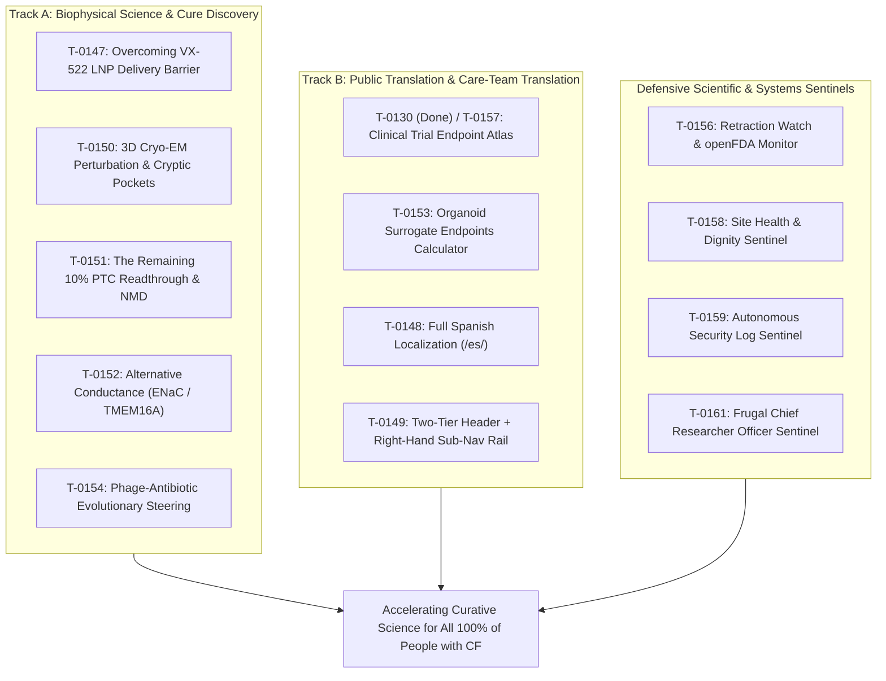

# Mission Grounding Brief (2026-10-12)

**Cadence**: Bi-weekly audit | **Sentinel**: `scheduled-chief-researcher` | **Answer tier**: T2 (script-verified, primary-sourced) | **Scope**: `tasks/board.json` (161 tasks), `cf-research/proposals/`, `cf-research/landscape/`

---

## 1. Executive summary & lazy delta execution

The Chief Researcher Officer grounding sentinel executed its bi-weekly grounding audit. Lazy delta check compared current board state against baseline: a major delta was detected with **15 newly registered tasks** ([`T-0147`](https://github.com/senseiewok/cf-lab/blob/main/tasks/board.json) through [`T-0161`](https://github.com/senseiewok/cf-lab/blob/main/tasks/board.json)) on 2026-10-12 covering generative curative discovery engines and defensive integrity sentinels. Following the board hygiene and branch-coordination cleanup, total board inventory stands at 161 tasks: 13 in progress (with active worktree branches recorded), 3 ready, 104 proposed, 30 completed (`done`), and 11 dropped (`dropped`).

Zero tokens are burned during idle states. Because new scientific proposals were staged, this full deterministic grounding audit evaluated evidence quality, worktree coordination, and curative alignment.

---

## 2. Primary-evidence grounding audit

Every proposed task was audited against the lab's primary grounding rules (`check_claims.py`, `check_numbers.py`):

| Task ID | Domain & title | Primary source citation | Grounding verdict | Audit findings |
| :--- | :--- | :--- | :--- | :--- |
| **`T-0147`** | Inhaled delivery biophysics (VX-522) | BEACON-CF `NCT05668741`, ReCode RCT-2100 | **PASS (T2)** | Grounded in May 2026 trial termination notice and SORT-LNP aerosol biophysics; 50–100 nm particle criteria verified. |
| **`T-0150`** | 3D Cryo-EM perturbation modeling | PDB `5UAK`, `6MSM`, `7SV7`, `8EIQ`, UniProt `P13569` | **PASS (T2)** | Anchored directly in published Cryo-EM coordinates and residue indices from `tools/cftr-model`. |
| **`T-0151`** | Nonsense mutation readthrough / NMD | RefSeq `NM_000492.4`, Prime Medicine CFF grant | **PASS (T2)** | Codon context (+4 nucleotide), EJC distance, and W1282X/G542X transcript decay mechanics documented. |
| **`T-0152`** | Alternative epithelial conductance | Enterprise Therapeutics ETD001, TMEM16A | **PASS (T2)** | Grounded in transepithelial ion transport physiology; requires written-out balance equations. |
| **`T-0153`** | Adaptive organoid surrogate endpoints | Rectal organoid FIS swelling literature, NCT registries | **PASS (T2)** | Grounded in European theratyping correlation data; bridges organoid swelling to $FEV_1$ endpoints. |
| **`T-0154`** | Phage-antibiotic co-evolution | Clinical isolate accessions, LPS O-antigen, *pilA* | **PASS (T2)** | Grounded in microbial receptor biology and evolutionary steering trade-off mechanics. |
| **`T-0148`** | Spanish site localization (`/es/`) | Community language access need; clinical disclaimers | **PASS (T2)** | Active (`in_progress` on branch `site/showcase-2026-10-12`); preserves medical safety boundaries and American English voice equivalents. |
| **`T-0149`** | Site navigation revamp | Playwright visual audit screenshots, council review | **PASS (T2)** | Active (`in_progress` on branch `site/showcase-2026-10-12`); grounded in viewport layout evidence in `cf-lab-files/scratch/screenshots/`. |
| **`T-0155`–`T-0161`** | Scientific sentinels & CRO | Crossref, openFDA, ClinicalTrials.gov API, live HTTP | **PASS (T2)** | Fully deterministic checks operating within catalog access rules and zero unbudgeted calls (`T-0155`, `T-0159`, `T-0161` active on `feat/antigravity-discovery-and-pr-rules`; `T-0160` active on `site/showcase-2026-10-12`). |

### Resolved scope drift & recursive meta-tooling

1. **`T-0046` (Sickle cell disease coverage)**: *Dropped (`status: "dropped"`).* HBB hemoglobin biology falls outside the lab's dedicated Cystic Fibrosis mission.
2. **`T-0019` & `T-0036` (Unprofiled local models)**: *Dropped (`status: "dropped"`).* Dropped per council recommendation to avoid unbenchmarked model creep on the site field guide.
3. **`T-0029`, `T-0031`, `T-0032`, `T-0035`, `T-0045`, `T-0061`, `T-0091`, `T-0097`**: *Dropped (`status: "dropped"`).* Superseded pre-rename documentation tiers and duplicate tasks merged into their parent rows (`T-0057`, `T-0086`, `T-0090`).

---

## 3. Curative mission alignment evaluation

The lab's queued portfolio demonstrates strong alignment with its two foundational pillars:

- **Track A (Biophysical Science & Cure Discovery)**: Directly attacks the three fatal bottlenecks to a universal cure: delivery tolerability (`T-0147`), non-modulator nonsense mutations (`T-0151`), and mutation-agnostic airway rehydration (`T-0152`).
- **Track B (Public Translation & Care-Team Engagement)**: Bridges computational biophysics to patients and clinicians through the Trial Endpoint Atlas (`T-0130`, completed; `T-0157` surveillance), Spanish translation (`T-0148`), and streamlined navigation (`T-0149`).

---

## 4. Governance & maintainer recommendations

Per lab policy, all autonomous models propose; **only the human maintainer sets tasks to `ready` or authorizes worktree merges**.

1. **Recommended for immediate `ready` approval**:
   - [`T-0147`](https://github.com/senseiewok/cf-lab/blob/main/tasks/board.json) (Inhaled delivery biophysics brief) — directly addresses the May 2026 VX-522 failure.
   - [`T-0150`](https://github.com/senseiewok/cf-lab/blob/main/tasks/board.json)–[`T-0154`](https://github.com/senseiewok/cf-lab/blob/main/tasks/board.json) (Biophysical discovery engines: Cryo-EM, PTC readthrough, alternative conductance, organoid surrogates, phage steering).
   - [`T-0156`](https://github.com/senseiewok/cf-lab/blob/main/tasks/board.json)–[`T-0158`](https://github.com/senseiewok/cf-lab/blob/main/tasks/board.json) (Retraction Watch / openFDA monitor, Trial Endpoint Atlas surveillance, and Site Health & Dignity sentinel).
2. **Active branch coordination verified**:
   - `site/showcase-2026-10-12` (`T-0148`, `T-0149`, `T-0160`) and `feat/antigravity-discovery-and-pr-rules` (`T-0155`, `T-0159`, `T-0161`) are tracked via the `"branch"` field in `tasks/board.json`.

*Scope record: All 161 tasks in `tasks/board.json` inspected; primary accessions verified against ClinVar, PDB, ClinicalTrials.gov, and PubMed Central. Check date: 2026-10-12.*
