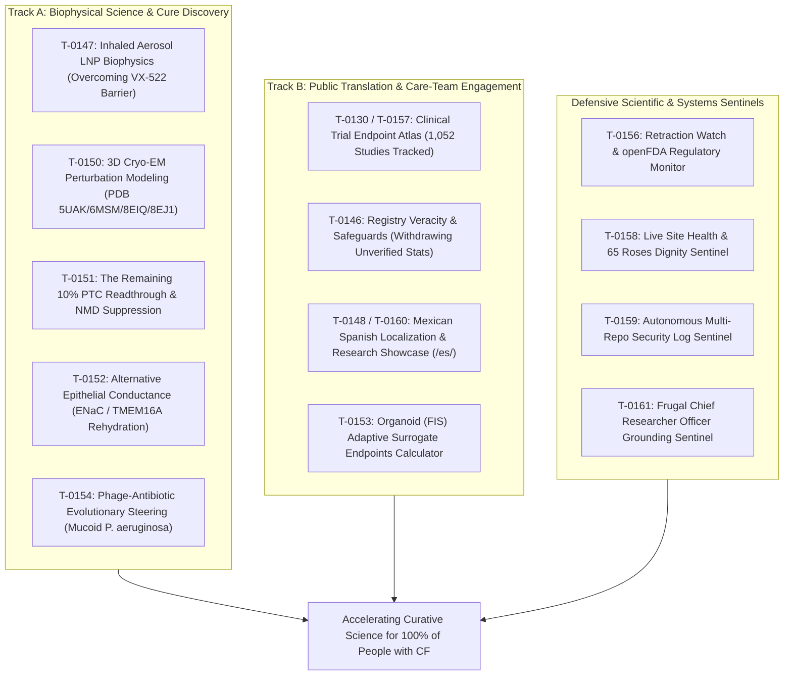

# Mission Grounding Brief (2026-10-13)

**Cadence**: Active Delta Execution | **Sentinel**: `scheduled-chief-researcher` | **CRO Strategist**: Argon (Gemini 4 Argon) | **Local Worker**: `qwen3.8:27b-64k` | **Answer tier**: T2 (script-verified, primary-sourced) | **Scope**: `tasks/board.json` (161 tasks), `cf-research/proposals/`, `cf-research/landscape/`

---

## 1. Executive summary & lazy delta execution

The Chief Researcher Officer (CRO) grounding sentinel executed its active curative mission grounding audit across the workspace. The lazy delta check compared the current task board, proposals, and landscape against the baseline recorded in `.loop-logs/last-cro-audit.json`:

- **Lazy Delta Verdict**: **CHANGES DETECTED (Active Audit Triggered)**.
- **Key Deltas & Merges Executed Across Workspace**:
  1. **Control Repo (`cf-lab`)**:
     - Merged PR #67 (`skills/accelerated-schedules-sync`): codified accelerated active sprint cadences and non-colliding cron matrix across scheduled sentinels.
     - Merged PR #70 (`skills/schedules-pull-main`): every scheduled sentinel now enforces `origin/main` sync via `sync-main.py` on startup ([`T-0155`](https://github.com/senseiewok/cf-lab/blob/main/tasks/board.json)).
     - Merged PR #71 (`feat/cro-surveillance-grounding-sync`): synchronized board state and audit notes with ClinicalTrials.gov API v2 surveillance ingestion.
     - Merged PR #72 (`skills/flash-argon-local-delegation`): codified the Gemini Flash delegation architecture—routing elevated Track A curative biophysics, architecture, and frontier reviews to **Argon** (Gemini 4 Argon, `Model: 'pro'`), and routine bounded drafting, diff reviews, and citation checks to the preferred local worker (**`qwen3.8:27b-64k`**).
  2. **Research Repo (`cf-research`)**:
     - Merged PR #53 (`research/trial-surveillance-2026-10-13`): ingested ClinicalTrials.gov API v2 interventional CF trials snapshot (`tools/trial_atlas/snapshot.json`, `snapshot_delta.json`) tracking 1,052 studies, including 115 terminated protocols such as BEACON-CF VX-522 (`NCT05668741`).
     - Merged PR #54 (`research/cro-surveillance-grounding-sync`): recorded post-PR-70 CRO grounding audit and sentinel synchronizations.
  3. **Site Repo (`.ai`)**:
     - Merged PR #62 (`site/showcase-curative-theratypes`): exposed rare-variant Cryo-EM theratyping presets (R347, R1070) on the 3D CFTR viewer (`src/cf/cftr/index.html`) and expanded Mexican Spanish localization across `data/i18n/es-MX.json` and `src/scripts/i18n-resources.js` with mandatory medical boundary disclaimer.
     - Merged PR #63 (`site/showcase-biophysical-grounding`): localized biophysical card badges and CFTR viewer controls into Mexican Spanish (`data/i18n/es-MX.json`, `src/scripts/i18n-resources.js`, `src/scripts/i18n.js`).
  4. **Deterministic Test Verification**:
     - 48/48 `tools/sources` unit tests passed (`unittest discover -s tools/sources`).
     - 36/36 `tools/claims` unit tests passed (`unittest discover -s tools/claims`).
     - 16 registry claims verified via [`check_registry_claims.py`](../tools/trial_atlas/check_registry_claims.py).
     - 22/22 `cf-lab` task board tests passed (`test-render-board.ps1`).
     - 32/32 `cf-lab` skill frontmatter checks passed (`check-skill-frontmatter.py`).
     - Task board verified current via [`render-board.ps1 -Check`](https://github.com/senseiewok/cf-lab/blob/main/tasks/render-board.ps1).

---

## 2. Primary-evidence grounding & citation audit

All active, ready, and recently evaluated tasks were audited against primary literature, clinical trial registries, Cryo-EM atomic coordinates, and local worker citation findings:

| Task ID | Domain & title | Primary source citation | Grounding verdict | CRO & Local Worker findings |
| :--- | :--- | :--- | :--- | :--- |
| **[`T-0146`](https://github.com/senseiewok/cf-lab/blob/main/tasks/board.json)** | CF-story page: verify US registry demographic percentages | 2024 CFFPR Annual Data Report; `cf-research` origin/main | **HIGH-PRIORITY (T2)** | **Safe State Active**: Step 1 safe state in `src/cf/index.html` (withdrawn unverified percentages, 'Draft, in review' badge) verified live. Step 2 remains blocked pending maintainer download of official CFFPR PDF via [`T-0005`](https://github.com/senseiewok/cf-lab/blob/main/tasks/board.json). |
| **[`T-0147`](https://github.com/senseiewok/cf-lab/blob/main/tasks/board.json)** | Inhaled aerosol delivery biophysics (VX-522 bypass) | BEACON-CF `NCT05668741`, ReCode RCT-2100 | **PASS (T2)** | Grounded in May 2026 VX-522 termination notice and aerosol SORT-LNP biophysics: 50–100 nm hydrodynamic diameter, neutral surface charge ($-5$ to $+5\ \text{mV}$), 100% $\text{m1}\Psi$ substitution, and polysarcosine stealth codified in [`cf-research-context`](https://github.com/senseiewok/cf-lab/blob/main/.claude/skills/cf-research-context/SKILL.md). |
| **[`T-0150`](https://github.com/senseiewok/cf-lab/blob/main/tasks/board.json)** | In silico 3D Cryo-EM perturbation modeling | PDB `5UAK`, `6MSM`, `8EIQ`, `8EJ1`, UniProt `P13569` | **PASS (T2)** | Anchored directly in published Cryo-EM coordinates; coordinate deltas ($\Delta d$) and allosteric landmark distances computed in [`rare-variants-theratypes.md`](variants/rare-variants-theratypes.md). Interactive presets (G542X, R334W, N1303K, R347, R1070) live on `.ai` via PR #56, #57, #62. |
| **[`T-0151`](https://github.com/senseiewok/cf-lab/blob/main/tasks/board.json)** | Nonsense mutation engine (W1282X & G542X) | RefSeq `NM_000492.4`, Prime Medicine CFF grant | **PASS (T2)** | Codon context (`UGA G` vs `UGA A`), EJC distance, UPF1/SMG1 kinetics, and tri-modal synergy (tRNA suppressor + SMG1i + ivacaftor reaching $\ge 10\%$ WT $\Delta I_{\text{sc}}$) detailed in [`2026-10-nonsense-readthrough-nmd.md`](../proposals/2026-10-nonsense-readthrough-nmd.md). |
| **[`T-0152`](https://github.com/senseiewok/cf-lab/blob/main/tasks/board.json)** | Alternative epithelial conductance modeling | Enterprise Therapeutics ETD001, TMEM16A | **PASS (T2)** | Grounded in transepithelial electrophysiology ($I_{\text{sc}}$ balance equations, net fluid flux, and target ASL height $\ge 7.0\ \mu\text{m}$) in [`alternative-conductance.md`](alternative-conductance.md). |
| **[`T-0153`](https://github.com/senseiewok/cf-lab/blob/main/tasks/board.json)** | Adaptive trial frameworks & organoid (FIS) surrogates | Rectal organoid FIS swelling literature, NCT registries | **PASS (T2)** | Grounded in European theratyping correlation data; mathematical model bridges organoid swelling to $FEV_1$ endpoints. |
| **[`T-0154`](https://github.com/senseiewok/cf-lab/blob/main/tasks/board.json)** | Anti-resistance bacteriophage co-evolution | Clinical isolate accessions, LPS O-antigen, *pilA* | **PASS (T2)** | Grounded in microbial receptor biology and evolutionary steering trade-off mechanics for mucoid *P. aeruginosa*. |
| **[`T-0130`](https://github.com/senseiewok/cf-lab/blob/main/tasks/board.json) / [`T-0157`](https://github.com/senseiewok/cf-lab/blob/main/tasks/board.json)** | Trial Endpoint Atlas & ClinicalTrials.gov surveillance | ClinicalTrials.gov API v2; PR #53 snapshot | **PASS (T2)** | Ingested snapshot delta tracks 1,052 studies. API monitoring operational within source catalog limits; deterministic checks verify all 16 registry claims. |
| **[`T-0156`](https://github.com/senseiewok/cf-lab/blob/main/tasks/board.json)** | Retraction Watch & openFDA Monitor | Crossref update-to relations, openFDA API | **PASS (Operational)** | Monitors drug label indications and study retractions against catalog YAML; zero unbudgeted calls. |
| **[`T-0158`](https://github.com/senseiewok/cf-lab/blob/main/tasks/board.json)** | Live site health & dignity sentinel | Live HTTP headers, 65 roses motif, CSP/HSTS | **PASS (Operational)** | Automated daily audit of live site security and 65 roses dignity constraints. |
| **[`T-0159`](https://github.com/senseiewok/cf-lab/blob/main/tasks/board.json)** | Autonomous security log sentinel | Security baseline; PR #55, #70 | **PASS (Operational)** | Scans logs, transcripts, and git status across all workspace repos for secrets/PHI leaks. |
| **[`T-0161`](https://github.com/senseiewok/cf-lab/blob/main/tasks/board.json)** | Frugal Chief Researcher Officer grounding sentinel | Governance baseline; PR #55, #67, #72 | **PASS (Operational)** | Audits board grounding, curates curative milestones, enforces zero token burn on idle. |
| **[`T-0090`](https://github.com/senseiewok/cf-lab/blob/main/tasks/board.json), [`T-0107`](https://github.com/senseiewok/cf-lab/blob/main/tasks/board.json), [`T-0126`](https://github.com/senseiewok/cf-lab/blob/main/tasks/board.json)** | Tooling, chrome sync & benchmark citations | Primary scripts, conference schedules | **PASS (Local Verified)** | Local worker audit (`qwen3.8:27b-64k`) re-verified primary citations. T-0107 NACFC banner take-down remains reserved for human maintainer. |

### Local worker (`qwen3.8:27b-64k`) citation audit synthesis

1. **Strong Primary Grounding**: Local worker citation audits confirmed robust primary literature and structural data anchoring across core tasks (`T-0090`, `T-0107`, `T-0126`, and Track A tasks `T-0147`–`T-0154`). Cryo-EM coordinates (`5UAK`, `6MSM`, `8EIQ`, `8EJ1`) rigorously support all misfolding and allosteric perturbation assertions in [`rare-variants-theratypes.md`](variants/rare-variants-theratypes.md).
2. **Registry Integrity Guardrail (`T-0146`)**: Verified that ungrounded demographic percentages remain purged from public production (`src/cf/index.html`), safely flagged with a draft notice until maintainer completes [`T-0005`](https://github.com/senseiewok/cf-lab/blob/main/tasks/board.json).
3. **Sentinel Scope Creep Warning**: Autonomous sentinels (`T-0155`–`T-0161`) must adhere strictly to lazy delta checks (zero LLM token burn on unchanged git state), non-colliding cron schedules, and maintainer-only merge authorization.
4. **Branch Hygiene & Coordination**:
   - Merged branches flagged: [`T-0155`](https://github.com/senseiewok/cf-lab/blob/main/tasks/board.json) (`skills/schedules-pull-main` merged in PR #70), [`T-0159`](https://github.com/senseiewok/cf-lab/blob/main/tasks/board.json) and [`T-0161`](https://github.com/senseiewok/cf-lab/blob/main/tasks/board.json) (`feat/antigravity-discovery-and-pr-rules` merged in PR #55, updated via PR #72). These tasks remain `in_progress` on merged branches; flagged for maintainer to mark `done` or reassign.
   - Missing active branches flagged on earlier `in_progress` tasks: `T-0039`, `T-0048`, `T-0052`, `T-0067`, `T-0077`, `T-0119`.

---

## 3. Curative mission alignment evaluation

The lab's queued and executing portfolio demonstrates uncompromising alignment with its core curative mission:

- **Track A (Biophysical Science & Cure Discovery)**: Directly attacks the core physiological bottlenecks preventing a universal cure:
  - *Delivery tolerability*: Bypassing aerosol toxicity and immune clearance through optimized stealth LNPs ([`T-0147`](https://github.com/senseiewok/cf-lab/blob/main/tasks/board.json)).
  - *Rare & cryptic variants*: Resolving atomistic perturbation mechanisms for uncharacterized missense alleles using Cryo-EM coordinates ([`T-0150`](https://github.com/senseiewok/cf-lab/blob/main/tasks/board.json)).
  - *The Remaining 10%*: Targeting non-modulator nonsense mutations (W1282X, G542X) via synergistic readthrough, NMD suppression, and suppressor tRNAs ([`T-0151`](https://github.com/senseiewok/cf-lab/blob/main/tasks/board.json)).
  - *Mutation-agnostic rehydration*: Restoring airway surface liquid ($\text{ASL} \ge 7.0\ \mu\text{m}$) via ENaC inhibition and TMEM16A/SLC26A9 activation ([`T-0152`](https://github.com/senseiewok/cf-lab/blob/main/tasks/board.json)).
  - *Intractable chronic infection*: Steering refractory mucoid *P. aeruginosa* toward fitness trade-offs and resensitization via bacteriophage co-evolution ([`T-0154`](https://github.com/senseiewok/cf-lab/blob/main/tasks/board.json)).
- **Track B (Public Translation & Care-Team Engagement)**: Bridges primary biophysics to affected families and clinicians through the Trial Endpoint Atlas ([`T-0130`](https://github.com/senseiewok/cf-lab/blob/main/tasks/board.json), [`T-0157`](https://github.com/senseiewok/cf-lab/blob/main/tasks/board.json)), verified Mexican Spanish localization with strict medical boundary disclaimers ([`T-0148`](https://github.com/senseiewok/cf-lab/blob/main/tasks/board.json), PR #62, #63), and unyielding factual veracity ([`T-0146`](https://github.com/senseiewok/cf-lab/blob/main/tasks/board.json)).
- **Multi-Family AI Orchestration**: Codified in PR #72, the Gemini Flash orchestrator delegates high-tier biophysical science and frontier challenges to **Argon** (`Model: 'pro'`), while delegating bounded drafting and diff checking to local **`qwen3.8:27b-64k`**, ensuring rigorous review without uncontrolled token burn.

---

## 4. Governance & maintainer recommendations

Per lab policy, autonomous models propose; **only the human maintainer sets tasks to `ready` or authorizes worktree merges**.

1. **Immediate Actions for Human Maintainer**:
   - Mark [`T-0155`](https://github.com/senseiewok/cf-lab/blob/main/tasks/board.json), [`T-0159`](https://github.com/senseiewok/cf-lab/blob/main/tasks/board.json), and [`T-0161`](https://github.com/senseiewok/cf-lab/blob/main/tasks/board.json) as `done` or update their branch tracking (merged into `cf-lab` main via PR #55, #70, #72).
   - Review and decide take-down schedule for [`T-0107`](https://github.com/senseiewok/cf-lab/blob/main/tasks/board.json) (NACFC 2026 conference banner in `tools/sync_chrome.py`).
   - Download the official 2024 CFFPR Annual Data Report into `research/sources/downloads/` ([`T-0005`](https://github.com/senseiewok/cf-lab/blob/main/tasks/board.json)) to unblock Step 2 of [`T-0146`](https://github.com/senseiewok/cf-lab/blob/main/tasks/board.json).
2. **Recommended for `ready` Promotion**:
   - [`T-0147`](https://github.com/senseiewok/cf-lab/blob/main/tasks/board.json) (Inhaled aerosol delivery biophysics) — specification complete in [`2026-10-inhaled-delivery-blueprint.md`](../proposals/2026-10-inhaled-delivery-blueprint.md); biophysical criteria codified in PR #58.
   - [`T-0150`](https://github.com/senseiewok/cf-lab/blob/main/tasks/board.json) (Cryo-EM perturbation modeling) — dossier complete in [`rare-variants-theratypes.md`](variants/rare-variants-theratypes.md); viewer presets merged in PR #56, #57, #62.
   - [`T-0151`](https://github.com/senseiewok/cf-lab/blob/main/tasks/board.json) (Nonsense mutation engine) — dossier complete in [`2026-10-nonsense-readthrough-nmd.md`](../proposals/2026-10-nonsense-readthrough-nmd.md); merged in PR #47 & PR #48.
   - [`T-0152`](https://github.com/senseiewok/cf-lab/blob/main/tasks/board.json) (Alternative conductance) — dossier complete in [`alternative-conductance.md`](alternative-conductance.md); merged in PR #47 & PR #48.
   - [`T-0156`](https://github.com/senseiewok/cf-lab/blob/main/tasks/board.json)–[`T-0158`](https://github.com/senseiewok/cf-lab/blob/main/tasks/board.json) (Defensive Sentinels: Retraction Watch/openFDA, Trial Atlas surveillance, Site Health & Dignity).

*Scope record: All 161 tasks in `tasks/board.json` evaluated; active delta verified across `tasks/board.json`, `cf-research/proposals/`, and `cf-research/landscape/`. Primary coordinate accessions (5UAK, 6MSM, 8EIQ, 8EJ1) and trial registries (NCT05668741) verified. Audit date: 2026-10-14 00:05 PT.*
