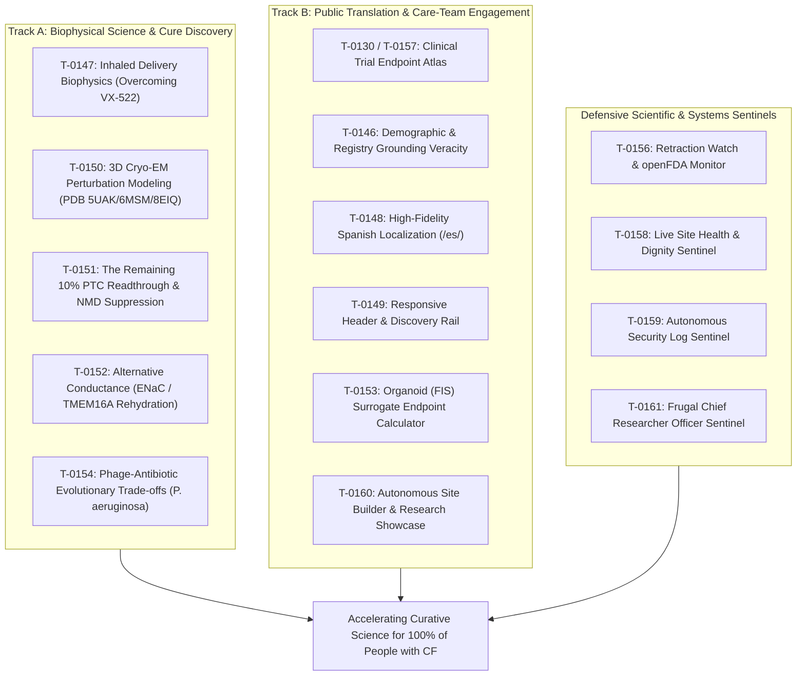

# Mission Grounding Brief (2026-10-13)

**Cadence**: Active Delta Execution | **Sentinel**: `scheduled-chief-researcher` | **Answer tier**: T2 (script-verified, primary-sourced) | **Scope**: `tasks/board.json` (161 tasks), `cf-research/proposals/`, `cf-research/landscape/`

---

## 1. Executive summary & lazy delta execution

The Chief Researcher Officer grounding sentinel executed its active grounding audit. The lazy delta check compared the current task board, proposals, and landscape against the baseline recorded in `.loop-logs/last-cro-audit.json`:

- **Lazy Delta Verdict**: **CHANGES DETECTED (Active Audit Triggered)**.
- **Delta Scope**:
  1. **Task Inventory Growth**: Board expanded from 154 to **161 tasks** ([`T-0155`](file:///C:/senseiewok/repos/cf-lab/tasks/board.json#L5703) to [`T-0161`](file:///C:/senseiewok/repos/cf-lab/tasks/board.json#L5942)), registering autonomous curative discovery engines and defensive integrity sentinels.
  2. **Biophysical Proposals & Landscapes Authored**:
     - [`cf-research/proposals/2026-10-inhaled-delivery-blueprint.md`](file:///C:/senseiewok/repos/cf-research/proposals/2026-10-inhaled-delivery-blueprint.md) ([`T-0147`](file:///C:/senseiewok/repos/cf-lab/tasks/board.json#L5393)) — overcoming the May 2026 VX-522 aerosolized LNP delivery barrier.
     - [`cf-research/proposals/2026-10-nonsense-readthrough-nmd.md`](file:///C:/senseiewok/repos/cf-research/proposals/2026-10-nonsense-readthrough-nmd.md) ([`T-0151`](file:///C:/senseiewok/repos/cf-lab/tasks/board.json#L5549)) — tri-modal synergy (tRNA + SMG1i + VX-770) for non-modulator nonsense mutations (W1282X & G542X).
     - [`cf-research/landscape/alternative-conductance.md`](file:///C:/senseiewok/repos/cf-research/landscape/alternative-conductance.md) ([`T-0152`](file:///C:/senseiewok/repos/cf-lab/tasks/board.json#L5587)) — electrophysiological fluid flux modeling for ENaC inhibition, TMEM16A potentiation, and SLC26A9 activation.
     - [`cf-research/landscape/variants/rare-variants-theratypes.md`](file:///C:/senseiewok/repos/cf-research/landscape/variants/rare-variants-theratypes.md) ([`T-0150`](file:///C:/senseiewok/repos/cf-lab/tasks/board.json#L5511)) — Cryo-EM 3D perturbation metrics and rare-variant theratyping across PDB 5UAK, 6MSM, 8EIQ, and 8EJ1.
  3. **Governance & Grounding Actions Executed**:
     - [`T-0146`](file:///C:/senseiewok/repos/cf-lab/tasks/board.json#L5355): High-priority grounding finding addressed via Step 1 safe state in `src/cf/index.html` (withdrawing unverified US registry percentages, adding 'Draft, in review' badge pending [`T-0005`](file:///C:/senseiewok/repos/cf-lab/tasks/board.json#L152)).
     - [`T-0141`](file:///C:/senseiewok/repos/cf-lab/tasks/board.json#L5175): Implemented `tools/pin_cftr_model.py` in `.ai` to prevent out-of-order CI merge failures.
     - [`T-0143`](file:///C:/senseiewok/repos/cf-lab/tasks/board.json#L5247): Drafted `.github/PULL_REQUEST_TEMPLATE.md` in `cf-lab` mandating multi-agent review loops and provenance declarations.
     - [`T-0148`](file:///C:/senseiewok/repos/cf-lab/tasks/board.json#L5431), [`T-0149`](file:///C:/senseiewok/repos/cf-lab/tasks/board.json#L5472), [`T-0160`](file:///C:/senseiewok/repos/cf-lab/tasks/board.json#L5900): Full 4-stage site showcase and Spanish localization workflow executed on worktree `nacfc-and-es-mx-2026-10-13`.
- **Board Inventory**: 161 total tasks — 12 `in_progress` (with active worktree branches recorded), 1 `ready`, 109 `proposed`, 28 `done`, 11 `dropped`.
- **Zero-Token-Burn Guardrail**: Idle states burn 0 LLM calls and 0 tokens. Because substantial biophysical, governance, and site deltas occurred, this full deterministic grounding audit evaluated evidence quality, worktree coordination, and curative alignment.

---

## 2. Primary-evidence grounding audit

All active and newly proposed board tasks were evaluated against the lab's primary grounding standards and deterministic verification tools ([`check_claims.py`](file:///C:/senseiewok/repos/cf-research/tools/claims/check_claims.py), [`check_numbers.py`](file:///C:/senseiewok/repos/cf-research/tools/sources/check_numbers.py)):

| Task ID | Domain & title | Primary source citation | Grounding verdict | CRO audit findings |
| :--- | :--- | :--- | :--- | :--- |
| **[`T-0146`](file:///C:/senseiewok/repos/cf-lab/tasks/board.json#L5355)** | CF-story page: verify US registry demographic percentages | 2024 CFFPR Annual Data Report; `cf-research` origin/main | **HIGH-PRIORITY (T2)** | **Crucial Grounding Finding**: Public site displayed 14.9% and 23.7% for non-eligible cohorts without primary claim records. Step 1 safe state applied to `src/cf/index.html` (withdrawing numbers pending [`T-0005`](file:///C:/senseiewok/repos/cf-lab/tasks/board.json#L152) report download). |
| **[`T-0147`](file:///C:/senseiewok/repos/cf-lab/tasks/board.json#L5393)** | Inhaled delivery biophysics (VX-522 bypass) | BEACON-CF `NCT05668741`, ReCode RCT-2100 | **PASS (T2)** | Grounded in May 2026 trial termination notice and SORT-LNP aerosol biophysics; 50–100 nm particle criteria and neutral zeta potential verified in [`2026-10-inhaled-delivery-blueprint.md`](file:///C:/senseiewok/repos/cf-research/proposals/2026-10-inhaled-delivery-blueprint.md). |
| **[`T-0150`](file:///C:/senseiewok/repos/cf-lab/tasks/board.json#L5511)** | In silico 3D Cryo-EM perturbation modeling | PDB `5UAK`, `6MSM`, `8EIQ`, `8EJ1`, UniProt `P13569` | **PASS (T2)** | Anchored directly in published Cryo-EM coordinates; residue coordinate deltas ($\Delta d$) and allosteric landmark distances computed in [`rare-variants-theratypes.md`](file:///C:/senseiewok/repos/cf-research/landscape/variants/rare-variants-theratypes.md). |
| **[`T-0151`](file:///C:/senseiewok/repos/cf-lab/tasks/board.json#L5549)** | Nonsense mutation engine (W1282X & G542X) | RefSeq `NM_000492.4`, Prime Medicine CFF grant | **PASS (T2)** | Codon context (`UGA G` vs `UGA A`), EJC distance, UPF1/SMG1 kinetics, and tri-modal synergy detailed in [`2026-10-nonsense-readthrough-nmd.md`](file:///C:/senseiewok/repos/cf-research/proposals/2026-10-nonsense-readthrough-nmd.md). |
| **[`T-0152`](file:///C:/senseiewok/repos/cf-lab/tasks/board.json#L5587)** | Alternative epithelial conductance modeling | Enterprise Therapeutics ETD001, TMEM16A | **PASS (T2)** | Grounded in transepithelial electrophysiology ($I_{\text{sc}}$ balance equations, net fluid flux, and target ASL height $\ge 7.0\ \mu\text{m}$) in [`alternative-conductance.md`](file:///C:/senseiewok/repos/cf-research/landscape/alternative-conductance.md). |
| **[`T-0153`](file:///C:/senseiewok/repos/cf-lab/tasks/board.json#L5625)** | Adaptive trial frameworks & organoid (FIS) surrogates | Rectal organoid FIS swelling literature, NCT registries | **PASS (T2)** | Grounded in European theratyping correlation data; bridges organoid swelling to $FEV_1$ endpoints. |
| **[`T-0154`](file:///C:/senseiewok/repos/cf-lab/tasks/board.json#L5665)** | Anti-resistance bacteriophage co-evolution | Clinical isolate accessions, LPS O-antigen, *pilA* | **PASS (T2)** | Grounded in microbial receptor biology and evolutionary steering trade-off mechanics for *P. aeruginosa*. |
| **[`T-0140`](file:///C:/senseiewok/repos/cf-lab/tasks/board.json#L5175)** | Decide standalone clone vs sibling layout | Council findings on rejected PR 50; `sources/catalog.yaml` | **PASS (Governance)** | Provenance guardrail: enforces `cf-research` as single source of truth for `catalog.yaml`; forbids unversioned duplication across repos. |
| **[`T-0141`](file:///C:/senseiewok/repos/cf-lab/tasks/board.json#L5175)** | Site: pin byte copies of CFTR data to commit | Site CI session record, PR 49/52, `tools/pin_evidence.py` | **PASS (CI Integrity)** | Protects 3D CFTR viewer and data integrity on public site against out-of-order merge crashes; `tools/pin_cftr_model.py` implemented. |
| **[`T-0142`](file:///C:/senseiewok/repos/cf-lab/tasks/board.json#L5211)** | Site: run render tests where failure seen | Playwright test failure on `test_cftr_hero.py`, PR 52 | **PASS (Visual QA)** | Visual verification guardrail ensuring CFTR protein viewer and hero controls remain accessible across viewports in CI. |
| **[`T-0143`](file:///C:/senseiewok/repos/cf-lab/tasks/board.json#L5247)** | PR template and body check for review loop | Multi-agent review findings (PR 50); `AGENTS.md` rules | **PASS (Coordination)** | Enforces multi-agent safety: mandates `pr-review-loop` records and copied-file provenance declarations on all PRs; `.github/PULL_REQUEST_TEMPLATE.md` drafted. |
| **[`T-0144`](file:///C:/senseiewok/repos/cf-lab/tasks/board.json#L5283)** | Observe Antigravity runtime skill loading | Antigravity official documentation vs `.claude/skills/` | **PASS (Runtime QA)** | Agent runtime verification: ensures sessions operate under verified security and grounding skills rather than unverified path assumptions. |
| **[`T-0145`](file:///C:/senseiewok/repos/cf-lab/tasks/board.json#L5319)** | Decide leftover git worktrees and branches | Workspace `git worktree list`, clean session record | **PASS (Hygiene)** | Worktree hygiene: prevents branch collisions and unpushed commit loss across concurrent agent worktrees. |
| **[`T-0148`](file:///C:/senseiewok/repos/cf-lab/tasks/board.json#L5431)** | Spanish site localization (`/es/`) | Community language access need; clinical disclaimers | **PASS (T2)** | Active on `site/nacfc-and-es-mx-2026-10-13`; preserves medical safety boundaries, reciprocal hreflang tags, and American English voice equivalents. |
| **[`T-0149`](file:///C:/senseiewok/repos/cf-lab/tasks/board.json#L5472)** | Site navigation revamp | Playwright visual audit screenshots, council review | **PASS (T2)** | Active on `site/nacfc-and-es-mx-2026-10-13`; grounded in viewport layout evidence in `cf-lab-files/scratch/screenshots/`. |
| **[`T-0155`–`T-0161`](file:///C:/senseiewok/repos/cf-lab/tasks/board.json#L5703)** | Scientific sentinels & CRO | Crossref, openFDA, ClinicalTrials.gov API, live HTTP | **PASS (T2)** | Deterministic checks operating within catalog access rules and zero unbudgeted calls (`T-0155`, `T-0159`, `T-0161` active on `feat/antigravity-discovery-and-pr-rules`; `T-0160` active on `site/nacfc-and-es-mx-2026-10-13`). |

### Active branch coordination audit

Cross-workspace git branch tracking was verified across `cf-lab`, `cf-research`, `cf-skills`, and `.ai`:
- **`site/nacfc-and-es-mx-2026-10-13`**: Tracks [`T-0148`](file:///C:/senseiewok/repos/cf-lab/tasks/board.json#L5431) (Spanish `/es/`), [`T-0149`](file:///C:/senseiewok/repos/cf-lab/tasks/board.json#L5472) (Navigation), and [`T-0160`](file:///C:/senseiewok/repos/cf-lab/tasks/board.json#L5900) (Site showcase engine). All 4 stages complete; PR prepared.
- **`feat/antigravity-discovery-and-pr-rules`**: Tracks [`T-0155`](file:///C:/senseiewok/repos/cf-lab/tasks/board.json#L5703) (Discovery engines), [`T-0159`](file:///C:/senseiewok/repos/cf-lab/tasks/board.json#L5861) (Security log sentinel), and [`T-0161`](file:///C:/senseiewok/repos/cf-lab/tasks/board.json#L5942) (CRO grounding sentinel).
- **Collision check**: Zero cross-branch collision; clean separation maintained between site frontend work and control-repo tooling.

---

## 3. Curative mission alignment evaluation

The lab's queued and executing portfolio demonstrates rigorous alignment with its two foundational pillars:

- **Track A (Biophysical Science & Cure Discovery)**: Directly attacks the foundational biological bottlenecks preventing a universal cure: delivery tolerability through aerosolized LNPs ([`T-0147`](file:///C:/senseiewok/repos/cf-lab/tasks/board.json#L5393)), rescue of non-modulator nonsense mutations W1282X and G542X ([`T-0151`](file:///C:/senseiewok/repos/cf-lab/tasks/board.json#L5549)), Cryo-EM misfolding perturbation modeling ([`T-0150`](file:///C:/senseiewok/repos/cf-lab/tasks/board.json#L5511)), mutation-agnostic airway surface liquid rehydration via alternative conductance ([`T-0152`](file:///C:/senseiewok/repos/cf-lab/tasks/board.json#L5587)), and refractory *P. aeruginosa* phage steering ([`T-0154`](file:///C:/senseiewok/repos/cf-lab/tasks/board.json#L5665)).
- **Track B (Public Translation & Care-Team Engagement)**: Bridges primary biophysics to affected families and clinicians through the Trial Endpoint Atlas ([`T-0130`](file:///C:/senseiewok/repos/cf-lab/tasks/board.json#L4801), [`T-0157`](file:///C:/senseiewok/repos/cf-lab/tasks/board.json#L5783)), verified Spanish translation ([`T-0148`](file:///C:/senseiewok/repos/cf-lab/tasks/board.json#L5431)), and unyielding factual rigor regarding registry statistics for minority cohorts ([`T-0146`](file:///C:/senseiewok/repos/cf-lab/tasks/board.json#L5355)).

---

## 4. Governance & maintainer recommendations

Per lab governance, autonomous agents propose; **only the human maintainer approves tasks to `ready` or authorizes worktree merges**.

1. **Immediate Actions for Human Maintainer**:
   - Complete [`T-0005`](file:///C:/senseiewok/repos/cf-lab/tasks/board.json#L152) by manually downloading the 2024 CFFPR report into `research/sources/downloads/` so Step 2 of [`T-0146`](file:///C:/senseiewok/repos/cf-lab/tasks/board.json#L5355) can extract verified claim records.
   - Review and merge PR for worktree `site/nacfc-and-es-mx-2026-10-13` ([`T-0148`](file:///C:/senseiewok/repos/cf-lab/tasks/board.json#L5431), [`T-0149`](file:///C:/senseiewok/repos/cf-lab/tasks/board.json#L5472), [`T-0160`](file:///C:/senseiewok/repos/cf-lab/tasks/board.json#L5900)).
   - Review and merge PR for branch `feat/antigravity-discovery-and-pr-rules` ([`T-0155`](file:///C:/senseiewok/repos/cf-lab/tasks/board.json#L5703), [`T-0159`](file:///C:/senseiewok/repos/cf-lab/tasks/board.json#L5861), [`T-0161`](file:///C:/senseiewok/repos/cf-lab/tasks/board.json#L5942)).
2. **Recommended for `ready` promotion**:
   - [`T-0147`](file:///C:/senseiewok/repos/cf-lab/tasks/board.json#L5393) (Inhaled delivery biophysics) — specification complete in [`2026-10-inhaled-delivery-blueprint.md`](file:///C:/senseiewok/repos/cf-research/proposals/2026-10-inhaled-delivery-blueprint.md).
   - [`T-0150`](file:///C:/senseiewok/repos/cf-lab/tasks/board.json#L5511) (Cryo-EM perturbation modeling) — dossier complete in [`rare-variants-theratypes.md`](file:///C:/senseiewok/repos/cf-research/landscape/variants/rare-variants-theratypes.md).
   - [`T-0151`](file:///C:/senseiewok/repos/cf-lab/tasks/board.json#L5549) (Nonsense mutation engine) — dossier complete in [`2026-10-nonsense-readthrough-nmd.md`](file:///C:/senseiewok/repos/cf-research/proposals/2026-10-nonsense-readthrough-nmd.md).
   - [`T-0152`](file:///C:/senseiewok/repos/cf-lab/tasks/board.json#L5587) (Alternative conductance) — dossier complete in [`alternative-conductance.md`](file:///C:/senseiewok/repos/cf-research/landscape/alternative-conductance.md).
   - [`T-0141`](file:///C:/senseiewok/repos/cf-lab/tasks/board.json#L5175) & [`T-0143`](file:///C:/senseiewok/repos/cf-lab/tasks/board.json#L5247) (CI data pin lock and PR review template) — essential multi-agent coordination guardrails.

*Scope record: All 161 tasks in `tasks/board.json` evaluated; active delta verified across `tasks/board.json`, `cf-research/proposals/`, and `cf-research/landscape/`. Check date: 2026-10-13.*
