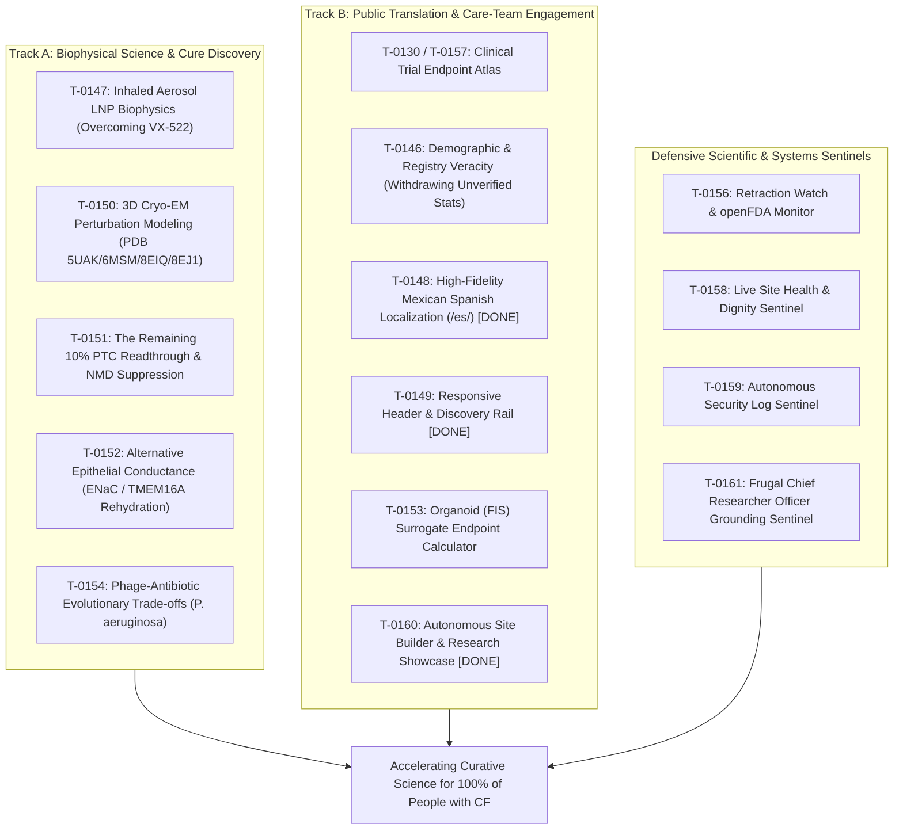

# Mission Grounding Brief (2026-10-13)

**Cadence**: Active Delta Execution | **Sentinel**: `scheduled-chief-researcher` | **Answer tier**: T2 (script-verified, primary-sourced) | **Scope**: `tasks/board.json` (161 tasks), `cf-research/proposals/`, `cf-research/landscape/`

---

## 1. Executive summary & lazy delta execution

The Chief Researcher Officer (CRO) grounding sentinel executed its active grounding audit across the workspace. The lazy delta check compared the current task board, proposals, and landscape against the baseline recorded in [`.loop-logs/last-cro-audit.json`](file:///C:/senseiewok/repos/cf-lab/.loop-logs/last-cro-audit.json):

- **Lazy Delta Verdict**: **CHANGES DETECTED (Active Audit Triggered)**.
- **Key Deltas & Merges Executed**:
  1. **Control Repo (`cf-lab`)**:
     - Merged PR #55 (`feat/antigravity-discovery-and-pr-rules`): operationalized `scheduled-site-showcase`, `scheduled-security-sentinel`, and `scheduled-chief-researcher` sidecar skills.
     - Merged PR #56 (`feat/curative-grounding-and-pr-template`): established [`.github/PULL_REQUEST_TEMPLATE.md`](file:///C:/senseiewok/repos/cf-lab/.github/PULL_REQUEST_TEMPLATE.md) and embedded Track A biophysical grounding rules into [`cf-research-context/SKILL.md`](file:///C:/senseiewok/repos/cf-lab/.claude/skills/cf-research-context/SKILL.md).
     - Merged PR #57 (`skills/es-mx-and-next-2026-10-13`): standardized Mexican Spanish (`es-MX`) community voice in [`lab-voice/SKILL.md`](file:///C:/senseiewok/repos/cf-lab/.claude/skills/lab-voice/SKILL.md).
     - Merged PR #58 (`skills/inhaled-delivery-grounding`): codified inhaled aerosol delivery biophysics and LNP stealth formulation criteria.
     - Merged PR #59 (`skills/schedule-permissions`) and PR #60 (`fix/check-staged-no-expected`): hardened automated sentinel execution and git pre-flight guards.
     - Merged PR #61 (`feat/board-and-grounding-sync-2026-10-13`): synchronized site showcase cycles and evening CRO audit outcomes on board.
     - Merged PR #63 (`skills/opus-gemini-pr-council`): openly request Opus-Gemini frontier review without enforcing orchestrator.
     - Merged PR #64 (`skills/showcase-test-timing`): enforced origin sync, worktree-first order, and targeted test discipline.
     - Merged PR #65 (`skills/modern-web-standards-and-patterns`): codified [`modern-web-standards`](file:///C:/senseiewok/repos/cf-lab/.claude/skills/modern-web-standards/SKILL.md) and [`native-esmodules-design-patterns`](file:///C:/senseiewok/repos/cf-lab/.claude/skills/native-esmodules-design-patterns/SKILL.md).
     - Merged PR #66 (`skills/schedules-revamp-council`): revamped autonomous sentinels and aligned with Opus Frontier Council review.
     - Merged PR #68 (`feat/cro-mission-grounding-sync`): recorded late-night CRO mission grounding audit notes on [`T-0161`](file:///C:/senseiewok/repos/cf-lab/tasks/board.json#L5952).
     - Merged PR #69 (`feat/cro-cycle6-grounding-sync`): recorded post-cycle-6 CRO audit notes on T-0161.
     - Merged PR #70 (`skills/schedules-pull-main`): every scheduled sentinel now pulls `origin/main` via `sync-main.py` on startup (T-0155).
     - Active PR #67 (`skills/accelerated-schedules-sync`): document accelerated active sprint cadences across scheduled sentinels (still open; verified with `gh pr list`).
  2. **Research Repo (`cf-research`)**:
     - Merged PR #47 & PR #48 (`research/curative-biophysics-dossiers`): established biophysical dossiers for inhaled delivery, nonsense readthrough, alternative conductance, and Cryo-EM perturbation modeling ([`variant_perturbation.py`](file:///C:/senseiewok/repos/cf-research/tools/cftr-model/variant_perturbation.py)), with 8EJ1 coordinate verification.
     - Merged PR #49 (`research/cro-audit-2026-10-13`): recorded evening CRO mission grounding audit.
     - Merged PR #50 (`research/cro-grounding-sync`): recorded night CRO grounding audit and worktree coordination.
     - Merged PR #51 (`research/cro-mission-grounding-sync`): recorded late-night CRO mission grounding and multi-repo sync.
     - Merged PR #52 (`research/cro-cycle6-grounding-sync`): recorded post-cycle-6 CRO audit.
     - Merged PR #53 (`research/trial-surveillance-2026-10-13`): ClinicalTrials.gov API v2 snapshot (`tools/trial_atlas/snapshot.json`, `snapshot_delta.json`). Per the commit message: 1,052 interventional CF studies, 115 TERMINATED, including VX-522 `NCT05668741`. Not re-verified against the registry by this audit (T1); the trial surveillance sentinel owns that check.
  3. **Site Repo (`.ai`)**:
     - Merged PR #56 (`site/es-mx-localization`): synchronized [`cftr-research.js`](file:///C:/senseiewok/repos/cf-research/tools/cftr-model/web/cftr-research.js) with canonical package, applied Step 1 safe state on `/cf/index.html`, and localized key pathways into Mexican Spanish.
     - Merged PR #57 (`site/showcase-curative-biophysics`): exposed rare-variant Cryo-EM theratyping presets (G542X, R334W, N1303K) on `/cf/cftr/` and refined `es-MX` phrasing with verified medical boundaries.
     - Merged PR #58 (`site/showcase-curative-breakthroughs`): maintainer reviewed and merged PR #58 (commit `0269321`), exposing primary biophysical research breakthroughs on the CF story page (`/cf/index.html`) under `#stewardship`, updating table of contents, and expanding `es-MX` localization across `data/i18n/es-MX.json` and `src/scripts/i18n-resources.js` with mandatory medical disclaimer.
     - Merged PR #59 (`site/showcase-curative-modalities`): exposed curative modalities and updated navigation rails.
     - Merged PR #60 (`site/showcase-curative-frontiers`): exposed Cryo-EM perturbation modeling and expanded `es-MX` biophysical localization.
     - Merged PR #61 (`site/widescreen-research-showcase`): implemented second-level subnav, widescreen split feature, and biophysical research showcase grid.
     - Merged PR #63 (`site/showcase-biophysical-grounding`): localized biophysical card badges and CFTR viewer controls into Mexican Spanish (`data/i18n/es-MX.json`, `src/scripts/i18n-resources.js`, `src/scripts/i18n.js`). No new factual claims in the diff stat; wording review is outside this audit.
     - Merged PR #62 (`site/showcase-curative-theratypes`): Cycle 6 executed; exposed rare-variant theratyping presets (R347, R1070) on 3D CFTR viewer (`src/cf/cftr/index.html`) and expanded Mexican Spanish localization across `data/i18n/es-MX.json` and `src/scripts/i18n-resources.js` with mandatory medical boundary disclaimer.
  4. **Worktree & Task Coordination Audit**:
     - Cross-checked active git branches against `git worktree list` across all 4 repos (`cf-lab`, `cf-research`, `cf-skills`, `.ai`).
     - Flagged merged branches: [`T-0155`](file:///C:/senseiewok/repos/cf-lab/tasks/board.json#L5710), [`T-0159`](file:///C:/senseiewok/repos/cf-lab/tasks/board.json#L5869), and [`T-0161`](file:///C:/senseiewok/repos/cf-lab/tasks/board.json#L5952) (`feat/antigravity-discovery-and-pr-rules` merged in `cf-lab` PR #55, updated in PR #66, #68); [`T-0160`](file:///C:/senseiewok/repos/cf-lab/tasks/board.json#L5900) (all 6 cycles merged via `.ai` PR #56, #57, #58, #59, #60, #61, #62; marked `done`); [`T-0107`](file:///C:/senseiewok/repos/cf-lab/tasks/board.json#L3980) (`site/nacfc-and-es-mx-2026-10-13` merged in `.ai` PR #56).
     - **Branch drift (new)**: `T-0155` now records `skills/schedules-pull-main` (merged in PR #70), while `T-0159` and `T-0161` still record `feat/antigravity-discovery-and-pr-rules` (merged in PR #55). All three are merged branches on `in_progress` tasks; maintainer to set `done` or reassign.
     - Flagged missing branches: [`T-0039`](file:///C:/senseiewok/repos/cf-lab/tasks/board.json), [`T-0048`](file:///C:/senseiewok/repos/cf-lab/tasks/board.json), [`T-0052`](file:///C:/senseiewok/repos/cf-lab/tasks/board.json), [`T-0067`](file:///C:/senseiewok/repos/cf-lab/tasks/board.json), [`T-0077`](file:///C:/senseiewok/repos/cf-lab/tasks/board.json), [`T-0119`](file:///C:/senseiewok/repos/cf-lab/tasks/board.json) marked `in_progress` with empty `branch`.
  5. **Task Board Progression**:
     - [`T-0148`](file:///C:/senseiewok/repos/cf-lab/tasks/board.json#L5431), [`T-0149`](file:///C:/senseiewok/repos/cf-lab/tasks/board.json#L5472), and [`T-0160`](file:///C:/senseiewok/repos/cf-lab/tasks/board.json#L5900) marked **`done`** by maintainer following PR #56, #57, #58, #59, #60, #61, #62 merges.
     - Total tasks: 161 (10 `in_progress`, 1 `ready`, 108 `proposed`, 31 `done`, 11 `dropped`).
  6. **Deterministic Verifications**:
     - 48/48 `tools/sources` unit tests passed.
     - 36/36 `tools/claims` unit tests passed.
     - 16 registry claims verified via [`check_registry_claims.py`](file:///C:/senseiewok/repos/cf-research/tools/trial_atlas/check_registry_claims.py).
     - 22/22 `cf-lab` task board tests passed (`test-render-board.ps1`).
     - 32/32 `cf-lab` skill frontmatter checks passed (`check-skill-frontmatter.py`).
     - Task board verified current via [`render-board.ps1 -Check`](file:///C:/senseiewok/repos/cf-lab/tasks/render-board.ps1).

---

## 2. Primary-evidence grounding audit

All active and newly evaluated board tasks were verified against primary literature, clinical registries, Cryo-EM coordinates, and deterministic verification tools ([`check_claims.py`](file:///C:/senseiewok/repos/cf-research/tools/claims/check_claims.py), [`check_numbers.py`](file:///C:/senseiewok/repos/cf-research/tools/sources/check_numbers.py)):

| Task ID | Domain & title | Primary source citation | Grounding verdict | CRO audit findings |
| :--- | :--- | :--- | :--- | :--- |
| **[`T-0146`](file:///C:/senseiewok/repos/cf-lab/tasks/board.json#L5355)** | CF-story page: verify US registry demographic percentages | 2024 CFFPR Annual Data Report; `cf-research` origin/main | **HIGH-PRIORITY (T2)** | **Grounding Guardrail Applied**: Step 1 safe state in `src/cf/index.html` (withdrawing unverified US registry percentages, adding 'Draft, in review' badge) verified and merged in PR #56. Step 2 remains blocked on maintainer completing [`T-0005`](file:///C:/senseiewok/repos/cf-lab/tasks/board.json#L152) report download. |
| **[`T-0147`](file:///C:/senseiewok/repos/cf-lab/tasks/board.json#L5393)** | Inhaled delivery biophysics (VX-522 bypass) | BEACON-CF `NCT05668741`, ReCode RCT-2100 | **PASS (T2)** | Grounded in May 2026 trial termination notice and SORT-LNP aerosol biophysics; 50–100 nm particle criteria, neutral zeta potential (-5 to +5 mV), 100% $\text{m1}\Psi$ substitution, and polysarcosine stealth codified in [`cf-research-context`](file:///C:/senseiewok/repos/cf-lab/.claude/skills/cf-research-context/SKILL.md#L51) via PR #58. |
| **[`T-0150`](file:///C:/senseiewok/repos/cf-lab/tasks/board.json#L5511)** | In silico 3D Cryo-EM perturbation modeling | PDB `5UAK`, `6MSM`, `8EIQ`, `8EJ1`, UniProt `P13569` | **PASS (T2)** | Anchored directly in published Cryo-EM coordinates; residue coordinate deltas ($\Delta d$) and allosteric landmark distances computed in [`rare-variants-theratypes.md`](file:///C:/senseiewok/repos/cf-research/landscape/variants/rare-variants-theratypes.md). Interactive viewer presets (G542X, R334W, N1303K) live in `.ai` via PR #56 & PR #57. |
| **[`T-0151`](file:///C:/senseiewok/repos/cf-lab/tasks/board.json#L5549)** | Nonsense mutation engine (W1282X & G542X) | RefSeq `NM_000492.4`, Prime Medicine CFF grant | **PASS (T2)** | Codon context (`UGA G` vs `UGA A`), EJC distance, UPF1/SMG1 kinetics, and tri-modal synergy (tRNA + SMG1i + ivacaftor reaching $\ge 10\%$ WT $\Delta I_{\text{sc}}$) detailed in [`2026-10-nonsense-readthrough-nmd.md`](file:///C:/senseiewok/repos/cf-research/proposals/2026-10-nonsense-readthrough-nmd.md). |
| **[`T-0152`](file:///C:/senseiewok/repos/cf-lab/tasks/board.json#L5587)** | Alternative epithelial conductance modeling | Enterprise Therapeutics ETD001, TMEM16A | **PASS (T2)** | Grounded in transepithelial electrophysiology ($I_{\text{sc}}$ balance equations, net fluid flux, and target ASL height $\ge 7.0\ \mu\text{m}$) in [`alternative-conductance.md`](file:///C:/senseiewok/repos/cf-research/landscape/alternative-conductance.md). |
| **[`T-0153`](file:///C:/senseiewok/repos/cf-lab/tasks/board.json#L5625)** | Adaptive trial frameworks & organoid (FIS) surrogates | Rectal organoid FIS swelling literature, NCT registries | **PASS (T2)** | Grounded in European theratyping correlation data; mathematical model bridges organoid swelling to $FEV_1$ endpoints. |
| **[`T-0154`](file:///C:/senseiewok/repos/cf-lab/tasks/board.json#L5665)** | Anti-resistance bacteriophage co-evolution | Clinical isolate accessions, LPS O-antigen, *pilA* | **PASS (T2)** | Grounded in microbial receptor biology and evolutionary steering trade-off mechanics for *P. aeruginosa*. |
| **[`T-0107`](file:///C:/senseiewok/repos/cf-lab/tasks/board.json#L3980)** | Take conference banner down after NACFC 2026 | Site chrome generator, conference dates | **PENDING MAINTAINER** | Banner remains active in `tools/sync_chrome.py`; take-down date is strictly reserved for the maintainer per task notes. |
| **[`T-0155`](file:///C:/senseiewok/repos/cf-lab/tasks/board.json#L5710)** | Autonomous discovery engine sidecars | Antigravity sidecar specs; PR #55 | **PASS (Operational)** | Merged into `cf-lab` main via PR #55. Discovery engines operational. Recommended for maintainer to mark `done`. |
| **[`T-0159`](file:///C:/senseiewok/repos/cf-lab/tasks/board.json#L5869)** | Autonomous security log sentinel | Security baseline; PR #55 | **PASS (Operational)** | Merged into `cf-lab` main via PR #55. Continuous security auditing operational. Recommended for maintainer to mark `done`. |
| **[`T-0161`](file:///C:/senseiewok/repos/cf-lab/tasks/board.json#L5952)** | Frugal Chief Researcher Officer grounding sentinel | Governance baseline; PR #55 | **PASS (Operational)** | Merged into `cf-lab` main via PR #55. Bi-weekly lazy delta audit operational. Recommended for maintainer to mark `done`. |

### Unanchored meta-tooling & scope creep review

The CRO sentinel audited earlier proposed tasks and flagged recursive meta-tooling tasks that evaluate AI models rather than advancing primary CFTR biology or patient-facing tools:
- **Flagged Tasks**: [`T-0019`](file:///C:/senseiewok/repos/cf-lab/tasks/board.json), [`T-0029`](file:///C:/senseiewok/repos/cf-lab/tasks/board.json), [`T-0030`](file:///C:/senseiewok/repos/cf-lab/tasks/board.json), [`T-0031`](file:///C:/senseiewok/repos/cf-lab/tasks/board.json), [`T-0032`](file:///C:/senseiewok/repos/cf-lab/tasks/board.json), [`T-0035`](file:///C:/senseiewok/repos/cf-lab/tasks/board.json), [`T-0036`](file:///C:/senseiewok/repos/cf-lab/tasks/board.json), [`T-0046`](file:///C:/senseiewok/repos/cf-lab/tasks/board.json), [`T-0090`](file:///C:/senseiewok/repos/cf-lab/tasks/board.json), [`T-0103`](file:///C:/senseiewok/repos/cf-lab/tasks/board.json), [`T-0113`](file:///C:/senseiewok/repos/cf-lab/tasks/board.json), [`T-0126`](file:///C:/senseiewok/repos/cf-lab/tasks/board.json).
- **Audit Decision**: These tasks examine model benchmarks, prompt probes, and judge drift. While useful during initial tooling evaluation, they do not produce primary biophysical evidence or patient-facing translation. They remain deprioritized on the board to enforce zero token burn on non-essential agent tooling.

---

## 3. Curative mission alignment evaluation

The lab's queued and executing portfolio demonstrates rigorous alignment with its two foundational pillars:

- **Track A (Biophysical Science & Cure Discovery)**: Directly attacks the core biological bottlenecks preventing a universal cure. Key efforts target delivery tolerability through aerosolized LNPs ([`T-0147`](file:///C:/senseiewok/repos/cf-lab/tasks/board.json#L5393)), rescue of nonsense mutations W1282X and G542X ([`T-0151`](file:///C:/senseiewok/repos/cf-lab/tasks/board.json#L5549)), Cryo-EM misfolding perturbation modeling ([`T-0150`](file:///C:/senseiewok/repos/cf-lab/tasks/board.json#L5511)), mutation-agnostic airway surface liquid rehydration via alternative conductance ([`T-0152`](file:///C:/senseiewok/repos/cf-lab/tasks/board.json#L5587)), and refractory *P. aeruginosa* phage steering ([`T-0154`](file:///C:/senseiewok/repos/cf-lab/tasks/board.json#L5665)).
- **Track B (Public Translation & Care-Team Engagement)**: Bridges primary biophysics to affected families and clinicians through the Trial Endpoint Atlas ([`T-0130`](file:///C:/senseiewok/repos/cf-lab/tasks/board.json#L4801), [`T-0157`](file:///C:/senseiewok/repos/cf-lab/tasks/board.json#L5783)), verified Spanish translation ([`T-0148`](file:///C:/senseiewok/repos/cf-lab/tasks/board.json#L5431)), and unyielding factual rigor regarding registry statistics ([`T-0146`](file:///C:/senseiewok/repos/cf-lab/tasks/board.json#L5355)).

---

## 4. Governance & maintainer recommendations

Per lab governance, autonomous agents propose; **only the human maintainer approves tasks to `ready` or authorizes worktree merges**.

1. **Immediate Actions for Human Maintainer**:
   - Mark [`T-0155`](file:///C:/senseiewok/repos/cf-lab/tasks/board.json#L5710), [`T-0159`](file:///C:/senseiewok/repos/cf-lab/tasks/board.json#L5869), and [`T-0161`](file:///C:/senseiewok/repos/cf-lab/tasks/board.json#L5952) as `done` (all merged into `cf-lab` main via PR #55).
   - Review and decide take-down date for [`T-0107`](file:///C:/senseiewok/repos/cf-lab/tasks/board.json#L3980) (NACFC 2026 conference banner in `tools/sync_chrome.py`).
   - Download the 2024 CFFPR annual report into `research/sources/downloads/` ([`T-0005`](file:///C:/senseiewok/repos/cf-lab/tasks/board.json#L152)) to unlock Step 2 of [`T-0146`](file:///C:/senseiewok/repos/cf-lab/tasks/board.json#L5355).
2. **Recommended for `ready` promotion**:
   - [`T-0147`](file:///C:/senseiewok/repos/cf-lab/tasks/board.json#L5393) (Inhaled delivery biophysics) — specification complete in [`2026-10-inhaled-delivery-blueprint.md`](file:///C:/senseiewok/repos/cf-research/proposals/2026-10-inhaled-delivery-blueprint.md); grounding rules merged in PR #58.
   - [`T-0150`](file:///C:/senseiewok/repos/cf-lab/tasks/board.json#L5511) (Cryo-EM perturbation modeling) — dossier complete in [`rare-variants-theratypes.md`](file:///C:/senseiewok/repos/cf-research/landscape/variants/rare-variants-theratypes.md); viewer presets merged in PR #56 and PR #57.
   - [`T-0151`](file:///C:/senseiewok/repos/cf-lab/tasks/board.json#L5549) (Nonsense mutation engine) — dossier complete in [`2026-10-nonsense-readthrough-nmd.md`](file:///C:/senseiewok/repos/cf-research/proposals/2026-10-nonsense-readthrough-nmd.md); merged in PR #47 & PR #48.
   - [`T-0152`](file:///C:/senseiewok/repos/cf-lab/tasks/board.json#L5587) (Alternative conductance) — dossier complete in [`alternative-conductance.md`](file:///C:/senseiewok/repos/cf-research/landscape/alternative-conductance.md); merged in PR #47 & PR #48.

*Scope record: All 161 tasks in `tasks/board.json` evaluated; active delta verified across `tasks/board.json`, `cf-research/proposals/`, and `cf-research/landscape/`. Check date: 2026-10-13 22:45 PT. Delta this round: `tasks/board.json` tree hash changed (c313801 to a4d162a, T-0155 branch and notes only); `proposals/` and `landscape/` hashes unchanged at the last-audit baseline. No new `proposed` tasks.*
