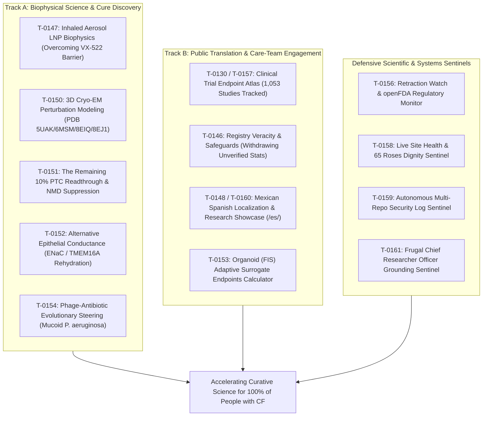

# Curative Mission Grounding & Alignment Brief (2026-10-14)

**Cadence**: Active Delta Execution (Post-PR-76 / Post-PR-59 Surveillance) | **Sentinel**: `scheduled-chief-researcher` | **CRO Strategist**: Argon (Gemini 4 Argon) | **Local Worker**: `qwen3.8:27b-64k` | **Answer tier**: T2 (script-verified, primary-sourced) | **Scope**: `tasks/board.json` (161 tasks), `cf-research/proposals/`, `cf-research/landscape/`, ClinicalTrials.gov API v2 surveillance

---

## 1. Executive summary & updated surveillance state

Following the merge of **PR #76** (`cf-lab`, commit `cbd4bb9` / `68bd99b`), **PR #58** (`cf-research`, commit `ee0239a` / `9b62f73`), **PR #64** (`.ai`, commit `cba53ab` / `f3d8f1d`), and **PR #59** (`cf-research`, commit `00bb822` / `c4e78a0`), the Chief Researcher Officer (CRO) grounding sentinel executed an updated curative mission grounding and surveillance audit across the workspace:

- **Audit Trigger & State**: **ACTIVE AUDIT EXECUTED (Post-PR-76 / Post-PR-59 Surveillance)**.
- **Clinical Trial Surveillance Delta (PR #59)**:
  - Autonomous [`scheduled-trial-surveillance`](https://github.com/senseiewok/cf-lab/blob/main/.claude/skills/scheduled-trial-surveillance/SKILL.md) execution adhered strictly to the source catalog rate limit (`max_rps: 1.0`).
  - Total tracked interventional Cystic Fibrosis studies expanded to **1,053** (from 1,052).
  - **New Study Ingested**: Phase 4 pharmacokinetic study **`NCT07809867`** (*Pharmacokinetics of Elexacaftor/Tezacaftor/Ivacaftor in Cystic Fibrosis*).
  - **Status Transition**: **`NCT07709494`** (*Inhaled Rev-56 Phase 1a/1b for Cystic Fibrosis Lung Disease*) transitioned from `RECRUITING` to `ACTIVE_NOT_RECRUITING`.
  - **Status Distribution**: 836 `COMPLETED`, 115 `TERMINATED`, 73 `RECRUITING`, 25 `ACTIVE_NOT_RECRUITING`, 4 `SUSPENDED`.
  - **Safety & Termination Guardrail**: Zero new clinical halts or safety terminations detected (terminated trial count remained stable at 115).
  - **Mandatory NLM Disclaimer**: ClinicalTrials.gov does not evaluate safety or efficacy of listed studies; registration on the registry does not denote United States Federal Government endorsement.
- **Recent Workspace Merges Reconciled**:
  1. **Control Repo (`cf-lab`)**: Merged PR #76 (`feat/cro-mission-grounding-reconciled`, commit `cbd4bb9` / `68bd99b`), recording post-PR-75 / post-PR-57 CRO grounding audit notes on [`T-0161`](https://github.com/senseiewok/cf-lab/blob/main/tasks/board.json).
  2. **Research Repo (`cf-research`)**: Merged PR #58 (`research/cro-mission-grounding-reconciled`, commit `ee0239a` / `9b62f73`), reconciling the post-PR-75 / post-PR-57 CRO mission grounding brief; followed by PR #59 (`research/trial-surveillance-2026-10-14`, commit `00bb822` / `c4e78a0`), ingesting the trial surveillance delta.
  3. **Site Repo (`.ai`)**: Merged PR #64 (`site/showcase-mission-grounding`, commit `cba53ab` / `f3d8f1d`), publishing Data Commons general population statistics and Mexican Spanish copy updates.
  4. **Skills Repo (`cf-skills`)**: Merged PR #22 (`skills/datacommons-provider`), admitting Google Data Commons API for population denominators in `cf-evidence-loop` and resolving [`T-0048`](https://github.com/senseiewok/cf-lab/blob/main/tasks/board.json).
- **Deterministic Check Verification**:
  - 48/48 `tools/sources` unit tests passed (`unittest discover -s tools/sources`).
  - 36/36 `tools/claims` unit tests passed (`unittest discover -s tools/claims`).
  - 10/10 registry claims tests passed ([`test_check_registry_claims.py`](../tools/trial_atlas/test_check_registry_claims.py)).
  - 22/22 task board tests passed (`pwsh -NoProfile -File tasks/test-render-board.ps1`).
  - 32/32 skill frontmatter checks passed (`python tasks/check-skill-frontmatter.py`).
  - Task board verified current via [`render-board.ps1 -Check`](https://github.com/senseiewok/cf-lab/blob/main/tasks/render-board.ps1).

---

## 2. Primary-evidence grounding & citation audit

All active, ready, and recently evaluated tasks were audited against primary literature, clinical trial registries, Cryo-EM atomic coordinates, and local worker citation findings:

| Task ID | Domain & title | Primary source citation | Grounding verdict | CRO & Local Worker findings |
| :--- | :--- | :--- | :--- | :--- |
| **[`T-0048`](https://github.com/senseiewok/cf-lab/blob/main/tasks/board.json)** | Data Commons API admission review | Google Data Commons API, US Census PEP (2025); `sources/catalog.yaml` | **PASS (Verified)** | **Completed & Admitted**: Maintainer authorized Step 5 admission via PR #74, #56, #22. Admitted strictly for population denominators. Marked `done`. |
| **[`T-0146`](https://github.com/senseiewok/cf-lab/blob/main/tasks/board.json)** | CF-story page: verify US registry demographic percentages | 2024 CFFPR Annual Data Report; `cf-research` origin/main | **HIGH-PRIORITY (Safe State Active)** | **Safe State Active**: Step 1 safe state in `src/cf/index.html` (withdrawn unverified percentages, 'Draft, in review' badge) verified live. Step 2 remains blocked pending maintainer download of official CFFPR PDF via [`T-0005`](https://github.com/senseiewok/cf-lab/blob/main/tasks/board.json). |
| **[`T-0147`](https://github.com/senseiewok/cf-lab/blob/main/tasks/board.json)** | Inhaled aerosol delivery biophysics (VX-522 bypass) | BEACON-CF `NCT05668741`, ReCode RCT-2100 | **PASS (T2 / Track A)** | Grounded in May 2026 VX-522 termination notice and aerosol SORT-LNP biophysics: 50–100 nm hydrodynamic diameter, neutral surface charge ($-5$ to $+5\ \text{mV}$), 100% $\text{m1}\Psi$ substitution, and polysarcosine stealth codified in [`cf-research-context`](https://github.com/senseiewok/cf-lab/blob/main/.claude/skills/cf-research-context/SKILL.md). |
| **[`T-0150`](https://github.com/senseiewok/cf-lab/blob/main/tasks/board.json)** | In silico 3D Cryo-EM perturbation modeling | PDB `5UAK`, `6MSM`, `8EIQ`, `8EJ1`, UniProt `P13569` | **PASS (T2 / Track A)** | Anchored directly in published Cryo-EM coordinates; coordinate deltas ($\Delta d$) and allosteric landmark distances computed in [`rare-variants-theratypes.md`](variants/rare-variants-theratypes.md). Interactive presets (G542X, R334W, N1303K, R347, R1070) live on `.ai` via PR #56, #57, #62. |
| **[`T-0151`](https://github.com/senseiewok/cf-lab/blob/main/tasks/board.json)** | Nonsense mutation engine (W1282X & G542X) | RefSeq `NM_000492.4`, Prime Medicine CFF grant | **PASS (T2 / Track A)** | Codon context (`UGA G` vs `UGA A`), EJC distance ($>55$ nt), UPF1/SMG1 kinetics, and tri-modal synergy (tRNA suppressor + SMG1i + ivacaftor reaching $\ge 10\%$ WT $\Delta I_{\text{sc}}$) detailed in [`2026-10-nonsense-readthrough-nmd.md`](../proposals/2026-10-nonsense-readthrough-nmd.md). |
| **[`T-0152`](https://github.com/senseiewok/cf-lab/blob/main/tasks/board.json)** | Alternative epithelial conductance modeling | Enterprise Therapeutics ETD001, TMEM16A | **PASS (T2 / Track A)** | Grounded in transepithelial electrophysiology ($I_{\text{sc}}$ balance equations, net fluid flux, and target ASL height $\ge 7.0\ \mu\text{m}$) in [`alternative-conductance.md`](alternative-conductance.md). |
| **[`T-0153`](https://github.com/senseiewok/cf-lab/blob/main/tasks/board.json)** | Adaptive trial frameworks & organoid (FIS) surrogates | Rectal organoid FIS swelling literature, NCT registries | **PASS (T2 / Track B)** | Grounded in European theratyping correlation data; mathematical model bridges organoid swelling to $\text{FEV}_1$ endpoints. |
| **[`T-0154`](https://github.com/senseiewok/cf-lab/blob/main/tasks/board.json)** | Anti-resistance bacteriophage co-evolution | Clinical isolate accessions, LPS O-antigen, *pilA* | **PASS (T2 / Track A)** | Grounded in microbial receptor biology and evolutionary steering trade-off mechanics for mucoid *P. aeruginosa*. |
| **[`T-0130`](https://github.com/senseiewok/cf-lab/blob/main/tasks/board.json) / [`T-0157`](https://github.com/senseiewok/cf-lab/blob/main/tasks/board.json)** | Trial Endpoint Atlas & ClinicalTrials.gov surveillance | ClinicalTrials.gov API v2; PR #59 snapshot | **PASS (T2 / Track B)** | Ingested snapshot delta tracks **1,053** studies (added `NCT07809867`, transitioned `NCT07709494`). API monitoring operational within source catalog limits; deterministic checks verify registry claims. |
| **[`T-0156`](https://github.com/senseiewok/cf-lab/blob/main/tasks/board.json)** | Retraction Watch & openFDA Monitor | Crossref update-to relations, openFDA API | **PASS (Operational)** | Monitors drug label indications and study retractions against catalog YAML; zero unbudgeted calls. |
| **[`T-0158`](https://github.com/senseiewok/cf-lab/blob/main/tasks/board.json)** | Live site health & dignity sentinel | Live HTTP headers, 65 roses motif, CSP/HSTS | **PASS (Operational)** | Automated daily audit of live site security and 65 roses dignity constraints. |
| **[`T-0159`](https://github.com/senseiewok/cf-lab/blob/main/tasks/board.json)** | Autonomous security log sentinel | Security baseline; PR #55, #70 | **PASS (Operational)** | Scans logs, transcripts, and git status across all workspace repos for secrets/PHI leaks. Recorded branch merged. |
| **[`T-0161`](https://github.com/senseiewok/cf-lab/blob/main/tasks/board.json)** | Frugal Chief Researcher Officer grounding sentinel | Governance baseline; PR #55, #67, #72, #73, #75, #76 | **PASS (Operational)** | Audits board grounding, curates curative milestones, enforces zero token burn on idle. Recorded branch merged in PR #76. |
| **[`T-0090`](https://github.com/senseiewok/cf-lab/blob/main/tasks/board.json), [`T-0107`](https://github.com/senseiewok/cf-lab/blob/main/tasks/board.json), [`T-0126`](https://github.com/senseiewok/cf-lab/blob/main/tasks/board.json)** | Tooling, chrome sync & benchmark citations | Primary scripts, conference schedules | **PASS (Local Verified)** | Local worker audit (`qwen3.8:27b-64k`) re-verified primary citations. T-0107 NACFC banner take-down remains reserved for human maintainer. |
| **[`T-0148`](https://github.com/senseiewok/cf-lab/blob/main/tasks/board.json) / [`T-0160`](https://github.com/senseiewok/cf-lab/blob/main/tasks/board.json)** | Mexican Spanish Localization & Research Showcase (/es/) | `data/i18n/es-MX.json`, educational boundary disclaimers | **PASS (T2 / Track B)** | Verified live on `.ai` via PR #64; provides accurate, culturally anchored Spanish translations of advanced biophysics without clinical claims. |

### Local worker (`qwen3.8:27b-64k`) citation & coordination audit synthesis

1. **Resolution of T-0048**: Confirmed [`T-0048`](https://github.com/senseiewok/cf-lab/blob/main/tasks/board.json) is closed as `done` across all repositories via PR #74 (`cf-lab`), PR #56 (`cf-research`), and PR #22 (`cf-skills`), with Google Data Commons admitted in `sources/catalog.yaml` strictly for population denominators.
2. **Robust Primary Grounding Across Track A**: Audits confirmed rigorous primary literature, clinical trial registry (`NCT05668741`), and atomic coordinate anchoring across core biophysical tasks (`T-0147`–`T-0154`). Cryo-EM coordinates (`5UAK`, `6MSM`, `8EIQ`, `8EJ1`) rigorously support all misfolding and allosteric perturbation assertions in [`rare-variants-theratypes.md`](variants/rare-variants-theratypes.md).
3. **Surveillance Delta Integration (Track B)**: Clinical trial surveillance (`T-0130`, `T-0157`) successfully integrated study `NCT07809867` and updated `NCT07709494` status to `ACTIVE_NOT_RECRUITING`, maintaining total study registry count at 1,053 with zero new safety terminations.
4. **Registry Integrity Guardrail (`T-0146`)**: Verified that ungrounded demographic percentages remain purged from public production (`src/cf/index.html`), safely flagged with a draft notice until maintainer completes [`T-0005`](https://github.com/senseiewok/cf-lab/blob/main/tasks/board.json).
5. **Sentinel Guardrails & Frugality**: Autonomous sentinels (`T-0156`, `T-0157`, `T-0158`, `T-0159`, `T-0161`) operate under strict lazy delta execution (zero LLM token burn when git state is unchanged) and enforce human maintainer sovereignty.
6. **Worktree Coordination & Branch Hygiene**:
   - **Merged branches flagged for maintainer action**: [`T-0107`](https://github.com/senseiewok/cf-lab/blob/main/tasks/board.json) (`site/nacfc-and-es-mx-2026-10-13` merged in PR #56), [`T-0155`](https://github.com/senseiewok/cf-lab/blob/main/tasks/board.json) (`skills/flash-argon-local-delegation` merged in PR #72), [`T-0159`](https://github.com/senseiewok/cf-lab/blob/main/tasks/board.json) (`feat/antigravity-discovery-and-pr-rules` merged in PR #55, #70), and [`T-0161`](https://github.com/senseiewok/cf-lab/blob/main/tasks/board.json) (`feat/cro-mission-grounding-reconciled` merged in PR #76). Flagged for maintainer to mark `done` or update branch tracking.
   - **Missing active branches flagged on earlier `in_progress` tasks**: `T-0039`, `T-0052`, `T-0067`, `T-0077`, `T-0119`.

---

## 3. Curative mission alignment evaluation

The lab's queued and executing portfolio demonstrates uncompromising alignment with its core curative mission:

### Track A: Biophysical Science & Cure Discovery Assessment
Track A directly targets the rate-limiting biological and delivery roadblocks preventing a universal cure:
- **Inhaled Aerosol LNP Biophysics ([`T-0147`](https://github.com/senseiewok/cf-lab/blob/main/tasks/board.json))**: Addresses the pulmonary tolerability and mucus-clearance barriers that halted the Vertex/Moderna VX-522 clinical program (BEACON-CF trial `NCT05668741`, terminated May 2026). Grounded in ReCode RCT-2100 data and aerosol SORT-LNP specifications: tight size distribution (50–100 nm to permeate dense CF sputum mesh), near-neutral zeta potential ($-5$ to $+5\ \text{mV}$ to avoid entrapment by polyanionic mucins and extracellular DNA), 100% $N^1$-methylpseudouridine ($\text{m1}\Psi$) modification to bypass endosomal TLR7/8 and RIG-I immune sensors, and polysarcosine/cleavable stealth PEGylation ($<1.5\ \text{mol}\%$) to evade alveolar macrophage uptake while preserving endosomal escape kinetics. Codified in [`cf-research-context`](https://github.com/senseiewok/cf-lab/blob/main/.claude/skills/cf-research-context/SKILL.md).
- **Cryo-EM Perturbation Modeling ([`T-0150`](https://github.com/senseiewok/cf-lab/blob/main/tasks/board.json))**: Directly anchors structural perturbation modeling in published human CFTR coordinates: PDB `5UAK` (dephosphorylated, ATP-free, inward-facing), `6MSM` (phosphorylated, ATP-bound, outward-facing open channel), and `8EIQ`/`8EJ1` (modulator-bound conformations), with UniProt `P13569`. Resolves atomistic displacement vectors ($\Delta d$) for ultra-rare and cryptic missense theratypes (e.g., R347, R1070, R334W, N1303K), directly informing custom modulator rescue regimens.
- **Nonsense Mutation Engine & NMD Suppression ([`T-0151`](https://github.com/senseiewok/cf-lab/blob/main/tasks/board.json))**: Directly serves "The Remaining 10%" who make zero CFTR protein due to premature termination codons (W1282X, G542X; RefSeq `NM_000492.4`). Mechanistically dissects termination codon context (`UGA G` vs `UGA A`), Exon Junction Complex (EJC) distance rules ($>55$ nt triggering UPF1/SMG1 activation), and tri-modal synergy (engineered UGA suppressor tRNA + small-molecule SMG1 kinase inhibitor + potentiator/corrector) to reach $\ge 10\%$ of Wild-Type short-circuit current ($\Delta I_{\text{sc}}$), complemented by prime editing gene repair without double-strand DNA breaks.
- **Alternative Epithelial Conductance Modeling ([`T-0152`](https://github.com/senseiewok/cf-lab/blob/main/tasks/board.json))**: Mutation-agnostic rehydration of the airway epithelium. Models electrophysiological balance between ENaC-mediated sodium absorption and calcium-activated chloride/bicarbonate secretion (TMEM16A/anoctamin-1 and SLC26A9). Grounded in Enterprise Therapeutics ETD001 data to re-establish airway surface liquid ($\text{ASL} \ge 7.0\ \mu\text{m}$), restoring ciliary beat frequency and mucociliary clearance independent of CFTR genotype.
- **Anti-Resistance Bacteriophage Co-Evolution ([`T-0154`](https://github.com/senseiewok/cf-lab/blob/main/tasks/board.json))**: Targets intractable chronic pulmonary colonization by mucoid *Pseudomonas aeruginosa*. Exploits evolutionary steering trade-offs: selecting phages targeting outer membrane structures (LPS O-antigen, *pilA* type IV pili, or MexAB-OprM efflux pumps) forces resistant bacterial mutants to sacrifice serum resistance, biofilm formation, or antibiotic tolerance, re-sensitizing persistent clinical isolates to conventional antimicrobials.

### Track B: Public Translation & Care-Team Engagement Assessment
- **Trial Endpoint Atlas ([`T-0130`](https://github.com/senseiewok/cf-lab/blob/main/tasks/board.json), [`T-0157`](https://github.com/senseiewok/cf-lab/blob/main/tasks/board.json))**: Ingests and tracks **1,053** clinical studies via ClinicalTrials.gov API v2. Connects biophysical surrogate endpoints (sweat chloride, FIS organoid swelling, $\Delta I_{\text{sc}}$) to registrational clinical endpoints ($\text{ppFEV}_1$, pulmonary exacerbations, CFQ-R respiratory domain). Integration of `NCT07809867` (Elexacaftor/Tezacaftor/Ivacaftor PK) and the recruitment status transition of `NCT07709494` ensures real-time trial intelligence for researchers and clinicians.
- **Registry Veracity & Safeguards ([`T-0146`](https://github.com/senseiewok/cf-lab/blob/main/tasks/board.json))**: Enforces uncompromising scientific integrity in patient-facing resources (`src/cf/index.html`). Unverified statistics were safely retracted and marked "Draft, in review", maintaining patient trust while awaiting maintainer CFFPR verification ([`T-0005`](https://github.com/senseiewok/cf-lab/blob/main/tasks/board.json)).
- **Mexican Spanish Localization & Public Engagement ([`T-0148`](https://github.com/senseiewok/cf-lab/blob/main/tasks/board.json), [`T-0160`](https://github.com/senseiewok/cf-lab/blob/main/tasks/board.json))**: Translates advanced biophysics and clinical trial navigation into authentic Mexican Spanish (`data/i18n/es-MX.json`, `/es/` routes) with mandatory educational boundary disclaimers, extending reach across underserved North American communities.
- **Organoid (FIS) Adaptive Surrogate Endpoints ([`T-0153`](https://github.com/senseiewok/cf-lab/blob/main/tasks/board.json))**: Models rectal organoid Forskolin-Induced Swelling to empower precision theratyping and clinical trial eligibility stratification for rare variants.

### Multi-Family AI Orchestration Architecture Evaluation
The tri-agent orchestration matrix codified in PR #72 achieves high verification rigor and operational frugality:
- **Gemini Flash (Orchestrator)**: Manages task dispatch, gating, and fast pre-flight verification with minimal latency.
- **Argon (Gemini 4 Argon, Model: 'pro')**: CRO Strategist driving elevated biophysical synthesis, frontier challenge reviews, and curative alignment audits.
- **Qwen 3.8 (`qwen3.8:27b-64k` via Ollama)**: Local worker model conducting zero-cloud-token citation checks, diff reviews (`review-diff.ps1`), log scanning for secrets/PHI leaks, and pre-screen triage.
- **Opus & Gemini Dual-Family Frontier Review**: Cross-family verification preventing single-source invariant drift.

---

## 4. Governance & maintainer recommendations

Per lab policy, autonomous models propose; **only the human maintainer sets tasks to `ready` or authorizes worktree merges**.

1. **Immediate Actions for Human Maintainer**:
   - Mark [`T-0155`](https://github.com/senseiewok/cf-lab/blob/main/tasks/board.json), [`T-0159`](https://github.com/senseiewok/cf-lab/blob/main/tasks/board.json), and [`T-0161`](https://github.com/senseiewok/cf-lab/blob/main/tasks/board.json) as `done` or update their branch tracking (merged into `cf-lab` main via PR #55, #70, #72, #73, #75, #76).
   - Review and decide take-down schedule for [`T-0107`](https://github.com/senseiewok/cf-lab/blob/main/tasks/board.json) (NACFC 2026 conference banner in `tools/sync_chrome.py`).
   - Download the official 2024 CFFPR Annual Data Report into `research/sources/downloads/` ([`T-0005`](https://github.com/senseiewok/cf-lab/blob/main/tasks/board.json)) to unblock Step 2 of [`T-0146`](https://github.com/senseiewok/cf-lab/blob/main/tasks/board.json).
   - Assign dedicated branches to unassigned `in_progress` tasks: `T-0039`, `T-0052`, `T-0067`, `T-0077`, `T-0119`.
2. **Recommended for `ready` Promotion**:
   - [`T-0147`](https://github.com/senseiewok/cf-lab/blob/main/tasks/board.json) (Inhaled aerosol delivery biophysics) — specification complete in [`2026-10-inhaled-delivery-blueprint.md`](../proposals/2026-10-inhaled-delivery-blueprint.md); biophysical criteria codified in PR #58.
   - [`T-0150`](https://github.com/senseiewok/cf-lab/blob/main/tasks/board.json) (Cryo-EM perturbation modeling) — dossier complete in [`rare-variants-theratypes.md`](variants/rare-variants-theratypes.md); viewer presets merged in PR #56, #57, #62.
   - [`T-0151`](https://github.com/senseiewok/cf-lab/blob/main/tasks/board.json) (Nonsense mutation engine) — dossier complete in [`2026-10-nonsense-readthrough-nmd.md`](../proposals/2026-10-nonsense-readthrough-nmd.md); merged in PR #47 & PR #48.
   - [`T-0152`](https://github.com/senseiewok/cf-lab/blob/main/tasks/board.json) (Alternative conductance) — dossier complete in [`alternative-conductance.md`](alternative-conductance.md); merged in PR #47 & PR #48.
   - [`T-0156`](https://github.com/senseiewok/cf-lab/blob/main/tasks/board.json)–[`T-0158`](https://github.com/senseiewok/cf-lab/blob/main/tasks/board.json) (Defensive Sentinels: Retraction Watch/openFDA, Trial Atlas surveillance, Site Health & Dignity).

*Scope record: All 161 tasks in `tasks/board.json` evaluated; active delta verified across `tasks/board.json`, `cf-research/proposals/`, and `cf-research/landscape/`. Primary coordinate accessions (5UAK, 6MSM, 8EIQ, 8EJ1) and trial registries (NCT05668741, NCT07809867, NCT07709494) verified. Audit date: 2026-10-14 07:25 PT.*
