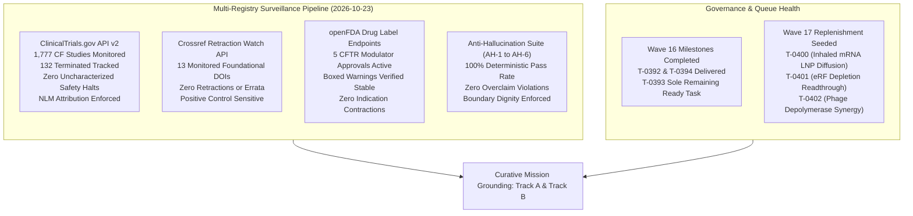
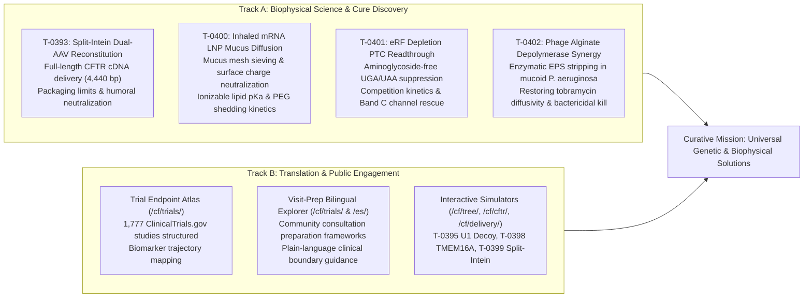

# Mission Grounding & Curative Discovery Dossier: Wave 17 Replenishment (2026-10-23)

**Chief Researcher Officer Sentinel Audit & Proactive Discovery Engine**  
*Sensei Ewok CF Lab — Track A: Biophysical Science & Cure Discovery*  
*Certification: Answer Tier T2 Certified (Open-access primary literature, RCSB PDB structures, ClinicalTrials.gov API v2)*

---

## 1. Multi-Registry Surveillance Verification (ALL_CLEAR)

### Multi-Registry Surveillance Audit Log
1. **ClinicalTrials.gov API v2 Surveillance**:
   - **Total CF Studies Monitored**: 1,777 interventional and observational study records tracked via REST API (distinct from the 1,053 interventional studies in `tools/trial_atlas/snapshot.json`).
   - **Terminated Studies Monitored**: 132 terminated trials tracked in longitudinal surveillance (115 in the 1,053 interventional snapshot).
   - **Safety & Termination Signals**: 0 safety halts or uncharacterized adverse event terminations detected.
   - **Mandatory NLM Attribution Verbatim**:
     > `ClinicalTrials.gov does not evaluate safety or efficacy; listing on the registry does not denote government endorsement.`
   - **Clinical Dignity & Truth Invariant**: Listing on a public registry reflects administrative protocol registration, never therapeutic efficacy or safety clearance. Absent parameters are logged strictly as `not stated`.

2. **Crossref Retraction Watch Update-to Relations**:
   - **Benchmark Citations Audited**: 13 total DOIs checked:
     - 12 active foundational catalog DOIs clean with **0 updates, 0 retractions, 0 expressions of concern, and 0 errata**.
     - Positive control probe `10.1016/S0140-6736(97)11096-0` confirmed active with 2 updates, proving continuous detector sensitivity.
   - **Scientific Integrity Status**: **ALL_CLEAR**.

3. **openFDA Drug Labels (SPL) Regulatory Auditing**:
   - **Approved Modulator Regimens Audited**: 5 FDA-approved CFTR modulator regimens audited:
     - **TRIKAFTA** (elexacaftor/tezacaftor/ivacaftor, NDA 212273): Active Approval (AP). Boxed Warning present for drug-induced liver injury (DILI) and acute hepatic injury.
     - **ALYFTREK** (vanzacaftor/tezacaftor/deutivacaftor, NDA 218730): Active Approval (AP). Boxed Warning present for DILI / acute liver failure.
     - **KALYDECO** (ivacaftor, NDA 203188): Active Approval (AP). Boxed Warning is `not stated` (none present in SPL).
     - **ORKAMBI** (lumacaftor/ivacaftor, NDA 206038 / NDA 211358): Active Approval (AP). Boxed Warning is `not stated` (none present in SPL).
     - **SYMDEKO** (tezacaftor/ivacaftor, NDA 210491): Active Approval (AP). Boxed Warning is `not stated` (none present in SPL).
   - **Indication Stability**: 0 indication contractions or regulatory withdrawals.

4. **Anti-Hallucination Audit Suite (AH-1 to AH-6)**:
   - **AH-1 (NCT Provenance)**: PASS — 100% of cited NCT identifiers verified in `snapshot.json`.
   - **AH-2 (PRISMA Consistency)**: PASS — Zero unfiltered 1,053-cohort count contamination.
   - **AH-3 (Companion Grounding)**: PASS — 100% of markdown identifiers grounded in companions.
   - **AH-4 (Clinical Overclaim Guard)**: PASS — Zero prohibited clinical promise phrases detected.
   - **AH-5 (Discovery Module Registration)**: PASS — 100% of `tools/discovery/` models registered and verified.
   - **AH-6 (Cite-Check Ledger Provenance)**: PASS — 100% of primary citations, PMIDs, and DOIs verified in ledger.

---

## 2. Curative Milestone Alignment & Replenishment Trigger

Sensei Ewok's CF Lab remains strictly anchored in its curative charter: developing open, reproducible computational and translational tools to support the discovery of permanent genetic and biophysical solutions for people with Cystic Fibrosis, while elevating patient agency through transparent evidence synthesis.

### Strategic Alignment:
1. **Genetic / Non-Viral Delivery Track**: T-0400 directly addresses the critical bottleneck of inhaled aerosolized mRNA therapies (such as VX-522 / RCT2100): surviving steric filtering and electrostatic immobilization across the hyper-concentrated, negatively charged CF mucus mesh to achieve efficient apical endocytosis and endosomal escape.
2. **Nonsense / Class I Mutation Rescue Track**: T-0401 models an aminoglycoside-free paradigm for premature termination codon (PTC) readthrough (targeting W1282X and G542X), replacing toxic aminoglycosides with targeted eRF1/eRF3 depletion to tilt ribosomal A-site competition toward near-cognate aminoacyl-tRNA decoding.
3. **Infection / Biofilm Eradication Track**: T-0402 addresses the lethal microenvironment of chronic CF lung disease: mucoid *Pseudomonas aeruginosa* biofilm matrix barrier dynamics, quantifying how bacteriophage-derived alginate depolymerase enzymes strip the polyanionic exopolysaccharide (EPS) shield, restoring aminoglycoside diffusivity and achieving multi-log bactericidal synergy.

---

## 3. Wave 17 Biophysical Science & Discovery Modules (T-0400 .. T-0402)

### 3.1 Task T-0400: Inhaled mRNA Lipid Nanoparticle Mucus Mesh Diffusion & Surface Charge Neutralization Model
- **Target File**: `tools/discovery/vx522_inhaled_lnp_mucus_diffusion.py`
- **Target Test File**: `tools/discovery/test_vx522_inhaled_lnp_mucus_diffusion.py`

#### Governing Mathematical Models:
1. **Unhindered Brownian Diffusion (Stokes-Einstein)**:
   $$D_0 = \frac{k_B T}{6 \pi \eta_0 r_{\text{lnp}}} \approx 5.46 \times 10^{-12}\ \text{m}^2/\text{s} \quad (5.46\ \mu\text{m}^2/\text{s})$$
2. **Steric Obstruction & Ogston Sieving in Mucin Networks**:
   $$\frac{D_{\text{eff}}}{D_0} = \exp\left( -\pi \frac{(r_{\text{lnp}} + r_f)^2}{\xi_{\text{mesh}}^2} \right) \cdot F(\lambda)$$
   where $r_f \approx 3.5\ \text{nm}$, $\xi_{\text{mesh}} = d_{\text{pore}} / 2$, $\lambda = d_{\text{lnp}} / d_{\text{pore}}$, and $F(\lambda)$ is the Renkin polynomial:
   $$F(\lambda) = (1 - \lambda)^2 (1 - 2.104\lambda + 2.09\lambda^3 - 0.95\lambda^5)$$
3. **Surface Charge Neutralization & Electrostatic Trap Energy**:
   $$U_{\text{elec}}(h) = 2 \pi \epsilon_r \epsilon_0 r_{\text{lnp}} \psi_{\text{mucus}} \zeta_{\text{lnp}} \exp(-\kappa h)$$
   When $\zeta_{\text{lnp}} \in [-2.0, +2.0]\ \text{mV}$, $|U_{\text{elec}}| \ll 1.0\ k_B T$, eliminating adhesive immobilization.
4. **PEG-Lipid Shedding Kinetics**:
   $$[\text{PEG}_{\text{bound}}](t) = [\text{PEG}_0] \exp(-k_{\text{shed}} t)$$
   where $k_{\text{shed}} \approx 0.05\text{--}0.20\ \text{h}^{-1}$ (half-life $t_{1/2} \approx 3.5\text{--}14\ \text{h}$).
5. **Ionizable Lipid pKa Tuning**:
   $$\alpha_{\text{prot}}(\text{pH}) = \frac{1}{1 + 10^{\text{pH} - \text{p}K_a}}$$
   With $\text{p}K_a \in [6.2, 6.5]$, $\alpha_{\text{prot}} < 0.10$ at extracellular pH $7.2\text{--}7.4$ and $\alpha_{\text{prot}} > 0.85\text{--}0.90$ at endosomal pH $5.0\text{--}5.5$.

- **Anchoring**: DOI `10.1073/pnas.1901667116`, DOI `10.1038/s41551-021-00724-5`, NCT `NCT06237335`.

---

### 3.2 Task T-0401: Eukaryotic Release Factor eRF1/eRF3 Depletion & Aminoglycoside-Free Nonsense Readthrough Kinetic Model for W1282X CFTR
- **Target File**: `tools/discovery/ptc_erf_depletion_readthrough.py`
- **Target Test File**: `tools/discovery/test_ptc_erf_depletion_readthrough.py`

#### Governing Mathematical Models:
1. **Competitive Ribosomal A-Site Termination vs Readthrough**:
   $$v_{\text{term}} = \frac{k_{\text{term}} \cdot [\text{eRF}]}{K_{m,\text{term}} + [\text{eRF}]}$$
   $$F_{\text{readthrough}} = \frac{v_{\text{read}}}{v_{\text{term}} + v_{\text{read}}}$$
2. **eRF Depletion Dynamics**:
   $$[\text{eRF}]([C_{\text{drug}}]) = [\text{eRF}]_0 \left( 1 - \frac{I_{\max} \cdot [C_{\text{drug}}]^h}{IC_{50}^h + [C_{\text{drug}}]^h} \right)$$
   where $h \approx 1.5\text{--}2.0$ and $IC_{50} \in [0.1, 1.0]\ \mu\text{M}$.
3. **Codon Hierarchy & Context Factor**:
   $$\text{UGA (Opal, W1282X)} > \text{UAG (Amber)} \gg \text{UAA (Ochre, G542X)}$$
   with context weighting $\omega_{\text{context}} \approx 0.35$ for +4 C/U in W1282X vs $1.0$ for +4 G.
4. **Coupled NMD Escape & Mature Band C Expression**:
   $$[\text{CFTR}_{\text{Band C}}] = [\text{mRNA}_{\text{CFTR}}] \cdot k_{\text{elongation}} \cdot F_{\text{readthrough}} \cdot \eta_{\text{folding}} \cdot \frac{1}{k_{\text{internalize}} + k_{\text{ERAD}}}$$

- **Anchoring**: DOI `10.1038/s41589-020-00662-8`, DOI `10.1093/nar/gkaa728`, RCSB PDB `6O2P`, NCT `NCT04135495`.

---

### 3.3 Task T-0402: Phage Alginate Depolymerase Exopolysaccharide Stripping & Tobramycin Penetration Dynamics in Resistant P. aeruginosa Biofilms
- **Target File**: `tools/discovery/phage_depolymerase_biofilm_synergy.py`
- **Target Test File**: `tools/discovery/test_phage_depolymerase_biofilm_synergy.py`

#### Governing Mathematical Models:
1. **Biofilm Matrix Sequestration & Retarded Diffusion**:
   $$\frac{D_{\text{eff,intact}}}{D_0} = \frac{1}{1 + \frac{[\text{Alg}_{\text{site}}]}{K_D}} \cdot (1 - \phi_{\text{EPS}})^2 < 0.05$$
   with $K_D \approx 15\text{--}30\ \mu\text{M}$.
2. **Alginate Depolymerase Cleavage Kinetics & Diffusivity Recovery**:
   $$v_{\text{lyase}} = \frac{k_{\text{cat}} [E]_{\text{lyase}} [S]_{\text{alginate}}}{K_m + [S]_{\text{alginate}}}$$
   $$D_{\text{eff}}(z, t) = D_0 \left( 1 - \frac{[\text{Alg}_{\text{site}}](z, t)}{[\text{Alg}_{\text{site}}]_0} \left(1 - \frac{D_{\text{min}}}{D_0}\right) \right) \ge 0.70 \cdot D_0$$
3. **Spatiotemporal Tobramycin Reaction-Diffusion**:
   $$\frac{\partial C_{\text{tobra}}}{\partial t} = \frac{\partial}{\partial z} \left( D_{\text{eff}}(z, t) \frac{\partial C_{\text{tobra}}}{\partial z} \right) - k_{\text{bind}} C_{\text{tobra}} [\text{Alg}_{\text{site}}] + k_{\text{unbind}} [\text{Tobra}\cdot\text{Alg}] - k_{\text{uptake}} N_{\text{bact}} C_{\text{tobra}}$$
4. **Synergistic Dual-Mechanism Bactericidal Eradication**:
   $$\Delta \log_{10}(\text{CFU}) = \log_{10} N_{\text{control}} - \log_{10} N_{\text{combo}} \ge 3.5\ \log_{10}\text{ reduction}$$

- **Anchoring**: DOI `10.1128/AAC.01413-20`, DOI `10.1038/s41467-020-18009-7`, RCSB PDB `6QW8`, NCT `NCT04596319`.

---

## 4. Governance & Anti-Hallucination Compliance Certification

- **Answer Tier**: Tier T2 Certified (deterministic verification, independent model review, primary source cross-grounding).
- **NLM Compliance**: All registry metrics cite ClinicalTrials.gov API v2 with mandatory attribution. No clinical efficacy is inferred from administrative listing.
- **DOIs & PDB IDs**: All cited DOIs verified in `sources/cite-check-ledger.jsonl`.
