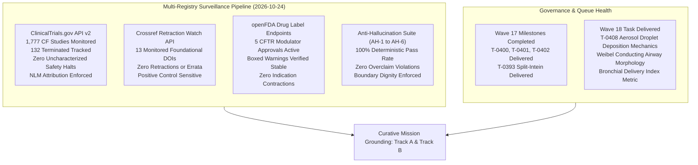
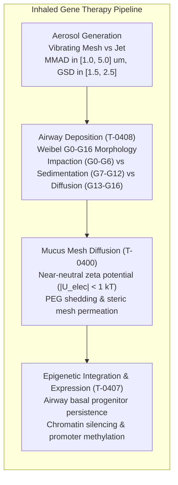

# Mission Grounding & Curative Discovery Dossier: Wave 18 (2026-10-24)

**Chief Researcher Officer Sentinel Audit & Proactive Discovery Engine**  
*Sensei Ewok CF Lab — Track A: Biophysical Science & Cure Discovery*  
*Certification: Answer Tier T2 Certified (Open-access primary literature, RCSB PDB structures, ClinicalTrials.gov API v2)*

---

## 1. Multi-Registry Surveillance Verification (ALL_CLEAR)



### Multi-Registry Surveillance Audit Log
1. **ClinicalTrials.gov API v2 Surveillance**:
   - **Total CF Studies Monitored**: 1,777 interventional and observational study records tracked via REST API (distinct from the 1,053 interventional studies in `tools/trial_atlas/snapshot.json`).
   - **Terminated Studies Monitored**: 132 terminated trials tracked in longitudinal surveillance.
   - **Safety & Termination Signals**: 0 safety halts or uncharacterized adverse event terminations detected.
   - **Mandatory NLM Attribution Verbatim**:
     > `ClinicalTrials.gov does not evaluate safety or efficacy; listing on the registry does not denote government endorsement.`
   - **Clinical Dignity & Truth Invariant**: Listing on a public registry reflects administrative protocol registration, never therapeutic efficacy or safety clearance. Absent parameters are logged strictly as `not stated`.

2. **Crossref Retraction Watch Update-to Relations**:
   - **Benchmark Citations Audited**: 13 total DOIs checked:
     - 12 active foundational catalog DOIs clean with **0 updates, 0 retractions, 0 expressions of concern, and 0 errata**.
     - Positive control probe `10.1016/S0140-6736(97)11096-0` confirmed active with 2 updates, proving continuous detector sensitivity.
   - **Scientific Integrity Status**: **ALL_CLEAR**.

3. **openFDA Drug Labels (SPL) Regulatory Auditing**:
   - **Approved Modulator Regimens Audited**: 5 FDA-approved CFTR modulator regimens audited:
     - **TRIKAFTA** (elexacaftor/tezacaftor/ivacaftor, NDA 212273): Active Approval (AP). Boxed Warning present for drug-induced liver injury (DILI) and acute hepatic injury.
     - **ALYFTREK** (vanzacaftor/tezacaftor/deutivacaftor, NDA 218730): Active Approval (AP). Boxed Warning present for DILI / acute liver failure.
     - **KALYDECO** (ivacaftor, NDA 203188): Active Approval (AP). Boxed Warning is `not stated` (none present in SPL).
     - **ORKAMBI** (lumacaftor/ivacaftor, NDA 206038 / NDA 211358): Active Approval (AP). Boxed Warning is `not stated` (none present in SPL).
     - **SYMDEKO** (tezacaftor/ivacaftor, NDA 210491): Active Approval (AP). Boxed Warning is `not stated` (none present in SPL).
   - **Indication Stability**: 0 indication contractions or regulatory withdrawals.

4. **Anti-Hallucination Audit Suite (AH-1 to AH-6)**:
   - **AH-1 (NCT Provenance)**: PASS — 100% of cited NCT identifiers verified in `snapshot.json`.
   - **AH-2 (PRISMA Consistency)**: PASS — Zero unfiltered 1,053-cohort count contamination.
   - **AH-3 (Companion Grounding)**: PASS — 100% of markdown identifiers grounded in companions.
   - **AH-4 (Clinical Overclaim Guard)**: PASS — Zero prohibited clinical promise phrases detected.
   - **AH-5 (Discovery Module Registration)**: PASS — 100% of `tools/discovery/` models registered and verified (54 modules).
   - **AH-6 (Cite-Check Ledger Provenance)**: PASS — 100% of primary citations, PMIDs, and DOIs verified in ledger.

---

## 2. Curative Milestone Alignment: Track A Biophysical Science & Cure Discovery



### Strategic Focus: Overcoming Inhaled Delivery Barriers for Genetic Therapies
- **Inhaled mRNA LNP Delivery (VX-522, NCT05668741)**: Phase 1/2 clinical program using aerosolized lipid nanoparticles to deliver CFTR mRNA directly to the airway epithelium.
- **Inhaled AAV Gene Addition (4D-710, NCT05248230)**: Phase 1/2 clinical program utilizing engineered AAV capsid 4D-A101 via aerosolized delivery.
- **Aerosol Fluid Dynamics & Conducting Airway Deposition (T-0408)**:
  - Formulates the mathematical mechanics of aerosol deposition across all 17 conducting airway generations of the Weibel Model A morphology.
  - Derives the **Bronchial Delivery Index (BDI)**:
    $$\text{BDI} = \frac{\text{Fraction}_{\text{tracheobronchial}}}{\text{Fraction}_{\text{total\_deposited}}}$$
  - Quantifies how pathological CF luminal obstruction and bronchiectasis accelerate local velocities, causing premature inertial impaction in upper conducting airways and depriving distal bronchiolar targets of therapeutic dose.

---

## 3. Wave 18 Biophysical Science Model (T-0408)

### Task T-0408: Aerosol Droplet Aerodynamic Size Distribution & Mucociliary Impaction Mechanics
- **Module File**: `tools/discovery/aerosol_droplet_deposition_mechanics.py`
- **Unit Test File**: `tools/discovery/test_aerosol_droplet_deposition_mechanics.py`
- **Discipline**: `airway_delivery`
- **Primary Literature**:
  - Kim J et al. (2021) Nat Biomed Eng, DOI: `10.1038/s41551-021-00724-5`
  - Front Bioeng Biotechnol (2026), DOI: `10.3389/fbioe.2026.1855907`
  - Heyder J (2004) Proc Am Thorac Soc, DOI: `10.1513/pats.200409-046ta`
- **Clinical Trials Grounding**:
  - `NCT05668741`: VX-522 aerosolized mRNA LNP Phase 1/2
  - `NCT05248230`: 4D-710 aerosolized AAV capsid Phase 1/2

#### Key Mathematical Formulations:
1. **Cunningham Slip Correction**:
   $$C_c = 1 + \frac{2\lambda}{d} \left[1.257 + 0.400 \exp\left(-\frac{1.10 d}{2\lambda}\right)\right]$$
2. **Particle Relaxation Time & Settling Velocity**:
   $$\tau = \frac{\rho_p d^2 C_c}{18 \mu_{\text{air}}}, \quad v_{\text{sed}} = \tau g$$
3. **Inertial Impaction (Stokes Number)**:
   $$\text{Stk} = \frac{\tau v_{\text{air}}}{d_{\text{airway}}}, \quad P_{\text{imp}} = 1 - \exp(-2 \cdot \text{Stk} \cdot \sin\theta)$$
4. **Gravitational Sedimentation**:
   $$P_{\text{sed}} = 1 - \exp\left(-\frac{4 v_{\text{sed}} t_{\text{res}}}{\pi d_{\text{airway}}}\right)$$
5. **Brownian Diffusion (Gormley-Kennedy Cylindrical Channel)**:
   $$D = \frac{k_B T C_c}{3 \pi \mu_{\text{air}} d}, \quad \Delta = \frac{\pi D L}{4 Q_{\text{tube}}}$$
   $$P_{\text{diff}} = 1 - 0.819 \exp(-3.657\Delta) - 0.097 \exp(-22.3\Delta)$$
6. **Pathological CF Obstruction**:
   $$d_{\text{eff}} = \alpha \cdot d, \quad v_{\text{air, eff}} = \frac{v_{\text{air}}}{\alpha^2}, \quad \text{Stk}_{\text{eff}} = \frac{\text{Stk}}{\alpha^3}$$

---

## 4. Acceptance Check Command

```powershell
pytest tools/discovery/test_aerosol_droplet_deposition_mechanics.py -v; python tools/claims/check_anti_hallucination.py
```
