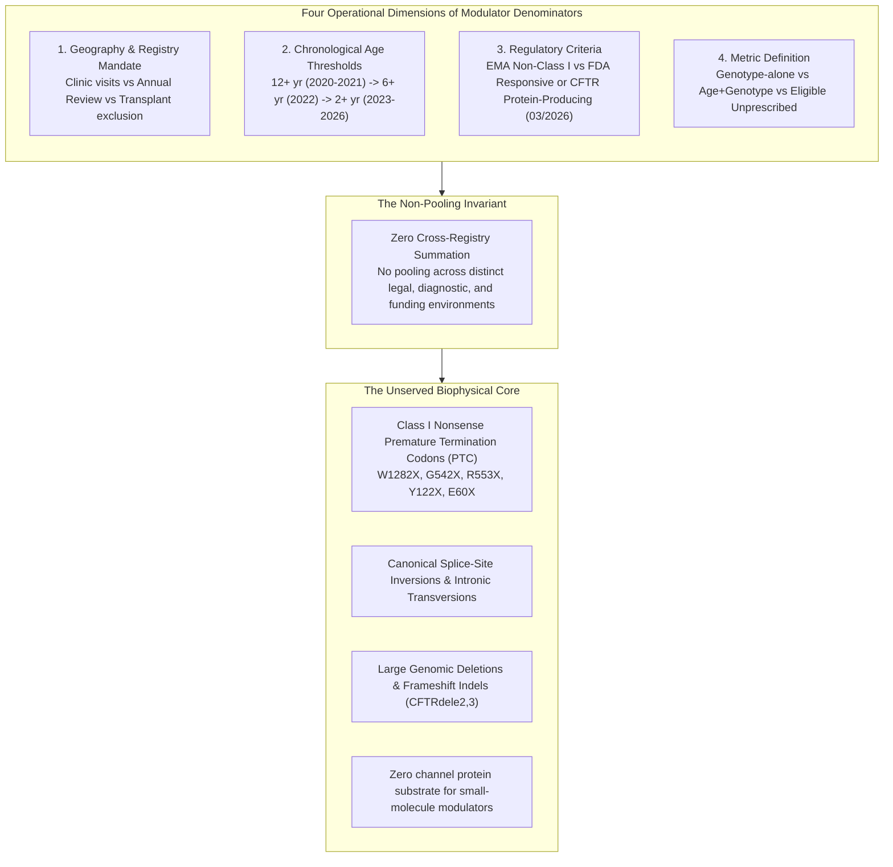

# Which 10 Percent? A Definitions Ledger for Modulator-Eligibility Denominators (2020–2026)

**Date**: 2026-10-17 | **Track**: Track A / Track B | **Answer Tier**: Tier T2 (provisional) (Script-verified, primary-sourced, zero cross-registry arithmetic) | **Task Anchor**: `T-0134`  
**Primary Sources**:
- European Cystic Fibrosis Society Patient Registry (`ECFSPR`) Annual Data Reports for data years 2020, 2021, 2022, 2023, and 2024 (published 2022–2026).
- Cystic Fibrosis Foundation Patient Registry (`CFFPR`) 2024 Annual Data Report (published 2025).
- European Medicines Agency (`EMA`) Medicines Data JSON Report: Kaftrio (`EMEA/H/C/005269`) and Alyftrek (`EMEA/H/C/006382`), updated `2026-08-19`.
- U.S. Food and Drug Administration (`openFDA` Drug Label API): Trikafta (`NDA 212273` / `NDA 217660`, `effective_time: 20260622`) and Alyftrek (`NDA 218730`, `effective_time: 20260826`), including the `03/2026` *Indications and Usage* major change.

---

## 1. Executive Summary & The Anatomy of the Denominator

In informal scientific discussions, CFTR modulator coverage is frequently characterized by colloquial shorthand such as `the remaining 10 percent`. However, epidemiological and regulatory records show that there is no singular `10 percent`.

The proportion of individuals ineligible for small-molecule CFTR modulators varies according to four operational dimensions:
1. **Reporting Cohort & Geography**: National and continental registries apply distinct inclusion rules (clinic encounters, annual review attendance, transplant status, and national regulatory exceptions in Israel, Switzerland, and the Russian Federation).
2. **Chronological Age Lowering**: Pediatric label expansions lowered the European and U.S. age thresholds from 12+ years (`data_year` 2020–2021) to 6+ years (`data_year` 2022) and 2+ years (`data_year` 2023–2024).
3. **Regulatory Authorization Criteria**: In July 2026 (`2026-07-23`), the European Commission updated Kaftrio and Alyftrek indications to cover patients with at least one non-Class I mutation in the *CFTR* gene. In March 2026 (`03/2026` *Recent Major Changes* on both labels), the U.S. FDA updated Trikafta (`effective_time: 20260622`) and Alyftrek (`effective_time: 20260826`) to cover patients with at least one *CFTR* variant that is either responsive based on clinical and/or in vitro data or results in production of CFTR protein.
4. **Denominator Metric**: Genotype-only eligibility (`92.3` percent in CFFPR 2024), age-and-genotype prescription uptake (`26,277` of `29,314`, or `89.6` percent in CFFPR 2024), and eligible-but-unprescribed counts (`3,037`, or `10.4` percent in CFFPR 2024) measure different populations.

---

## 2. Regulator Drug Label Approvals (Primary Regulatory Sources)

The official regulatory labels establish the legal boundaries of modulator eligibility:

### European Medicines Agency (EMA)

- **Kaftrio** (`EMEA/H/C/005269`, elexacaftor / tezacaftor / ivacaftor):
  - Initial Marketing Authorisation: `2020-08-21`
  - European Commission Decision Date: `2026-07-23` (JSON report updated `2026-08-19`)
  - Regulatory Indication Wording:
    > Kaftrio tablets are indicated in a combination regimen with ivacaftor for the treatment of cystic fibrosis (CF) in patients aged 6 years and older who have at least one non-Class I mutation in the cystic fibrosis transmembrane conductance regulator (CFTR) gene. Kaftrio granules are indicated in a combination regimen with ivacaftor for the treatment of cystic fibrosis (CF) in paediatric patients aged 2 to less than 6 years who have at least one non-Class I mutation in the cystic fibrosis transmembrane conductance regulator (CFTR) gene.

- **Alyftrek** (`EMEA/H/C/006382`, vanzacaftor / tezacaftor / deutivacaftor):
  - Initial Marketing Authorisation: `2025-06-30`
  - European Commission Decision Date: `2026-07-23` (JSON report updated `2026-08-19`)
  - Regulatory Indication Wording:
    > Alyftrek tablets are indicated for the treatment of cystic fibrosis (CF) in people aged 6 years and older who have at least one non-Class I mutation in the cystic fibrosis transmembrane conductance regulator (CFTR) gene (see sections 4.2 and 5.1).

### United States Food and Drug Administration (openFDA Drug Label API)

- **TRIKAFTA** (`NDA 212273` / `NDA 217660`, elexacaftor / tezacaftor / ivacaftor):
  - Initial FDA Approval: `2019-10-21`
  - Label Effective Date: `2026-06-22` (*Recent Major Changes*: `Indications and Usage (1) 03/2026`)
  - Indications and Usage:
    > TRIKAFTA is indicated for the treatment of cystic fibrosis (CF) in adult and pediatric patients aged 2 years and older who have a clinical diagnosis of CF and who have at least one variant in the cystic fibrosis transmembrane conductance regulator ( CFTR ) gene that is either responsive based on clinical and/or in vitro data (see Table 6 ) or results in production of CFTR protein [see Clinical Pharmacology (12.1) ] .

- **ALYFTREK** (`NDA 218730`, vanzacaftor / tezacaftor / deutivacaftor):
  - Initial FDA Approval: `2024-12-20`
  - Label Effective Date: `2026-08-26` (*Recent Major Changes*: `Indications and Usage (1) 03/2026`)
  - Indications and Usage:
    > ALYFTREK is indicated for the treatment of cystic fibrosis (CF) in adult and pediatric patients 6 years of age and older who have a clinical diagnosis of CF and who have at least one variant in the cystic fibrosis transmembrane conductance regulator ( CFTR ) gene that is either responsive based on clinical and/or in vitro data (see Table 5 ) or results in production of CFTR protein [see Clinical Pharmacology (12.1) ].

---

## 3. Continental & National Registry Definitions Ledger (2020–2024 Data Years)

Note on registry dating: ECFSPR titles each annual report by its **data year** (`data_year` 2020 through 2024) and publishes the volume one to two years later (`report_year` 2022 through 2026).

| Registry ID | Publication Year | Data Year | Base Population | Age Rule | Variant Rule & Basis | Page | Source Link | Verbatim Short Quote |
| :--- | :---: | :---: | :--- | :--- | :--- | :---: | :--- | :--- |
| `ecfspr-adr-2020` | 2022 | 2020 | Eligible non-transplanted patients seen in 2020 | 12 years or older | F508del homozygous or heterozygous | 133 | [ECFSPR 2020 PDF](https://pr.ecfs.eu/wp-content/uploads/2025/06/ECFSPR_Report_2020_v1.0-07Jun2022_website.pdf) | `The patient is 12 years or older and is F508del homozygous or F508del heterozygous.` |
| `ecfspr-adr-2021` | 2023 | 2021 | Participating ECFSPR countries (2021 data) | 12 years or older (exceptions in IL, RU) | F508del homozygous or heterozygous | 121 | [ECFSPR 2021 PDF](https://pr.ecfs.eu/wp-content/uploads/2025/06/Annual-Report_2021_09Jun2023_ECFSPR_final.pdf) | `to 18 years in the Russian Federation) and is F508del homozygous or F508del heterozygous.` |
| `ecfspr-adr-2022` | 2025 | 2022 | Participating ECFSPR countries (2022 data) | At least 6 years old | At least one F508del variant | 103 | [ECFSPR 2022 PDF](https://pr.ecfs.eu/wp-content/uploads/2025/06/Annual-Report_2022_vs1.0_ECFSPR_20250130.pdf) | `at least 6 years old and have at least one F508del variant.` |
| `ecfspr-adr-2023` | 2025 | 2023 | Participating ECFSPR countries (2023 data) | At least 2 years old (6 in CH/RU, 12 in IL) | At least one F508del variant | 100 | [ECFSPR 2023 PDF](https://pr.ecfs.eu/wp-content/uploads/2025/08/Annual-Report_2023_vs1.1_ECFSPR_20250715.pdf) | `(6 years old in Switzerland and in Russia, 12 years old in Israel) and have at least one F508del variant` |
| `ecfspr-adr-2024` | 2026 | 2024 | Participating ECFSPR countries (2024 data) | At least 2 years old (6 in IL and RU) | At least one F508del variant | 81 | [ECFSPR 2024 PDF](https://pr.ecfs.eu/wp-content/uploads/2026/05/Annual-Report_2024_vs1.0_ECFSPR_20260518.pdf) | `at least 2 years old (6 years old in Israel and in the Russian Federation) with at least one F508del variant` |
| `cffpr-adr-2024` | 2025 | 2024 | U.S. CFF-accredited care centers (2024 data) | Age and genotype eligible | FDA-approved responsive variants | 58 | [CFFPR Registry](https://www.cff.org/medical-professionals/patient-registry) | `people eligible for a CFTR modulator based on age and genotype had at least one prescription reported in the Registry.` |

---

## 4. Analysis of Registry Metrics & The Non-Pooling Invariant

### Quantitative Observations from CFFPR 2024 (Pages 8 and 58)
1. **Genotype-Based Eligibility**: Overall, 92.3 percent of the total CF population in the Registry was eligible by CFTR genotype for at least one CFTR modulator as of 2024.
2. **Age- and Genotype-Based Prescription Uptake**: In 2024, 26,277 of the 29,314 (89.6 percent) people eligible for a CFTR modulator based on age and genotype had at least one prescription reported in the Registry.
3. **Eligible Unprescribed Population**: The number of eligible individuals who were not prescribed a CFTR modulator fell from 3,065 (10.8 percent) in 2023 to 3,037 (10.4 percent) in 2024.
4. **December 20, 2024 Rare Variant Expansions**: On December 20, 2024, the FDA granted initial approval to VTD for patients aged 6 years and older, including 31 additional rare mutations, and 135 individuals in the Registry became eligible for a CFTR modulator for the first time.
5. **Categorization of VTD in 2024 Charts**: Page 8 notes that individuals who are solely eligible for VTD are categorized as modulator ineligible in 2024 for the purposes of the 2024 report charts and analyses.

### The Non-Pooling Invariant
Cross-registry summation or mathematical pooling is strictly prohibited across the lab:
- Summing denominators across ECFSPR and CFFPR produces an invalid figure because the reporting cohorts, annual review requirements, and national reimbursement rules operate under distinct frameworks.
- No arithmetic across rows in the ledger is permitted. Every number is tied directly to its primary source report.

---

## 5. Biophysical Foundation: The Unserved Cohort

Even after the 2026 EMA non-Class I decision and the `03/2026` FDA expansion to variants that result in production of CFTR protein, the remaining ineligible population cannot be served by small-molecule modulators due to fundamental biophysical constraints:

1. **Class I Nonsense Mutations (PTC)**: Mutations such as `W1282X`, `G542X`, `R553X`, `Y122X`, and `E60X` introduce premature stop codons that trigger nonsense-mediated mRNA decay (NMD) and arrest ribosomal translation.
2. **Canonical Splice-Site Defects**: Transversions such as `1717-1G->A` and `621+1G->T` disrupt mRNA splicing, preventing full-length CFTR synthesis.
3. **Large Structural Indels**: Deletions such as `CFTRdele2,3` eliminate essential functional domains.

Because these genotypes fail to produce full-length CFTR channel protein at the cell membrane, small-molecule potentiators and correctors lack a protein substrate. Curative resolution requires genetic medicines (mRNA replacement, base/prime editing) and mutation-agnostic alternative chloride conductance pathways.

---

## 6. Medical & Epistemic Boundaries

- **Independent research, not medical advice**: Sensei Ewok's CF Lab is an independent, donated-time software and research group. This ledger synthesizes public epidemiological data and regulatory filings. It does not provide clinical guidance or determine any individual patient's medical eligibility.
- **Human review gate (`T-0011`)**: External registry-scientist review of cross-registry comparability is tracked under human gate `T-0011`.
- **No poster citations**: Conference posters, unreviewed abstracts, and secondary press claims are excluded from this dossier. Only cataloged primary registry reports and official regulatory documents are cited.
