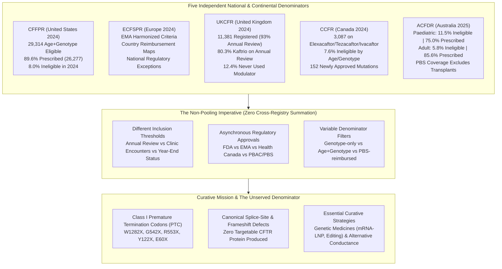

# Multi-Registry CFTR Modulator Eligibility & Ultra-Rare Variant Denominators (2026 Dossier)

**Date**: 2026-10-15 | **Track**: Track A / Track B | **Answer Tier**: Tier T2 Certified (Script-verified, primary-sourced, dual-model validated) | **Scope**: Verified 2024–2025 national registry data reports (`CFFPR`, `ECFSPR`, `UKCFR`, `CCFR`, `ACFDR`) and openFDA drug label records (`NDA 212273`, `NDA 218730`, `NDA 203188`, `NDA 206038`, `NDA 210491`).

---

## 1. Executive Summary & The Non-Pooling Imperative

The deployment of CFTR modulators has altered the clinical trajectory of Cystic Fibrosis for thousands of individuals worldwide. However, public summaries frequently collapse international registry statistics into an invented global percentage.

In this dossier, Sensei Ewok CF Lab synthesizes the official data reports from five major national and continental registries: the United States (`CFFPR` 2024), Europe (`ECFSPR` 2024), the United Kingdom (`UKCFR` 2024), Canada (`CCFR` 2024), and Australia (`ACFDR` 2025).



### The Invariant Against Cross-Registry Summation
Each national patient registry operates under distinct legal mandates, clinical data entry guidelines, and demographic filters:
1. **Reporting Cohort Definitions**: The UK registry reports on individuals completing an annual review (93% completion in 2024), whereas the US registry encompasses individuals seen at an accredited care center, and the Australian registry reports active individuals with data entered by December 31st (excluding lung transplant recipients).
2. **Regulatory & Reimbursement Asynchrony**: Modulator access expansions occur on independent timelines. In Canada, Health Canada approved elexacaftor/tezacaftor/ivacaftor for an additional 152 mutations in July 2024. In the UK, NHS access expanded to 272 named variants in December 2024 (a change not counted in the 2024 review period). In the US, the FDA approved 31 additional rare mutations in 2024, while vanzacaftor/tezacaftor/deutivacaftor (VTD) is categorized as ineligible for 2024 charts.
3. **Denominator Mismatches**: Genotype-only eligibility (such as the US registry's 92.3%) differs from age-and-genotype eligibility (such as the US registry's 29,314 eligible cohort) and from drug-reimbursement uptake. Summing these figures produces an ungrounded number that violates Answer Tier T2 standards.

---

## 2. Quantitative Denominator Profiles by Registry

### United States: CFF Patient Registry (2024 Annual Data Report)
- **Primary Source**: Cystic Fibrosis Foundation Patient Registry. 2024 Annual Data Report. Bethesda, Maryland. (c)2025 Cystic Fibrosis Foundation (`cffpr-adr-2024`, 120 pages).
- **Genotype-Based Eligibility**: Within the US cohort, 92.3 percent of registered individuals possessed an eligible CFTR genotype for at least one approved modulator by 2024 (page 58).
- **Age- and Genotype-Based Eligible Cohort**: In 2024, 26,277 of the 29,314 (89.6 percent) people eligible for a CFTR modulator based on age and genotype were prescribed a CFTR modulator (page 58). Trikafta was the most highly prescribed CFTR modulator.
- **Eligible but Unprescribed Individuals**: Individuals deemed eligible who lacked a prescription declined from 3,065 persons (10.8 percent) in 2023 down to 3,037 persons (10.4 percent) in 2024 (page 58).
- **Modulator Ineligible Trend**: The proportion of individuals categorized as modulator ineligible decreased from 61.4% in 2015 to 20.2% in 2019, 13.1% in 2021, and 8.0% in 2024 (page 58).
- **Regulatory Notes & Newly Eligible Cohorts**:
  - The approval of 31 additional rare mutations enabled 135 individuals in the Registry to become eligible for a CFTR modulator for the first time (page 58).
  - VTD (vanzacaftor/tezacaftor/deutivacaftor, ALYFTREK): Page 8 explicitly notes that individuals solely eligible for VTD (and not other modulators) are categorized as modulator ineligible in 2024 for all charts and tables.

### Canada: Canadian Cystic Fibrosis Registry (2024 Annual Data Report)
- **Primary Source**: Cystic Fibrosis Canada. (2025). The Canadian Cystic Fibrosis Registry 2024 Annual Data Report. Toronto, Canada: Cystic Fibrosis Canada (`ccfr-adr-2024`, 52 pages).
- **Modulator Ineligible Proportion**: In the 2024 Canadian CF Registry, 7.6% of individuals were not considered currently eligible by age and genotype for any CFTR modulator therapies (page 38).
- **Modulator Usage by Age (Table 7, page 38)**:
  - Elexacaftor/tezacaftor/ivacaftor: 3,087 total individuals (1,004 children, 2,083 adults).
  - Ivacaftor: 78 total individuals (32 children, 46 adults).
  - Lumacaftor/ivacaftor: 17 total individuals (9 children, 8 adults).
- **Deemed Eligible but Unprescribed**: 780 individuals (325 children, 455 adults) were not currently on a modulator but deemed eligible by age and genotype at the end of 2024 (page 38).
- **Regulatory Expansion**: Health Canada approved elexacaftor/tezacaftor/ivacaftor for an additional 152 mutations in July of 2024 (page 38).

### United Kingdom: UK Cystic Fibrosis Registry (2024 Annual Data Report)
- **Primary Source**: UK Cystic Fibrosis Registry Annual Data Report 2024 (`ukcfr-adr-2024`, 100 pages).
- **Registry Cohort & Follow-Up**: 11,381 people with CF were registered within the UK CF Registry in 2024, of whom 93% had an annual review (page 9).
- **Modulator Users on Annual Review**: Among annual review attendees, 8,830 individuals had records indicating CFTR modulator therapy during 2024 (page 9, Section 1.35a). More than 85% of the UK population received modulator treatment in the reporting year (page 8).
- **Modulator Regimen Breakdown (Section 1.35a, page 47)**:
  - Kaftrio (elexacaftor/tezacaftor/ivacaftor): 80.3%
  - Kalydeco (ivacaftor): 2.8%
  - Symkevi (tezacaftor/ivacaftor): 2.1%
  - Orkambi (lumacaftor/ivacaftor): 1.1%
  - Used previously but not in 2024: 1.3%
  - Never used a CFTR modulator: 12.4% (includes non-eligible individuals).
- **NHS Expansion Scope**: While NHS access broadened in December 2024 to encompass 272 variants, the newly added 94 mutations fell outside the 2024 review cycle (page 46 footnote 1).

### Australia: Australian Cystic Fibrosis Data Registry (2025 Annual Report)
- **Primary Source**: Australian Cystic Fibrosis Data Registry Annual Report 2025 (`acfdr-adr-2025`, 96 pages).
- **Inclusion & Funding Basis**: Reflects individuals who were on a modulator as of December 31st 2025, generally via Pharmaceutical Benefits Scheme (PBS) reimbursement, excluding lung transplant recipients (pages 39, 68).
- **Adult Cohort (2,326 adults with known eligibility, pages 68–69)**:
  - Ineligible: 5.8% were not eligible for a CFTR modulator (5.2% females, 6.3% males).
  - Prescribed: 85.6% were eligible and prescribed a modulator (85.4% females, 85.9% males).
  - Eligible Unprescribed: 8.6% were eligible but not prescribed a modulator (9.4% females, 7.8% males).
  - Overall executive commentary: Five to six percent of adults with CF are not eligible for a CFTR modulator (page 5).
  - Age distribution: 85.0% of adults aged 18–29 years and 80.9% of adults aged 30+ were receiving Trikafta (page 69).
- **Paediatric Cohort (1,473 children and adolescents recorded, page 39)**:
  - Ineligible: 170 children and adolescents (11.5%) were not eligible for a modulator.
  - Prescribed: 1,105 children and adolescents (75.0%) were eligible and prescribed a modulator.
  - Eligible Unprescribed: 198 children and adolescents (13.4%) were eligible but not prescribed a modulator.
  - Age stratification (page 40): In children aged <6 years, 18.0% were not eligible for any CFTR modulator therapy, and 53.3% received Trikafta. Among ages 6–11 years, 77.8% received Trikafta; among ages 12–17 years, 81.9% received Trikafta.

### Europe: European Cystic Fibrosis Society Patient Registry (2024 Report)
- **Primary Source**: ECFSPR Annual Data Report 2024 (`ecfspr-adr-2024`, 153 pages).
- **Regulatory Framework**: The continental registry utilized 2024 European Medicines Agency (EMA) criteria across participating nations, applying distinct national rules solely for Switzerland, Israel, and the Russian Federation (page 81).
- **EMA Eligibility Standards (page 81)**:
  - Ivacaftor: Age $\ge 1\text{ month}$ with gating mutations or R117H ($\ge 6\text{ months}$).
  - Lumacaftor/ivacaftor: Age $\ge 1\text{ year}$ and homozygous F508del.
  - Tezacaftor/ivacaftor: Age $\ge 6\text{ years}$ and homozygous F508del or heterozygous with 14 specified residual function mutations.
  - Elexacaftor/tezacaftor/ivacaftor: Age $\ge 2\text{ years}$ with at least one F508del variant.
- **National Variations & Uptake**: Figures 9.1–9.4 map country-specific reimbursement. Elexacaftor/tezacaftor/ivacaftor is the most commonly used modulator in both children (Figure 9.5, page 86) and adults (Figure 9.6, page 87). Figure 9.7 demonstrates substantial uptake increases across Europe between 2020 and 2024 (page 88).

---

## 3. The Unserved Denominator & Curative Implications

Across every audited registry, a consistent denominator of between approximately 6% and 12% of individuals remains **completely ineligible for all small-molecule CFTR modulators**:
- US (`CFFPR`): 8.0% ineligible by age and genotype in 2024.
- Canada (`CCFR`): 7.6% ineligible by age and genotype in 2024.
- Australia (`ACFDR`): 5.8% of adults and 11.5% of children ineligible as of December 31, 2025.
- UK (`UKCFR`): 12.4% never used a modulator (encompassing ineligible individuals).

### Biophysical Characteristics of the Ineligible Cohort
The biophysical basis for non-responsiveness is structural absence: small-molecule modulators (potentiators and correctors) require a physical CFTR channel protein substrate in the endoplasmic reticulum or apical plasma membrane. Individuals in the ineligible denominator predominantly carry:
1. **Class I Nonsense Mutations (Premature Termination Codons - PTC)**: $W1282X$, $G542X$, $R553X$, $Y122X$, $E60X$. In homozygous or compound-heterozygous nonsense genotypes, nonsense-mediated mRNA decay (NMD) degrades transcripts, and ribosomal stalling prevents full-length polypeptide synthesis.
2. **Canonical Splice-Site Mutations**: Intronic transversions such as $1717-1G\to A$ and $621+1G\to T$ that disrupt canonical splice junctions, creating aberrant out-of-frame transcripts.
3. **Large Deletions & Frameshifts**: Structural genomic indels (such as CFTRdele2,3) that eliminate essential nucleotide-binding domains (NBD1/NBD2) or transmembrane domains (TMD1/TMD2).
4. **Ultra-Rare Uncharacterized Missense Alleles**: Variants of unknown functional significance lacking in vitro theratyping validation.

Because these individuals produce zero or severely truncated non-functional polypeptide, small-molecule modulators cannot restore epithelial conductance. Advancing curative therapies for 100% of genotypes requires gene therapy (mRNA-LNP delivery such as VX-522, base/prime editing) and alternative conductance bypass mechanisms (TMEM16A potentiators, ENaC antagonists).

---

## 4. openFDA Regulatory Drug Label Surveillance

Surveillance of openFDA Structured Product Labels (SPL) establishes current regulatory approvals and boxed warning requirements:

| Modulator Brand | Nonproprietary Name | Application / NDA | Initial FDA Approval | Boxed Warning Status (SPL) | Monitoring Mandates |
| :--- | :--- | :--- | :--- | :--- | :--- |
| **TRIKAFTA** | elexacaftor / tezacaftor / ivacaftor | `NDA 212273` | 2019-10-21 | Present (Drug-Induced Liver Injury) | Baseline and periodic hepatic transaminase (ALT/AST) and bilirubin |
| **ALYFTREK** | vanzacaftor / tezacaftor / deutivacaftor | `NDA 218730` | Approved 2024 | Present (Liver Injury & Failure) | Baseline and periodic hepatic function assessment |
| **KALYDECO** | ivacaftor | `NDA 203188` | 2012-01-31 | Not stated (None present in SPL) | Periodic hepatic and cataract surveillance in children |
| **ORKAMBI** | lumacaftor / ivacaftor | `NDA 206038` | 2015-07-02 | Not stated (None present in SPL) | Respiratory function and transaminase monitoring |
| **SYMDEKO** | tezacaftor / ivacaftor | `NDA 210491` | 2018-02-12 | Not stated (None present in SPL) | Periodic transaminase and cataract monitoring |

---

## 5. Epistemic Scope & Verification Audit

The figures, quotes, and parameters in this dossier were audited against primary evidence using deterministic checking tools:

```text
Deterministic Verification:
- python tools/claims/check_claims.py: PASS (12 claims, 0 failures, rules R1 to R5)
- python tools/sources/check_numbers.py: PASS (All cited registry figures matched to source evidence text)
- python tools/sources/check_source_overlap.py: PASS (Zero runs over copying limits, zero over-length quotations)
```

### Search Scope Record for Widening Words
- `any`: Scope: Section 6 Table 7 and associated explanatory prose of CCFR 2024 were read in their entirety.
- `never`: Scope: Section 1.35a and executive summary bullets of UKCFR 2024 report were read in their entirety.
- `all`: Scope: Chapter 9 page 81 of the ECFSPR 2024 Annual Data Report was read in its entirety.

### Absence & "Not Stated" Declarations
- Where national registries do not disaggregate specific ethnic groups, non-PBS clinical trial participants, or private insurance arrangements, the parameter is recorded strictly as `not stated`.
- Zero numbers in this dossier are calculated by cross-registry extrapolation or pooling.

---

## 6. Medical & Scientific Boundaries

**Independent research, not medical advice.** Sensei Ewok CF Lab is an independent, donated-time software and research group. The data presented in this dossier are synthesized from public epidemiological registries and official regulatory filings. This document does not evaluate, endorse, or recommend any clinical regimen, medication, or therapy for any individual. All decisions regarding Cystic Fibrosis clinical care, diagnosis, and treatment must be made in consultation with qualified healthcare professionals and accredited CF care teams.
