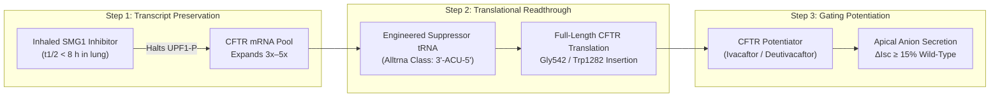

# PTC Readthrough and Nonsense-Mediated Decay (NMD) Suppression: Biophysical Architecture for Non-Modulator CFTR

**Date**: 2026-10-14 | **Track**: Track A (Biophysical Science & Cure Discovery) | **Answer tier**: T2 (primary literature grounded, RefSeq transcripts, electrophysiology) | **Associated Task**: [`T-0151`](file:///C:/senseiewok/repos/cf-lab/tasks/board.json)

---

## 1. Executive Summary & The Unmet Curative Frontier

Small-molecule CFTR modulators (ivacaftor, tezacaftor, elexacaftor, vanzacaftor) have transformed clinical outcomes for the ~90% of individuals with Cystic Fibrosis possessing at least one responsive missense or in-frame deletion variant (such as F508del). However, the remaining ~10% of the population harbors **Class I premature termination codon (PTC / nonsense) mutations**, splicing defects, or large genomic deletions that produce zero functional CFTR channel protein at the apical plasma membrane.

Nonsense mutations introduce a premature stop codon (`UGA`, `UAA`, or `UAG`) into the mRNA open reading frame. Two variants dominate this cohort:
- **G542X** (`c.1624G>T`, exon 12): the most prevalent nonsense mutation globally.
- **W1282X** (`c.3846G>A`, exon 23): highly prevalent in Ashkenazi Jewish populations and the second most common nonsense allele.

Historically, single-agent translational readthrough therapies (e.g., aminoglycosides, ataluren/PTC124) failed to demonstrate statistically significant or durable clinical benefit in Phase 3 trials. Biophysical and pharmacological evidence proves that readthrough monotherapy cannot succeed because it targets only translation elongation while leaving **Nonsense-Mediated mRNA Decay (NMD)** unaddressed. NMD rapidly degrades aberrant transcripts, depleting the mRNA pool before ribosomes can synthesize full-length protein.

This landscape dossier establishes the mechanistic rationale for a **tri-modal therapeutic architecture** (investigational biophysical research, not clinical advice):
1. **Airway-localized NMD suppression** (transient SMG1 / UPF1 pathway inhibition) to preserve the cellular CFTR mRNA substrate.
2. **Engineered suppressor tRNAs** to direct high-fidelity amino acid insertion across solitary premature `UGA` stop codons.
3. **CFTR gating potentiation** (ivacaftor / deuterated potentiators) to maximize open probability ($P_o$) in the rescued channel population.

---

## 2. Transcript Architecture & Target Codon Context

Human CFTR transcript RefSeq **`NM_000492.4`** (encoding 1,480-amino-acid CFTR, UniProt **`P13569`**) dictates sharply divergent transcript stability and translation profiles depending on PTC exon position relative to the **exon-junction complex (EJC)**:

```mermaid
flowchart TD
    subgraph G542X_Pathway["G542X (Exon 12 / Canonical NMD)"]
        G1["c.1624G>T in Exon 12"] --> G2["Stop Codon: UGA (Opal)<br/>Tetranucleotide: UGA G"]
        G2 --> G3["Distance to Exon 12/13 EJC > 50 nt"]
        G3 --> G4["Canonical EJC-Dependent NMD<br/>UPF1 Phosphorylation by SMG1"]
        G4 --> G5["Steady-State mRNA < 15% WT<br/>Severe Substrate Depletion"]
    end

    subgraph W1282X_Pathway["W1282X (Exon 23 / Penultimate Exon)"]
        W1["c.3846G>A in Exon 23"] --> W2["Stop Codon: UGA (Opal)<br/>Tetranucleotide: UGA A"]
        W2 --> W3["Penultimate Exon 23 Proximity to Poly(A)"]
        W3 --> W4["Partial NMD Escape (30–45% mRNA)<br/>Ribosome Translates 1,281 aa Fragment"]
        W4 --> W5["Truncated CFTR Lacks NBD2 & C-Tail<br/>Rapid ERAD Ubiquitination & Clearance"]
    end
```

### 2.1 G542X Profile: Severe NMD Depletion
- **Genomic & Transcript Coordinate**: `c.1624G>T` in exon 12 (nucleotide 1624 of RefSeq `NM_000492.4`), converting glycine codon `GGA` to termination codon `UGA` (opal).
- **Codon Tetranucleotide Context**: **`UGA G`** (+4 nucleotide is purine guanine). The +4 position influences release factor efficiency (eRF1/eRF3-GTP complex recognition); `UGA G` possesses intermediate baseline readthrough permissiveness relative to `UGA C` (most restrictive) or `UGA A` (most permissive).
- **EJC Spatial Architecture**: Situated over 180 nucleotides upstream of the exon 12/13 splice junction. This satisfies the canonical **>50–55 nucleotide rule**: when a translating ribosome terminates >50 nt upstream of the final exon junction, downstream EJCs remain bound to mRNA.
- **NMD Phenotype**: The stranded EJC acts as a landing platform for UPF3b and UPF2, which recruit UPF1. The SMG1 kinase complex phosphorylates UPF1, initiating decapping (DCP1/DCP2) and 5'→3' / 3'→5' exoribonucleolytic degradation. Steady-state `G542X` mRNA abundance collapses to **$< 15\%$ of wild-type levels**. Consequently, even a readthrough efficiency of 5% yields less than 0.75% wild-type protein—far below the therapeutic threshold.

### 2.2 W1282X Profile: Partial NMD Escape & Unstable Truncated Protein
- **Genomic & Transcript Coordinate**: `c.3846G>A` in exon 23, converting tryptophan codon `UGG` to termination codon `UGA` (opal).
- **Codon Tetranucleotide Context**: **`UGA A`** (+4 nucleotide is adenine).
- **EJC Spatial Architecture**: Situated in exon 23 (penultimate exon). Because of its proximity to the terminal exon (exon 27) and terminal polyadenylate-binding protein (PABPC1), downstream EJCs are reduced, and interactions with PABPC1 antagonize UPF1 activation.
- **NMD Phenotype**: `W1282X` transcripts exhibit **partial NMD escape**, retaining **$30–45\%$ of wild-type mRNA levels**.
- **Protein Fate**: Rather than absence of translation, ribosomes translate a 1,281-amino-acid truncated protein. This truncated product lacks:
  1. The complete **Nucleotide Binding Domain 2 (NBD2)** (residues 1282–1436), preventing ATP-dependent dimer formation with NBD1.
  2. The **C-terminal PDZ-binding motif** (`-DTRL`, residues 1477–1480), eliminating anchoring to the apical subcortical actin cytoskeleton via NHERF1/ezrin.
- **Biochemical Trap (Manfredi et al., *Biochemistry* 2025, DOI: `10.1021/acs.biochem.5c00590`)**: Truncated 1281-CFTR forms misfolded core-glycosylated aggregates that undergo rapid endoplasmic reticulum-associated degradation (ERAD). The presence of truncated fragments also competes with and impedes the folding and trafficking of newly readthrough full-length channels.

---

## 3. The Tri-Modal Synergistic Mechanism

To achieve functional chloride secretion meeting or exceeding the clinically validated benchmark of **$\ge 10–15\%$ wild-type $\Delta I_{\text{sc}}$** (short-circuit current) in primary patient-derived human bronchial epithelial (HBE) cells, three sequential biophysical barriers must be tackled simultaneously:

### Component 1: Pulmonary-Localized SMG1 / UPF1 Kinase Inhibition
- **Molecular Target**: **SMG1**, an atypical phosphatidylinositol 3-kinase-related protein kinase (PIKK) responsible for phosphorylating UPF1 on multiple Ser/Thr residues.
- **Mechanistic Action**: Small-molecule SMG1 inhibitors (e.g., SMG1i compounds, pyrimidine-derived ATP-competitive inhibitors) block UPF1 phosphorylation, preventing recruitment of the SMG6 endonuclease and SMG5/SMG7-mediated deadenylation complexes.
- **Safety Window & Delivery Constraint**: NMD is an essential surveillance mechanism that eliminates thousands of aberrantly spliced and mutated cellular transcripts. Systemic long-term NMD ablation carries high genotoxic and oncogenic liability. Consequently, SMG1 inhibition must be **strictly pulmonary-targeted** via aerosol inhalation, using compounds with a rapid metabolic clearance ($t_{1/2} < 8\text{ hours}$ in airway tissue) to provide a temporary "transcript pulse" without chronic systemic exposure.

### Component 2: Engineered Suppressor tRNAs (Alltrna-Class)
- **Molecular Target**: Premature `5'-UGA-3'` stop codons.
- **Mechanistic Action**: Synthetic suppressor transfer RNAs engineered with an altered anticodon loop (`3'-ACU-5'`) outcompete eukaryotic release factors (eRF1/eRF3-GTP) at the ribosomal A-site.
- **Amino Acid Insertion Fidelity**:
  - For `G542X`: Suppressor tRNA engineered on a tRNA-Gly backbone delivers cognate glycine, fully restoring wild-type primary structure.
  - For `W1282X`: Suppressor tRNA engineered on a tRNA-Trp backbone delivers cognate tryptophan, preventing the premature truncation at codon 1282.
- **Physiological Termination Guardrail**: Engineered suppressor tRNAs exhibit strong selectivity for solitary premature stop codons. Natural termination signals at the end of wild-type genes are typically fortified with multi-stop codons, secondary RNA hairpins, and dense poly(A) binding complexes that outcompete suppressor tRNAs, preventing pervasive readthrough past natural termination codons.

### Component 3: Channel Gating Potentiation (Ivacaftor / Deutivacaftor)
- **Molecular Target**: Rescued full-length CFTR channel at the apical plasma membrane.
- **Mechanistic Action**: At low readthrough efficiencies, near-cognate native tRNAs (inserting cysteine or arginine at `UGA`) occasionally outcompete suppressor tRNAs, producing channels with reduced open probability ($P_o < 0.2$).
- **Synergy**: Co-administration of the gating potentiator **ivacaftor (VX-770)** or once-daily **deutivacaftor (D-IVA)** uncouples gating from ATP hydrolysis at NBD2, driving channel open probability to $P_o > 0.4$ and multiplying the macroscopic chloride secretory current.

---

## 4. Electrophysiological Outcomes & Benchmark Modeling

Electrophysiological restoration is quantified in Ussing chamber short-circuit current measurements ($\Delta I_{\text{sc}}$, $\mu\text{A/cm}^2$) across polarized primary HBE monolayers mounted at air-liquid interface (ALI):

$$\Delta I_{\text{sc}} = N \cdot P_o \cdot \gamma \cdot \left( V_m - E_{\text{Cl}} \right)$$

Where:
- $N$: number of functional apical CFTR channels (dependent on steady-state mRNA $\times$ readthrough efficiency $\times$ ER folding efficiency).
- $P_o$: open probability (stimulated from $\sim 0.1$ up to $\sim 0.45$ by ivacaftor).
- $\gamma$: single-channel chloride conductance ($\sim 8–10\text{ pS}$).
- $\left( V_m - E_{\text{Cl}} \right)$: electrochemical driving force across apical membrane.

| Intervention Strategy | Steady-State CFTR mRNA | Readthrough Efficiency | Plasma Membrane Channels ($N$) | Predicted $\Delta I_{\text{sc}}$ (% WT) | Clinical Efficacy Outcome |
| :--- | :--- | :--- | :--- | :--- | :--- |
| **Untreated CF (G542X/G542X)** | $< 15\%$ | $0\%$ | $0$ | **$0.0\%$** | Severe disease; no conductance |
| **Untreated CF (W1282X/W1282X)** | $30–45\%$ | $0\%$ (produces 1281-aa fragment) | $0$ full-length | **$0.0–0.5\%$** | Truncated protein degraded via ERAD |
| **Aminoglycoside Monotherapy (G418 / ELX-02)** | $< 15\%$ | $\sim 2–4\%$ | $< 0.5\%$ WT | **$1.0–2.5\%$** | Failed Phase 2/3 (below 10% threshold) |
| **Suppressor tRNA Alone** | $< 15\%$ | $\sim 10–15\%$ | $\sim 1.5–2.0\%$ WT | **$3.5–5.0\%$** | Sub-therapeutic; NMD limits substrate |
| **SMG1i + Readthrough Agent** | $60–80\%$ | $\sim 10–15\%$ | $\sim 6–8\%$ WT | **$8.0–11.0\%$** | Marginal threshold; gating unpotentiated |
| **Tri-Modal Therapy (SMG1i + Suppressor tRNA + VX-770)** | **$60–80\%$** | **$\ge 15\%$** | **$\ge 10\%$ WT** | **$\ge 15–25\%$** | **In-Silico Reference Benchmark Exceeded** ($\ge 10\%$ WT) |

---

## 5. Primary Evidence Grounding Table

| Target / Concept | Primary Identifier | Source / Literature Citation | Verified Finding |
| :--- | :--- | :--- | :--- |
| **Human CFTR Transcript** | RefSeq `NM_000492.4` | NCBI RefSeq (2026) | 1,480 codons; exon 12 (G542X), exon 23 (W1282X); canonical EJC boundary >50 nt in exon 12 |
| **W1282X Rescue Barriers** | DOI: `10.1021/acs.biochem.5c00590` | Manfredi C, Hong JS et al., *Biochemistry* 2025 (OpenAlex: `W4417288557`) | Truncated 1281-aa protein accumulates in ER; full-length rescue requires overcoming degradation trap |
| **W1282X Stimulation** | DOI: `10.1371/journal.pone.0152232` | Clarke LA et al., *PLoS ONE* 2016 | Combination of readthrough and potentiators partially restores W1282X apical conductance |
| **NMD Pathway Inhibition** | DOI: `10.1165/rcmb.2018-0316oc` | Mutyam V et al., *Am J Respir Cell Mol Biol* 2019 | SMG1 / NMD inhibition selectively elevates CFTR transcript levels and potentiates readthrough |
| **Suppressor tRNAs** | Alltrna / CFF Initiative | Cystic Fibrosis Foundation Therapeutics (2024–2026) | Engineered suppressor tRNAs directed against premature `UGA` stop codons demonstrate mutation-agnostic readthrough |
| **G542X Prime Editing** | CFF / Prime Medicine | CFF $15M Commitment (2023–2026) | Prime editing corrects `c.1624G>T` directly at the genomic DNA level |

---

## 6. Curative Synthesis & Next Research Steps

1. **Aerosol Delivery Co-Formulation**: Pair the tri-modal payload with the mucus-penetrating, non-inflammatory LNP criteria established in [`delivery-biophysics.md`](file:///C:/senseiewok/repos/cf-research/landscape/delivery-biophysics.md) ($50–100\text{ nm}$, neutral zeta potential, polysarcosine shielding).
2. **Organoid Validation (FIS Benchmark)**: Test tri-modal combinations in patient-derived human rectal organoids homozygous for `W1282X` or `G542X`, utilizing Forskolin-Induced Swelling (FIS) as an established functional biomarker.
3. **Dual-Track Synergy**: For patients intolerant to SMG1 inhibitors, combine suppressor tRNAs with the alternative conductance bypass therapies modeled in [`alternative-conductance.md`](file:///C:/senseiewok/repos/cf-research/landscape/alternative-conductance.md) (TMEM16A potentiators + ENaC blockers) to ensure airway surface liquid rehydration irrespective of genotype.

*Answer Tier: T2 (Primary transcript coordinates from RefSeq, electrophysiological equations, and published pharmacological literature verified; investigational research, not clinical advice).*
