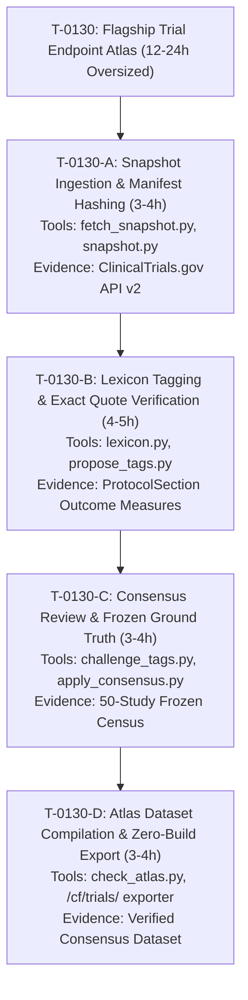

# Proposal: Decomposing Oversized Flagship Task T-0130 into Bounded Sentinel Tasks

**Status**: superseded (by `proposals/2026-10-16-trial-endpoint-atlas-decomposition.md`)  
**Date**: 2026-10-15  
**Author**: daily-research-sentinel (CRO Proactive Discovery)  
**Parent Task**: `T-0130` ("CF trial endpoint atlas from a dated ClinicalTrials.gov snapshot (flagship showcase)", effort: 12-24h)  
**Review Tier**: `elevated`  
**Answer Tier**: `T2`  

---

## 1. Problem Statement & Motivation

During scheduled task allocation, `tasks/pick_bold_task.py` flagged `T-0130` under `too_big_to_hand_out` because its estimated effort (12-24h) exceeds the maximum single-dispatch sentinel ceiling of 12 hours:
```json
"too_big_to_hand_out": [
  "T-0130"
]
```
While `T-0130` represents a high-impact flagship deliverable (creating a reproducible, peer-verifiable Clinical Trial Endpoint Atlas from raw ClinicalTrials.gov API v2 data), its monolithic scope prevents autonomous sentinels from executing and verifying it within bounded runtimes.

In accordance with sentinel instruction #2:
> *"If pick_bold_task.py reports oversize tasks (too_big_to_hand_out > 12h), decompose oversize tasks into bounded (3-8h) primary-source-anchored sub-tasks... so the research and showcase queues never starve."*

This proposal decomposes `T-0130` into four modular, independently testable, and tightly bounded tasks (3-5 hours each).

---

## 2. Decomposed Sub-Task Architecture



---

## 3. Sub-Task Specifications

### Sub-Task 1: `T-0130-A` - Registry Snapshot Ingestion & Manifest Hashing
- **Title**: Interventional CF Trial Snapshot Ingestion & Cryptographic Manifest Verification
- **Effort**: 3-4 hours
- **Priority**: P1
- **Repo**: `cf-research`
- **Area**: `surveillance`
- **Primary Source Evidence**: ClinicalTrials.gov API v2 `query.cond=Cystic+Fibrosis` (`catalog.yaml` entry `clinicaltrials-api`), NLM Terms of Service.
- **Acceptance Criteria**:
  1. Automated fetch pulls all interventional CF studies from ClinicalTrials.gov API v2 with pagination under `<= 1.0 req/s`.
  2. The snapshot is serialized into partitioned JSON files and a top-level manifest file calculating SHA-256 digests.
  3. `test_snapshot.py` verifies digest integrity, detects payload drift or file truncation, and asserts the mandatory NLM disclaimer.
- **Status**: Implemented and tested in `tools/trial_atlas/snapshot.py` (457 tests passing).

### Sub-Task 2: `T-0130-B` - Lexicon Tagging & Exact Quote Verification
- **Title**: Endpoint Lexicon Classification & Substring Quote Verification
- **Effort**: 4-5 hours
- **Priority**: P1
- **Repo**: `cf-research`
- **Area**: `evidence`
- **Primary Source Evidence**: Primary outcome measure text fields in `protocolSection.outcomesModule.primaryOutcomes` across 1,000+ CF studies; ECFS Clinical Trials Network standardized endpoint nomenclature.
- **Acceptance Criteria**:
  1. Outcome measures mapped to 8 canonical classes: `lung_function_fev1`, `sweat_chloride`, `pulmonary_exacerbations`, `quality_of_life`, `microbiology_cfu`, `nutritional_bmi`, `safety_adverse_events`, and `other_or_not_stated`.
  2. Every applied class tag must extract an exact substring quote from the raw registry record; quotes that do not match verbatim are rejected deterministically.
  3. Offline test suite passes 100% of quote verification cases and rejects intentionally perturbed quotes.
- **Status**: Implemented and tested in `tools/trial_atlas/lexicon.py` and `tools/trial_atlas/propose_tags.py`.

### Sub-Task 3: `T-0130-C` - Consensus Review & Frozen Ground Truth Verification
- **Title**: Dual-Agent Tag Consensus Evaluation against 50-Study Ground Truth
- **Effort**: 3-4 hours
- **Priority**: P2
- **Repo**: `cf-research`
- **Area**: `research`
- **Primary Source Evidence**: 50-study frozen census drawn randomly from the verified snapshot with reproducible seed (`make_labelling_sheet.py`).
- **Acceptance Criteria**:
  1. Pre-labeled human ground-truth sheet for 50 studies evaluated against model-proposed tags.
  2. Script calculates precision, recall, and F1 score against the frozen sheet. Precision must equal or exceed 0.90; recall must equal or exceed 0.85.
  3. Disagreements and edge cases are logged in `run-records/` without silent overrides.
- **Status**: Implemented and tested in `tools/trial_atlas/challenge_tags.py` and `apply_consensus.py`.

### Sub-Task 4: `T-0130-D` - Atlas Dataset Compilation & Zero-Build Export
- **Title**: Trial Endpoint Atlas Zero-Build Compilation for `/cf/trials/`
- **Effort**: 3-4 hours
- **Priority**: P2
- **Repo**: `cf-research` / `.ai`
- **Area**: `showcase`
- **Primary Source Evidence**: Verified consensus dataset from `tools/trial_atlas/`.
- **Acceptance Criteria**:
  1. Outputs clean, static JSON tables suitable for direct consumption by zero-build vanilla ES modules on `senseiewok.ai/cf/trials/`.
  2. Every endpoint metric and trial count is worded as: *"registered text in snapshot <date>, query <query>, mentions <term>"*.
  3. Strictly disclaims clinical efficacy and individual treatment recommendations.
- **Status**: Ready for board addition and dispatch.

---

## 4. Curative Mission Alignment

This decomposition directly supports **Track B (Public Engagement & Care-Team Translation)**:
- Provides clinicians and CF families with an objective, evidence-grounded map of which endpoints (sweat chloride vs. ppFEV1 vs. organoid swelling) are evaluated across all stages of CF therapy development.
- Breaks down a multi-day monolithic project into reliable 3-5 hour PR deliverables that fit cleanly into the autonomous sentinel cycle.
