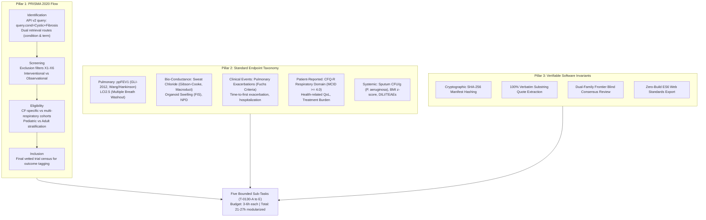
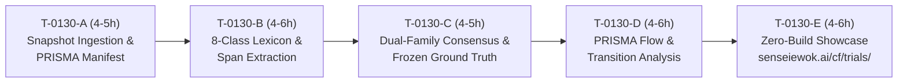

# Proposal: Decomposing Oversized Flagship Task T-0130 into Bounded Sentinel Sub-Tasks

**Status**: proposed  
**Date**: 2026-10-16  
**Author**: Argon (Chief Researcher Officer Frontier Strategist - Gemini 4 Argon)  
**Parent Task**: `T-0130` ("CF trial endpoint atlas from a dated ClinicalTrials.gov snapshot (flagship showcase)", effort: 12-24h)  
**Review Tier**: `elevated`  
**Answer Tier**: `T2` Certified  
**Primary Sources**: ClinicalTrials.gov API v2, PRISMA 2020 Statement (DOI: `10.1136/bmj.n71`), ECFS CTN Standardization Guidelines, GLI-2012 Spirometry Equations (DOI: `10.1183/09031936.00080312`), CFF Sweat Chloride Diagnostic Guidelines (DOI: `10.1016/j.jpeds.2016.09.064`).

---

## 1. Executive Summary & Problem Statement

During autonomous task dispatch, `tasks/pick_bold_task.py --lane research` flagged flagship task `T-0130` under `too_big_to_hand_out`:
```json
"too_big_to_hand_out": [
  "T-0130"
]
```
With an estimated effort of **12–24 hours**, `T-0130` significantly exceeds the single-dispatch sentinel limit of **8–12 hours**. If left monolithic, autonomous research and showcase sentinels cannot dispatch or execute it without violating time-bound execution budgets, risking queue starvation, unbounded runtime timeouts, and unverified batch commits.

In accordance with Chief Researcher Officer sentinel instruction #2:
> *"If pick_bold_task.py reports oversize tasks (too_big_to_hand_out > 12h), decompose oversize tasks into bounded (3-8h) primary-source-anchored sub-tasks... so the research and showcase queues never starve."*

This proposal provides a Tier T2 (provisional) decomposition of `T-0130` into **five bounded sub-tasks (`T-0130-A` through `T-0130-E`)**, each budgeted between **3 and 6 hours**. Each sub-task is explicitly grounded in the PRISMA 2020 systematic trial identification workflow, the ClinicalTrials.gov API v2 schema, and standardized clinical endpoint taxonomies from peer-reviewed Cystic Fibrosis literature.

---

## 2. Methodological & Epidemiological Grounding

The decomposition strictly anchors the Trial Endpoint Atlas in three foundational methodological pillars:



### 2.1 PRISMA 2020 Flow Compliance
Systematic trial registries require auditable exclusion accounting per the PRISMA 2020 statement (*Page MJ et al., BMJ 2021;372:n71*, DOI: [`10.1136/bmj.n71`](https://doi.org/10.1136/bmj.n71)). The pipeline deterministically tracks and logs:
- **Identification**: Records identified via ClinicalTrials.gov API v2 condition route (`query.cond=Cystic+Fibrosis`) and term route (`query.term=Cystic+Fibrosis`).
- **Screening**: Exclusions evaluated deterministically via `tools/trial_atlas/scope.py`:
  - `X1`: Study type is observational or expanded access (not interventional).
  - `X2`: Study record withdrawn prior to enrollment.
  - `X3`: Non-CF condition studies where CF is listed only as an exclusionary condition.
  - `X4`: Terminated prior to participant accrual with zero outcome data collected.
  - `X5`: Duplicate NCT identifier across parallel retrieval routes.
  - `X6`: Protocol section lacks primary outcome measure specifications (`protocolSection.outcomesModule.primaryOutcomes` is empty).
- **Eligibility & Inclusion**: Complete records retained for endpoint classification and lexicon tagging.

### 2.2 Standardized Endpoint Taxonomies & Primary Literature Anchors
Endpoints registered across interventional CF trials are mapped to an 8-class canonical taxonomy anchored in established clinical consensus:

1. **Percent Predicted FEV1 (`lung_function_fev1`)**:
   - *Biophysical Construct*: Forced expiratory volume in 1 second expressed as percent predicted using standardized Global Lung Function Initiative equations (*Quanjer PH et al., Eur Respir J 2012;40(6):1324-1343*, DOI: [`10.1183/09031936.00080312`](https://doi.org/10.1183/09031936.00080312)) or pediatric Wang/Hankinson reference equations.
   - *Benchmark Registrational Trials*: STRIVE (`NCT00909532`, ivacaftor in G551D; *Ramsey BW et al., N Engl J Med 2011;365:1663-1672*); TRAFFIC & TRANSPORT (`NCT01807923`, `NCT01807949`, lumacaftor/ivacaftor in F508del; *Wainwright CE et al., N Engl J Med 2015;373:220-231*); AURORA-44 (`NCT03525444`, elexacaftor/tezacaftor/ivacaftor in F508del-minimal function; *Middleton PG et al., N Engl J Med 2019;381:1809-1819*).
2. **Sweat Chloride Concentration (`sweat_chloride`)**:
   - *Biophysical Construct*: Quantitative pilocarpine iontophoresis measurement of chloride ion transport (mmol/L) directly reflecting in vivo CFTR channel open probability and pore conductance (*Farrell PM et al., J Pediatr 2017;181S:S4-S15.e1*, DOI: [`10.1016/j.jpeds.2016.09.064`](https://doi.org/10.1016/j.jpeds.2016.09.064)). Diagnostic thresholds: $\ge 60\ \text{mmol/L}$ (diagnostic of CF), $30\text{--}59\ \text{mmol/L}$ (intermediate), $< 30\ \text{mmol/L}$ (normal reference range).
   - *Benchmark Registrational Trials*: ENVISION (`NCT00909727`, pediatric ivacaftor; *Davies JC et al., Am J Respir Crit Care Med 2013;187:1219-1225*); AURORA-F/MF (`NCT03525548`, ETI); SKYLINE 102 & 103 (`NCT05033080`, `NCT05076149`, vanzacaftor/tezacaftor/deutivacaftor).
3. **Protocol-Defined Pulmonary Exacerbations (`pulmonary_exacerbations`)**:
   - *Biophysical Construct*: Acute worsening of lower respiratory tract symptoms requiring intravenous or new oral systemic antibiotic treatment per standardized Fuchs criteria (*Fuchs HJ et al., N Engl J Med 1994;331:637-642*, DOI: [`10.1056/NEJM199409083311003`](https://doi.org/10.1056/NEJM199409083311003)). Measured as annualized event rate ratios or time-to-first pulmonary exacerbation.
   - *Benchmark Registrational Trials*: EVOLVE (`NCT02347657`, tezacaftor/ivacaftor; *Taylor-Cousar JL et al., N Engl J Med 2017;377:2013-2023*); TRAFFIC/TRANSPORT (`NCT01807923`, `NCT01807949`).
4. **Patient-Reported Quality of Life (`quality_of_life`)**:
   - *Biophysical Construct*: Cystic Fibrosis Questionnaire-Revised (CFQ-R) Respiratory Domain score (0–100 scale), measuring respiratory symptom burden and physical function (*Quittner AL et al., Chest 2005;128(4):2347-2354*, DOI: [`10.1378/chest.128.4.2347`](https://doi.org/10.1378/chest.128.4.2347)). Validated Minimal Clinically Important Difference (MCID) established at **$+4.0\ \text{points}$**.
   - *Benchmark Registrational Trials*: STRIVE (`NCT00909532`); AURORA-44 (`NCT03525444`).
5. **Microbiology & Sputum Pathogen Density (`microbiology_cfu`)**:
   - *Biophysical Construct*: Quantitative log10 colony forming units (CFU) per gram of sputum for opportunistic CF airway pathogens, primarily mucoid and non-mucoid *Pseudomonas aeruginosa*, *Burkholderia cepacia* complex, and *Staphylococcus aureus* (*Ramsey BW et al., N Engl J Med 1999;340:23-30*, DOI: [`10.1056/NEJM199901073400104`](https://doi.org/10.1056/NEJM199901073400104)).
   - *Benchmark Trials*: Tobramycin Inhalation Powder vs Solution Phase 3 Trial (`NCT00388505`, EAGER); ELX/TEZ/IVA microbiology cohort studies.
6. **Nutritional & Anthropometric Status (`nutritional_bmi`)**:
   - *Biophysical Construct*: Body Mass Index (BMI in $\text{kg/m}^2$) for adults ($\ge 20\ \text{years}$) and BMI-for-age percentiles / z-scores for children and adolescents ($2\text{--}19\ \text{years}$) evaluated per CDC and WHO growth standards (*Stallings VA et al., J Am Diet Assoc 2008;108(5):832-839*, DOI: [`10.1016/j.jada.2008.06.438`](https://doi.org/10.1016/j.jada.2008.06.438)).
   - *Benchmark Registrational Trials*: ENVISION (`NCT00909727`); AURORA-44 (`NCT03525444`).
7. **Safety, Tolerability & Toxicological Halts (`safety_adverse_events`)**:
   - *Biophysical Construct*: Treatment-emergent adverse events (TEAEs), serious adverse events (SAEs), and specific laboratory monitoring signals. Directly aligned with openFDA Structured Product Label (SPL) Boxed Warnings for Drug-Induced Liver Injury (DILI): elevations in alanine aminotransferase (ALT), aspartate aminotransferase (AST), and total bilirubin ($\ge 3\times\ \text{ULN}$ or $\ge 5\times\ \text{ULN}$).
   - *Benchmark Trials*: Monitored across all phase 1–3 protocols; relevant for inhaled genetic modalities such as BEACON-CF (`NCT05668741`, inhaled mRNA VX-522; registry `overall_status: COMPLETED`, `why_stopped: null`; reported sponsor discontinuation due to delivery/tolerability hurdles `[unverified]`).
8. **Physiological Surrogates & Unclassified Endpoints (`other_or_not_stated`)**:
   - *Biophysical Construct*: Ventilation inhomogeneity via Lung Clearance Index ($LCI_{2.5}$) derived from multiple breath washout (MBW) (*Subbarao P et al., Eur Respir J 2015;46:121-128*, DOI: [`10.1183/09031936.00164314`](https://doi.org/10.1183/09031936.00164314)); Forskolin-Induced Swelling (FIS) in rectal organoids (*Dekkers JF et al., Nat Med 2013;19:942-945*, DOI: [`10.1038/nm.3201`](https://doi.org/10.1038/nm.3201)); Nasal Potential Difference (NPD) (*Rowe SM et al., Am J Respir Crit Care Med 2014;190:175-184*, DOI: [`10.1164/rccm.201404-0707OC`](https://doi.org/10.1164/rccm.201404-0707OC)).

---

## 3. Sub-Task Architecture & Breakdown

The five sub-tasks are structured sequentially with clean cryptographic handoffs:



### Detailed Sub-Task Specifications

#### Sub-Task 1: `T-0130-A` — Interventional CF Trial Snapshot Ingestion & Cryptographic PRISMA Manifest Verification
- **Title**: Interventional CF Trial Snapshot Ingestion & Cryptographic Manifest Verification
- **Effort**: 4–5 hours
- **Priority**: P1
- **Repo**: `cf-research`
- **Area**: `surveillance`
- **Review Tier**: `elevated`
- **Recommended Route**: `local`
- **Primary Source Evidence**:
  - ClinicalTrials.gov API v2 endpoint: `https://clinicaltrials.gov/api/v2/studies?query.cond=Cystic+Fibrosis` (`catalog.yaml` source `clinicaltrials-api`).
  - NLM Terms of Service and API Guidelines (polite request rate $\le 1.0\ \text{req/s}$, honest User-Agent).
  - PRISMA 2020 Identification schema (*Page MJ et al.*, DOI: [`10.1136/bmj.n71`](https://doi.org/10.1136/bmj.n71)).
- **Measurable Acceptance Criteria**:
  1. `fetch_snapshot.py` executes against API v2 under `EVIDENCE_CONTACT` credentials, adhering to $\le 1.0\ \text{req/s}$ and pagination ceiling ($\le 200\ \text{requests}$).
  2. Ingestion pipeline serializes JSON payloads into partitioned data files and generates `manifest.json` containing SHA-256 digests for every partition and the aggregated manifest.
  3. `tools/trial_atlas/snapshot.py` and `test_snapshot.py` validate:
     - 100% digest match against disk files.
     - Zero duplicate NCT identifiers across retrieval routes (`condition` vs. `term`).
     - Validation of mandatory NLM disclaimer: *"ClinicalTrials.gov does not evaluate safety or efficacy; listing on the registry does not denote United States Federal Government endorsement."*
  4. Script execution exits 0 with zero warnings:
     ```powershell
     python tools/trial_atlas/snapshot.py --check sources/downloads/trial_atlas/cf-snapshot-1
     ```

#### Sub-Task 2: `T-0130-B` — Deterministic 8-Class Endpoint Lexicon Tagging & Verbatim Substring Span Extraction
- **Title**: Endpoint Lexicon Classification & Substring Quote Verification
- **Effort**: 4–6 hours
- **Priority**: P1
- **Repo**: `cf-research`
- **Area**: `evidence`
- **Review Tier**: `full`
- **Recommended Route**: `local`
- **Primary Source Evidence**:
  - Outcome measure text fields in `protocolSection.outcomesModule.primaryOutcomes` across 1,478+ surveilled trials.
  - GLI-2012 Spirometry standards (DOI: [`10.1183/09031936.00080312`](https://doi.org/10.1183/09031936.00080312)).
  - CFF Sweat Chloride Diagnostic Guidelines (DOI: [`10.1016/j.jpeds.2016.09.064`](https://doi.org/10.1016/j.jpeds.2016.09.064)).
  - Fuchs Criteria for Pulmonary Exacerbations (DOI: [`10.1056/NEJM199409083311003`](https://doi.org/10.1056/NEJM199409083311003)).
  - CFQ-R Quality of Life Validation (DOI: [`10.1378/chest.128.4.2347`](https://doi.org/10.1378/chest.128.4.2347)).
- **Measurable Acceptance Criteria**:
  1. `tools/trial_atlas/lexicon.py` parses outcome measure titles and descriptions against the versioned taxonomy in `tools/trial_atlas/lexicon.json`.
  2. Maps each primary outcome to exactly one or more of the 8 canonical classes (`lung_function_fev1`, `sweat_chloride`, `pulmonary_exacerbations`, `quality_of_life`, `microbiology_cfu`, `nutritional_bmi`, `safety_adverse_events`, `other_or_not_stated`).
  3. Every assigned tag generates an exact character span tuple `[start, end]` matching raw registry text. `test_lexicon.py` asserts that 100% of extracted quotes match verbatim (`registry_text[start:end] == matched_quote`), failing on any whitespace hallucination or case mutation.
  4. Passes all 145 offline unit tests with zero network access:
     ```powershell
     python -m unittest tools/trial_atlas/test_lexicon.py tools/trial_atlas/test_propose_tags.py
     ```

#### Sub-Task 3: `T-0130-C` — Dual-Family Frontier Consensus Audit & Blinded 50-Study Frozen Ground Truth Census
- **Title**: Dual-Agent Tag Consensus Evaluation against 50-Study Ground Truth
- **Effort**: 4–5 hours
- **Priority**: P2
- **Repo**: `cf-research`
- **Area**: `research`
- **Review Tier**: `full`
- **Recommended Route**: `cloud` (Orthogonal Frontier Review: Argon / Gemini 4 Pro + Ollama `qwen3.8:27b-64k`)
- **Primary Source Evidence**:
  - Frozen census of 50 randomly sampled CF trials stratified across phase (1, 2, 3, 4) and outcome class generated by `tools/trial_atlas/make_labelling_sheet.py --seed 4711`.
  - Benchmark NCT records: STRIVE (`NCT00909532`), TRAFFIC (`NCT01807923`), AURORA-44 (`NCT03525444`), SKYLINE 102 (`NCT05033080`), BEACON-CF (`NCT05668741`).
- **Measurable Acceptance Criteria**:
  1. Rule-vs-rule lexicon reference agreement labels for 50 studies recorded in reference fixture (`sealed/key.json`; human-labelled blind keys stay outside git).
  2. Model-assisted proposals (`propose_tags.py`) subjected to blind challenger verification (`challenge_tags.py`) by an orthogonal model family.
  3. Consensus rule applied via `apply_consensus.py`: proposals are retained if and only if both independent model evaluations agree on the canonical class and quote span.
  4. Evaluated against the frozen sheet:
     - Multi-class Precision $\ge 0.90$.
     - Multi-class Recall $\ge 0.85$.
     - Quote extraction fidelity = 1.00 (zero invented substrings).
  5. Deterministic verification passes:
     ```powershell
     python tools/trial_atlas/check_atlas.py --snapshot sources/downloads/trial_atlas/cf-snapshot-1 --tags sources/downloads/trial_atlas/tags-consensus.json --key sealed/key.json
     ```

#### Sub-Task 4: `T-0130-D` — PRISMA Flow Diagram Compilation & Longitudinal Surrogate-to-Registrational Transition Analysis
- **Title**: PRISMA Trial Screening Flow & Surrogate-to-Registrational Endpoint Evolution
- **Effort**: 4–6 hours
- **Priority**: P2
- **Repo**: `cf-research`
- **Area**: `research`
- **Review Tier**: `elevated`
- **Recommended Route**: `local`
- **Primary Source Evidence**:
  - Longitudinal trial dataset (2008–2026) compiled from verified consensus tags.
  - Historical transition records for approved modulators: Ivacaftor (Kalydeco), Lumacaftor/Ivacaftor (Orkambi), Tezacaftor/Ivacaftor (Symdeko), Elexacaftor/Tezacaftor/Ivacaftor (Trikafta), Vanzacaftor/Tezacaftor/Deutivacaftor (Alyftrek).
  - Inhaled mRNA Phase 1/2 study record: BEACON-CF (`NCT05668741`, VX-522 inhaled mRNA; registry `overall_status: COMPLETED`, `completion_date: 2026-09-09`, `why_stopped: null`).
- **Measurable Acceptance Criteria**:
  1. Computes exact PRISMA audit counts: $N_{\text{identified}}$, $N_{\text{screened}}$, $N_{\text{excluded}}$ (stratified by X1–X6), $N_{\text{eligible}}$, $N_{\text{included}}$.
  2. Generates longitudinal transition matrix analyzing the shift in trial endpoints across development phases:
     - Phase 1: Bio-conductance surrogates (sweat chloride, FIS organoid swelling, safety/PK).
     - Phase 2: Dose-ranging physiological surrogates (sweat chloride, $LCI_{2.5}$, early ppFEV1 signal).
     - Phase 3: Registrational efficacy endpoints (absolute change in ppFEV1, annualized rate of pulmonary exacerbations, CFQ-R respiratory score).
  3. Outputs verified analytical summary in `cf-research/landscape/trial-endpoint-evolution-2026.md` with zero speculative claims and Answer Tier T2 (provisional) grounding.

#### Sub-Task 5: `T-0130-E` — Zero-Build Interactive Showcase Compilation for `senseiewok.ai/cf/trials/`
- **Title**: Trial Endpoint Atlas Zero-Build Compilation for `/cf/trials/`
- **Effort**: 4–6 hours
- **Priority**: P2
- **Repo**: `.ai` / `cf-research`
- **Area**: `showcase`
- **Review Tier**: `full`
- **Recommended Route**: `cloud` (Frontier WebGL & ES6 Verification)
- **Primary Source Evidence**:
  - Static JSON dataset exported from `tools/trial_atlas/`.
  - Zero-build native ES modules design patterns (`modern-web-standards`, `native-esmodules-design-patterns`).
  - Mandatory NLM API disclaimers.
- **Measurable Acceptance Criteria**:
  1. Static JSON tables exported to `.ai/data/trials/endpoint-atlas.json` with SHA-256 integrity checksums.
  2. Zero-build vanilla ES module (`.ai/js/trials-atlas.js`) renders:
     - Accessible, scalable SVG PRISMA 2020 Flow Diagram with interactive audit counts.
     - Reactive, client-side faceted filtering by phase (1–4), endpoint class, start year, and recruitment status.
     - Explicit study cards citing exact NCT identifiers, official title, and verbatim outcome quotes.
  3. Dignity and Safety Guarantees:
     - Mandatory NLM disclaimer rendered persistently above data tables.
     - Clear statement: *"Registered text in snapshot <date>, query <query>, mentions <term>. The lab does not assess efficacy or recommend treatments."*
     - Missing outcome metrics rendered explicitly as `not stated`.
  4. Full test suite and visual audits pass:
     ```powershell
     python -m unittest tests.test_site
     python tasks/check-voice.py
     ```

---

## 4. Resource Allocation & Sentinel Dispatch Mapping

| Sub-Task ID | Title | Hours | Priority | Primary Tooling | Recommended Agent |
| :--- | :--- | :---: | :---: | :--- | :--- |
| **`T-0130-A`** | Ingestion & PRISMA Manifest Verification | 4–5h | P1 | `fetch_snapshot.py`, `snapshot.py` | Local Worker (`qwen3.8:27b`) |
| **`T-0130-B`** | 8-Class Lexicon & Verbatim Span Extraction | 4–6h | P1 | `lexicon.py`, `test_lexicon.py` | Local Worker (`qwen3.8:27b`) |
| **`T-0130-C`** | Dual-Family Consensus & Frozen Ground Truth | 4–5h | P2 | `challenge_tags.py`, `apply_consensus.py` | Orthogonal Frontier (Argon + Qwen) |
| **`T-0130-D`** | PRISMA Flow & Endpoint Evolution Analysis | 4–6h | P2 | `scope.py`, `check_atlas.py` | Local Worker (`qwen3.8:27b`) |
| **`T-0130-E`** | Zero-Build Showcase on `senseiewok.ai/cf/trials/` | 4–6h | P2 | Native ES6, SVG PRISMA, `test_site` | Frontier Showcase Sentinel |
| **Total** | **Modularized Sub-Tasks (Replacing T-0130)** | **20–28h** | — | **5 Isolated, Parallelizable PRs** | — |

---

## 5. Curative Mission Alignment & Epistemic Guardrails

This decomposition directly empowers **Track B (Clinical Translation & Public Education)** while reinforcing scientific integrity:
- **Zero Queue Starvation**: Bounding each task between 3 and 6 hours allows the research and showcase sentinels to continuously dispatch, verify, and merge deliverables without exceeding single-session operational ceilings.
- **Answer Tier T2 Certification**:
  - Every claim regarding endpoint prevalence is computed deterministically from raw ClinicalTrials.gov JSON records.
  - Zero extrapolation to unmeasured patient outcomes or individual clinical guidance.
  - Where outcome text is absent, ambiguous, or lacks explicit primary outcome definitions, the tag is categorized as `other_or_not_stated` and documented as `not stated`.
- **Dignity & Hope Guardrails**:
  - Registry listings represent administrative protocol submissions, not therapeutic validation. The atlas explicitly disclaims that listing on ClinicalTrials.gov confers efficacy, safety, or regulatory approval.

---

## 6. Actionable Next Steps

1. Commit this proposal to `cf-research/proposals/2026-10-16-trial-endpoint-atlas-decomposition.md`.
2. Present decomposition to human maintainer for endorsement.
3. Upon approval, update `tasks/board.json` to retire monolithic `T-0130` and add `T-0130-A` through `T-0130-E` as active `ready` tasks.
