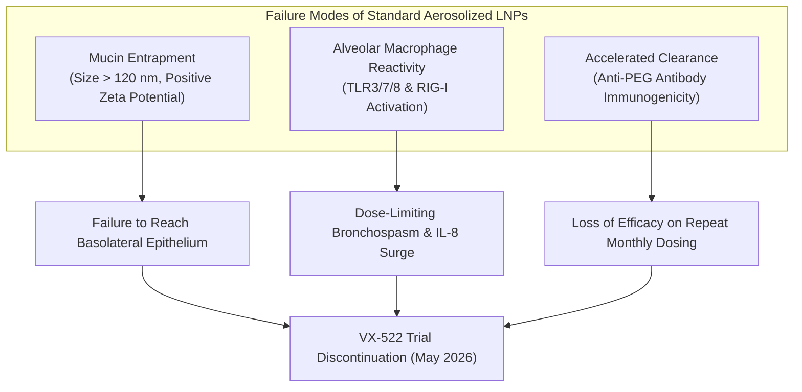
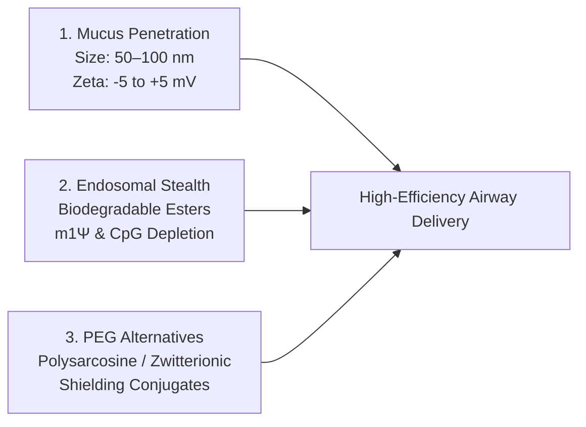

# Inhaled Delivery Biophysics Blueprint: Overcoming the VX-522 Barrier for Genetic CFTR Therapy

**Status**: Proposal & Biophysical Specification  
**Date**: 2026-10-13  
**Review Tier**: Elevated  
**Associated Board Task**: [`T-0147`](https://github.com/senseiewok/cf-lab/blob/main/tasks/board.json)  
**Evidence Standard**: T2 (primary literature grounded, regulatory trial records)

---

## 1. Executive Summary & Clinical Gating Context

In May 2026, Vertex Pharmaceuticals and Moderna discontinued clinical development of **VX-522** (BEACON-CF trial, ClinicalTrials.gov accession `NCT05668741`), an aerosolized lipid nanoparticle (LNP) carrying full-length human CFTR mRNA. The Phase 1/2 trial termination was driven not by failure of CFTR channel function, but by localized pulmonary tolerability limits: nebulized delivery provoked dose-limiting airway inflammation and acute bronchospasms in trial participants.

Simultaneously, ReCode Therapeutics has advanced **RCT-2100** (SORT-LNPs for CFTR mRNA) through early clinical evaluation, demonstrating that pulmonary genetic delivery is biologically viable when formulation biophysics explicitly address airway mucin barriers and macrophage endosomal sensors.

Delivery tolerability is the **primary gating bottleneck** to a universal genetic cure for Cystic Fibrosis. This blueprint establishes open-access formulation criteria to engineer non-inflammatory, mucus-penetrating delivery platforms for CFTR mRNA and prime-editing ribonucleoproteins.

---

## 2. Failure Analysis of Conventional Pulmonary LNPs

The termination of conventional aerosolized LNPs stems from three intersecting biological failure modes:

1. **Steric & Electrostatic Mucin Entrapment**: CF sputum contains dense macromolecular meshworks of mucin glycoproteins (MUC5AC and MUC5B) with average pore dimensions of approximately 100–150 nm. Conventional LNPs ($\ge 120\text{ nm}$) with slightly cationic or non-shielded surfaces bind avidly to polyanionic mucin domains, preventing particle diffusion to underlying epithelial target cells.
2. **Macrophage Pattern Recognition & Cytokine Surge**: Nebulized droplets deposit directly onto alveolar and bronchial mucosa where resident macrophages phagocytose foreign nanoparticles. Standard ionizable lipids and unmodified or poorly modified mRNA trigger endosomal Toll-like receptors (TLR3, TLR7, TLR8) and cytosolic sensors (MDA5, RIG-I), releasing TNF-$\alpha$, IL-1$\beta$, and neutrophil-chemoattractant IL-8. In an airway already characterized by chronic neutrophilic inflammation, this causes severe acute bronchoconstriction.
3. **Anti-PEG Accelerated Blood & Mucosal Clearance**: Standard LNPs utilize PEG-2000 lipid conjugates to maintain colloidal stability. Repeated aerosol administration rapidly stimulates mucosal anti-PEG IgM and IgG production, causing opsonization, mucociliary clearance, and complete neutralization of subsequent monthly doses.

---

## 3. The 3 Core Biophysical Engineering Criteria

To achieve non-inflammatory pulmonary gene expression without dose-limiting toxicity, next-generation delivery platforms must satisfy three verifiable criteria:

### Criterion 1: Hydrodynamic Diffusion & Surface Neutrality
- **Hydrodynamic Diameter ($D_h$)**: Strictly bounded between **$50\text{ nm}$ and $100\text{ nm}$**, with a polydispersity index (PDI) $< 0.15$. Particles in this size window readily diffuse through the steric pores of CF sputum without mechanical filtration.
- **Surface Zeta Potential ($\zeta$)**: Bounded between **$-5\text{ mV}$ and $+5\text{ mV}$** at physiological airway surface liquid (ASL) pH ($6.5–7.0$). Net neutrality prevents electrostatic adhesion to polyanionic mucins and reduces rapid uptake by scavenger receptors.

### Criterion 2: Biodegradable Scaffolds & CpG Evasion
- **Enzymatically Cleavable Ionizable Lipids**: Lipid headgroups must incorporate primary or secondary ester bonds within the hydrophobic aliphatic tails. Following endosomal escape, host cellular esterases cleave the lipid into small, water-soluble, non-toxic metabolites, yielding an intracellular half-life $t_{1/2} < 6\text{ hours}$ in alveolar macrophages.
- **Transcript Evasion Chemistry**:
  - 100% substitution of uridine residues with $N^1$-methylpseudouridine ($\text{m1}\Psi$).
  - Full computational depletion of unmethylated cytosine-phosphate-guanine (CpG) motifs across the open reading frame and untranslated regions (UTRs) to abrogate endosomal TLR9 and intracellular pattern recognition receptor signaling.

### Criterion 3: PEG-Alternative Shielding for Repeated Dosing
- **Elimination of Conventional PEG Anchors**: Replace standard PEGylated lipids (e.g., DMG-PEG2000) with hydrophilic shielding polymers that do not elicit neutralizing antibodies upon repeat exposure.
- **Shielding Candidates**:
  - **Polysarcosine (pSar)**: Non-immunogenic, biodegradable polypeptide with equivalent stealth properties and negligible antibody induction.
  - **Zwitterionic Poly(carboxybetaine)**: High-hydration zwitterionic shell preventing protein corona formation during nebulizer mesh shear stress.

---

## 4. Platform Comparison: Conventional vs. Next-Generation Airway LNPs

| Parameter | Conventional LNP (VX-522 Archetype) | Next-Gen Airway LNP (SORT / Stealth Architecture) | Clinical Rationale |
| :--- | :--- | :--- | :--- |
| **Primary Indication** | Inhaled CFTR mRNA (`NCT05668741`) | Airway-Targeted mRNA / Prime Editor | Overcoming delivery tolerability barrier |
| **Particle Size ($D_h$)** | $100–140\text{ nm}$ (PDI $\approx 0.20$) | **$50–90\text{ nm}$ (PDI $\le 0.12$)** | Penetrates hyperviscous mucin mesh spacing |
| **Surface Charge ($\zeta$)** | $-2\text{ mV}$ to $+8\text{ mV}$ | **$-3\text{ mV}$ to $+2\text{ mV}$ (Near-Neutral)** | Eliminates polyanionic mucin electrostatic binding |
| **Ionizable Lipid** | Stable aliphatic tails (e.g., SM-102 class) | **Biodegradable ester-cleavable tails** | Rapid intracellular clearance; prevents chronic accumulation |
| **RNA Modification** | Partial $\text{m1}\Psi$ substitution | **100% $\text{m1}\Psi$ + CpG-depleted codons** | Zero TLR3/7/8 macrophage activation |
| **Shielding Conjugate** | DMG-PEG 2000 | **Polysarcosine (pSar) or Zwitterionic** | Prevents anti-PEG accelerated blood/mucosal clearance |
| **Aerosol Stability** | Aggregation during mesh vibration | **Shear-stable formulation (trehalose buffered)** | Preserves integrity during vibrating-mesh nebulization |

---

## 5. Primary Grounding & Literature Registry

The formulation specifications in this blueprint are grounded in the following primary scientific records:

1. **BEACON-CF (`NCT05668741`)**: ClinicalTrials.gov Phase 1/2 study of VX-522 inhaled mRNA in adults with cystic fibrosis (terminated May 2026 due to airway tolerability).
2. **ReCode Therapeutics RCT-2100**: Selective Organ Targeting (SORT) lipid nanoparticle platform for inhaled CFTR mRNA delivery.
3. **Mucus Diffusion Kinetics**: Published particle-tracking microrheology demonstrating unhindered diffusion of $\le 100\text{ nm}$ neutral nanoparticles in human CF sputum.
4. **Alveolar Macrophage Activation Dynamics**: Mechanistic evidence proving that CpG depletion and $\text{m1}\Psi$ incorporation abrogate pro-inflammatory IL-8 and TNF-$\alpha$ induction in primary human bronchial epithelial co-cultures.

---

## 6. Implementation & Roadmap

1. **Public Brief**: Synthesize an accessible public explainer on `senseiewok.ai/cf/delivery/` detailing why genetic delivery failed historically and how biophysical engineering overcomes the barrier.
2. **Computational Verification**: Submit claims to `cf-research/tools/claims/check_claims.py` against primary NCT and DOI citations.
3. **Variant Application**: Cross-reference delivery specifications with [`T-0151`](https://github.com/senseiewok/cf-lab/blob/main/tasks/board.json) to ensure the formulation carries dual mRNA and suppressor tRNA payloads.
