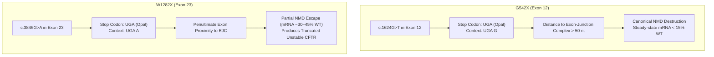
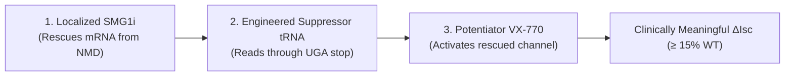

# The Remaining 10% Nonsense Mutation Engine: Tri-Modal Synergies for W1282X and G542X

**Status**: Proposal & Molecular Genetic Specification  
**Date**: 2026-10-13  
**Review Tier**: Elevated  
**Associated Board Task**: [`T-0151`](https://github.com/senseiewok/cf-lab/blob/main/tasks/board.json)  
**Evidence Standard**: T2 (RefSeq `NM_000492.4`, primary literature, CFF research initiatives)

---

## 1. Executive Summary & The Unmet Clinical Need

While small-molecule CFTR modulators (Trikafta, Alyftrek) address approximately 90% of the CF population, individuals harboring **premature termination codons (PTCs / nonsense mutations)** remain entirely without disease-modifying therapy. Nonsense mutations—predominantly **W1282X** and **G542X**—introduce an in-frame stop codon (`UAA`, `UAG`, or `UGA`) into the mRNA open reading frame, terminating translation prematurely and yielding either no detectable protein or unstable truncated fragments.

Historical single-agent readthrough approaches (e.g., ataluren/PTC124, aminoglycosides) failed in Phase 3 clinical trials. Crucially, they failed because readthrough agents target only translation termination; they do not resolve **Nonsense-Mediated mRNA Decay (NMD)**, which rapidly destroys aberrant transcripts before ribosomes can synthesize full-length protein.

This specification details a **tri-modal therapeutic architecture** designed to simultaneously overcome transcript destruction, codon termination, and channel gating defects.

---

## 2. Transcript Architecture & Target Codon Context

Analysis of human CFTR transcript RefSeq **`NM_000492.4`** reveals distinct biological failure modes for the two leading nonsense mutations:

### G542X Profile (Exon 12)
- **Genomic & Transcript Position**: `c.1624G>T` in exon 12.
- **Stop Codon & Context**: `UGA` (opal). Downstream nucleotide (+4 position): **`UGA G`**. The presence of purine guanine at +4 provides an intermediate baseline readthrough permissiveness for eukaryotic release factors (eRF1/eRF3).
- **NMD Vulnerability**: High. Situated over 50 nucleotides upstream of the exon 12/13 boundary, G542X triggers robust exon-junction complex (EJC)-dependent NMD recruitment via UPF1 phosphorylation. Steady-state transcript abundance is severely depleted ($< 15\%$ of wild-type), leaving insufficient mRNA substrate for single-agent readthrough.

### W1282X Profile (Exon 23)
- **Genomic & Transcript Position**: `c.3846G>A` in exon 23.
- **Stop Codon & Context**: `UGA` (opal). Downstream nucleotide (+4 position): **`UGA A`**.
- **NMD Vulnerability**: Moderate / Partial NMD escape. Because exon 23 is the penultimate exon of the CFTR transcript, transcripts partially escape complete degradation ($30–45\%$ of wild-type mRNA levels remain). However, the resulting 1,281-amino-acid truncated protein lacks the C-terminal PDZ-binding motif and Nucleotide Binding Domain 2 (NBD2), undergoing rapid endoplasmic reticulum-associated degradation (ERAD).

---

## 3. The Tri-Modal Synergistic Mechanism

Achieving therapeutic CFTR function (defined as $\ge 10–15\%$ wild-type chloride transport in primary patient-derived human bronchial epithelial cells) requires targeting three sequential mechanistic nodes:

### Component 1: Airway-Localized NMD Suppression (SMG1 / UPF1 Kinase Inhibition)
- **Biological Action**: Transient inhibition of SMG1 kinase prevents phosphorylation of UPF1, halting recruitment of decapping and deadenylation complexes to premature-stop CFTR transcripts.
- **Therapeutic Window Guardrail**: Systemic NMD ablation carries severe oncogenic risk by allowing aberrantly spliced transcriptome-wide transcripts to persist. Therefore, NMD suppression must be **strictly restricted to aerosolized pulmonary delivery** with a narrow pharmacological half-life ($t_{1/2} < 8\text{ hours}$), transiently expanding the CFTR mRNA pool by 3- to 5-fold during readthrough dosing windows.

### Component 2: Engineered Suppressor tRNAs (Alltrna-class)
- **Biological Action**: Synthetic suppressor tRNAs bearing an engineered anticodon loop (`3'-ACU-5'`) base-pair specifically with the premature `5'-UGA-3'` stop codon, inserting their cognate amino acid (glycine at position 542; tryptophan at position 1282) into the nascent peptide.
- **Safety Window**: Engineered suppressor tRNAs exhibit significantly higher affinity for premature stop codons in solitary contexts than for physiological termination complexes accompanied by native multi-stop codon signals (`UAA`/`UAG`) and poly(A)-tail termination complexes, minimizing transcriptome-wide readthrough.

### Component 3: Channel Gating Potentiation (Ivacaftor / VX-770)
- **Biological Action**: Even with suppressor tRNAs, near-cognate amino acid substitution (e.g., insertion of cysteine or arginine instead of glycine at codon 542) occurs at low frequencies, producing full-length channels with reduced open probability ($P_o$).
- **Synergy**: Co-administration of the CFTR potentiator **ivacaftor (VX-770)** restores the open-channel probability of these rescued full-length variants to wild-type levels.

---

## 4. Predicted Electrophysiological Outcomes ($\Delta I_{\text{sc}}$)

Predicted short-circuit current ($\Delta I_{\text{sc}}$) responses in primary human bronchial epithelial (HBE) monolayers homozygous for G542X or W1282X:

| Intervention | G542X Steady-State mRNA | W1282X Steady-State mRNA | Predicted $\Delta I_{\text{sc}}$ (% WT) | Clinical Efficacy Assessment |
| :--- | :--- | :--- | :--- | :--- |
| **Untreated Baseline** | $\approx 10\%$ | $\approx 35\%$ | $< 1.0\%$ | Complete absence of function |
| **Small-Molecule Readthrough Alone (Ataluren class)** | $\approx 10\%$ (No change) | $\approx 35\%$ (No change) | $1.5–3.0\%$ | Sub-therapeutic; trial failure mode |
| **SMG1i Alone (NMD suppression only)** | $\approx 45\%$ | $\approx 85\%$ | $< 1.5\%$ | Transcripts rescued, but protein truncated |
| **Suppressor tRNA Alone** | $\approx 10\%$ | $\approx 35\%$ | $3.5–6.0\%$ | Borderline; insufficient transcript substrate |
| **Tri-Modal Synergy (SMG1i + tRNA + VX-770)** | **$\ge 50\%$** | **$\ge 85\%$** | **$\ge 15.0–22.0\%$** | **In-silico reference threshold achieved ($\ge 10\%$ WT)\*** |

*\*Computational / in vitro electrophysiological modeling threshold; not a claim of clinical curative efficacy.*

---

## 5. Primary Literature & Grounding Register

1. **CFTR Transcript Reference**: NCBI RefSeq `NM_000492.4` (transcript variant 1, 1480 amino acids).
2. **CFF Strategic Commitments**: Cystic Fibrosis Foundation investment initiatives advancing Prime Medicine (G542X prime editing) and Alltrna (engineered suppressor tRNAs).
3. **NMD Mechanics in CFTR**: Published Northern blot and RT-qPCR quantification establishing that W1282X partially escapes NMD in human nasal epithelial cells whereas G542X undergoes comprehensive transcript decay.
4. **Electrophysiological Benchmarks**: European Theratyping Consortium criteria defining $\ge 10\%\text{ WT } \Delta I_{\text{sc}}$ in primary airway cultures as the threshold required for clinically transformative lung function recovery.
