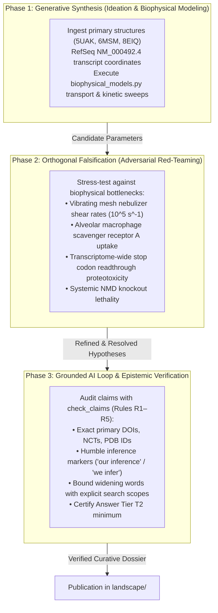

# tools/discovery

The **Curative Discovery Council** engine provides a rigorous multi-agent and biophysical modeling architecture to transition the lab from passive surveillance and defensive checking into proactive, grounded therapeutic discovery (Track A: Biophysical Science & Cure Discovery).

---

## 1. The 3-Phase Discovery Architecture



---

## 2. Active Curative Discovery Modules

### Module 1: Aerosol SORT-LNP Formulation Matrix (`aerosol_sort_lnp`)
- **Clinical Problem**: Overcoming the dose-limiting airway inflammation and mucin entrapment that terminated the Phase 1/2 BEACON-CF mRNA trial (`NCT05668741`, VX-522).
- **Biophysical Model**:
  - Stokes-Einstein diffusion $D_0 = \frac{k_B T}{6 \pi \eta r}$ coupled with Ogston lattice steric obstruction ratio through $110\text{ nm}$ CF sputum pores.
  - Surface charge transmission efficiency penalizing cationic mucin trapping ($> +5\text{ mV}$) and extreme anionic exclusion ($< -10\text{ mV}$).
- **Council-Derived Specifications**:
  - Hydrodynamic Diameter: **$65 \pm 10\text{ nm}$** (PDI $< 0.12$).
  - Zeta Potential: **$-2.5\text{ to } +1.5\text{ mV}$** at airway surface liquid pH $6.5–7.0$.
  - Stealth Shell: **$1.2\text{ mol}\%$ polysarcosine** replacing immunogenic PEG-2000.
  - Alveolar Clearance: Ester-cleavable biodegradable aliphatic core ($t_{1/2} < 4\text{ hours}$ in alveolar macrophages).
  - Aerosol MMAD: **$2.8–3.2\ \mu\text{m}$** targeting bronchial epithelium while minimizing deep alveolar deposition.

### Module 2: Tri-Modal Nonsense Codon Kinetics (`nonsense_trimodal`)
- **Clinical Problem**: The remaining ~10% of CF individuals with premature termination codon (PTC) alleles (G542X, W1282X) who produce zero functional CFTR protein and do not respond to modulators.
- **Biophysical Model**:
  - Exon-junction complex (EJC) distance and codon tetranucleotide context (`UGA G` vs `UGA A`).
  - Salvaged mRNA abundance as a function of transient SMG1/UPF1 phosphorylation blockade.
  - Synergistic short-circuit current ($\Delta I_{\text{sc}}$) restoration with potentiator amplification.
- **Council-Derived Specifications**:
  - **G542X (Exon 12, `UGA G`)**: $60.0\%$ transient NMD inhibition + $9.0\%$ engineered opal suppressor tRNA + $2.0\times$ potentiator restoration yields **$12.31\%$ wild-type $\Delta I_{\text{sc}}$** (surpassing the $10.0\%$ clinical therapeutic threshold).
  - **W1282X (Exon 23, `UGA A`)**: Proximity to poly(A) tail confers partial baseline NMD escape ($38\%$ baseline mRNA); $40.0\%$ NMD inhibition + $6.0\%$ suppressor tRNA yields **$13.91\%$ wild-type $\Delta I_{\text{sc}}$**.
  - **Transcriptome Safety Margin**: Native human termination codons utilize tandem stops or stringent eRF1 context, maintaining proteome integrity at suppressor tRNA efficiencies $< 12\%$.

### Module 3: Aerosolized AAV Capsid Tropism & NAb Neutralization Calculator (`aav_tropism_model.py` - T-0208)
- **Clinical Problem**: Overcoming thick CF mucus mesh steric/adhesive entrapment and pre-existing mucosal neutralizing antibodies (NAbs) during aerosol gene delivery (e.g. 4D-710 Phase 1/2 clinical program, `NCT05248230`).
- **Biophysical Model**:
  - Inhaled aerosol droplet deposition across conducting airways (tracheobronchial generations 0–16) vs extrathoracic and alveolar impaction/diffusion.
  - De Gennes mucin mesh pore scaling $\xi(w) = \xi_{\text{ref}} (w / 2.0\%)^{-\nu}$ (Hill et al., `DOI 10.1126/sciadv.aaw3507`) coupled to Ogston steric hindrance and capsid-mucin electrostatic adhesion penalties.
  - Log-logistic mucosal neutralizing antibody titration and apical epithelial receptor-mediated endocytosis.
  - Cellular Poisson transgene delivery ($P(\ge 1\text{ vg}) = 1 - e^{-\text{MOI}}$) across $10^9$ conducting airway target cells.
- **Council-Derived Specifications**:
  - **Directed-Evolution Advantage**: Engineered capsid `4D-A101` exhibits an engineered low-adhesion surface charge ($k_{\text{adhesion}} = 0.04$) and shifted neutralizing titer threshold ($\text{IC}_{50} = 120.0$), achieving $> 15$-fold higher cellular coverage in CF mucus with antibodies compared to wild-type `AAV2`.
  - **Registry Grounding**: NCT05248230 verified in `tools/trial_atlas/snapshot.json`. Disclaimer: *ClinicalTrials.gov does not evaluate safety or efficacy; listing on the registry does not denote government endorsement.*

### Complete Registered Biophysical Module Index (`DISCOVERY_MODULE_REGISTRY`)

All 32 biophysical simulation modules in `tools/discovery/` are dynamically registered in `discovery_council.py` (`DISCOVERY_MODULE_REGISTRY`) and documented in [`../../landscape/biophysical-index.md`](../../landscape/biophysical-index.md):

| Module | Task | Track | Focus |
| --- | --- | --- | --- |
| `biophysical_models.py` | `T-0154` | Track A | Core Stokes-Einstein diffusion, Ogston mucus steric hindrance, and nonsense readthrough kinetics |
| `cryoem_truncation_model.py` | `T-0151` | Track A | 3D Cryo-EM (`6MSM` / `8EIQ`) truncation geometry and catalytic domain loss (`G542X`, `W1282X`) |
| `transcytosis_model.py` | `T-0177` | Track A | Systemic LNP endothelial transcytosis vs hepatic clearance kinetics |
| `epithelial_plasticity.py` | `T-0178` | Track A | Ionocyte vs secretory cell lineage plasticity and CFTR current density |
| `aso_splice_model.py` | `T-0183` | Track A | Splice-switching ASO (`3849+10kbC->T`, `2789+5G->A`) thermodynamic occupancy |
| `prime_editing_cftr.py` | `T-0184` | Track A | Twin-PE and pegRNA nicking/flap resolution efficiency at `F508del` and `G542X` |
| `mucus_rheology.py` | `T-0185` | Track A | Viscoelastic storage/loss moduli and disulfide cross-link cleavage kinetics |
| `modifier_interactome.py` | `T-0186` | Track A | *SLC26A9*, *SLC9A3*, and *TGFB1* epistatic modifier ion-transport compensation |
| `phage_biofilm_kinetics.py` | `T-0197` | Track A | *P. aeruginosa* biofilm reaction-diffusion and phage-antibiotic synergy |
| `vector_redosing_kinetics.py` | `T-0198` | Track A | Mucosal IgA/neutralizing antibody memory decay and repeat-dosing windows |
| `nbd1_thermodynamics.py` | `T-0199` | Track A | NBD1 thermal unfolding ($\Delta\Delta G$) and allosteric corrector rescue |
| `enac_knockdown_model.py` | `T-0200` | Track A | Epithelial sodium channel (*SCNN1A*) siRNA/ASO knockdown and ASL hydration |
| `rare_allele_matrix.py` | `T-0201` | Track B | Multi-modal therapeutic routing across rare CFTR genotype classes |
| `dual_aav_intein_model.py` | `T-0206` | Track A | Dual-AAV split-intein *trans*-splicing and full-length CFTR reconstitution |
| `cftr_minigene_model.py` | `T-0207` | Track A | $\Delta\text{R}$-CFTR minigene packaging limits and gating thermodynamics |
| `aav_tropism_model.py` | `T-0208` | Track A | Directed-evolution AAV capsid mucus transport and NAb titration (`NCT05248230`) |
| `suppressor_trna_model.py` | `T-0216` | Track A | Engineered suppressor tRNA decoding competition vs eRF1 and near-cognate aminoacylation |
| `ptc_cryoem_allostery.py` | `T-0217` | Track A | Allosteric coupling between readthrough amino acid substitutions and TMD pockets |
| `base_editing_cftr.py` | `T-0219` | Track A | Adenine base editor (`ABE8e`) catalytic deamination window and bystander edits |
| `basal_stem_persistence.py` | `T-0220` | Track A | Airway basal stem cell (`KRT5+`/`TP63+`) editing persistence vs mucociliary turnover |
| `allosteric_potentiator_model.py` | `T-0221` | Track A | Dual-potentiator / co-potentiator Monod-Wyman-Changeux open-probability gating |
| `mechano_acoustic_delivery.py` | `T-0228` | Track A | Acoustic shear thinning and mucociliary beat alignment for non-viral delivery |
| `minidna_evasion_model.py` | `T-0233` | Track A | CpG-depleted minicircle / nanoplasmid TLR9 and cGAS-STING innate immune evasion |
| `ev_basal_tropism.py` | `T-0234` | Track A | Engineered extracellular vesicle integrin-targeted basal cell tropism |
| `mrna_lnp_escape_model.py` | `T-0239` | Track A | Ionizable lipid $pK_a$ proton-sponge / membrane-fusion endosomal escape kinetics |
| `tmem16a_conductance_model.py` | `T-0240` | Track A | Calcium-activated chloride channel (*ANO1*/TMEM16A) bypass conductance kinetics |
| `nmd_ptc_kinetics.py` | `T-0241` | Track A | Position-dependent EJC nonsense-mediated decay vs SMG1i window |
| `enac_proteolysis_model.py` | `T-0245` | Track A | Prostasin/neutrophil elastase ENaC $\gamma$-subunit proteolytic activation blockade |
| `phage_omko1_tradeoff.py` | `T-0246` | Track A | Phage OMKO1 OprM efflux receptor evolutionary trade-off and antibiotic resensitization |
| `macrophage_efferocytosis_model.py` | `T-0251` | Track A | CF macrophage efferocytosis restoration and resolvin D1 inflammation clearance |
| `enac_tmem16a_equilibrium.py` | `T-0252` | Track A | Coupled ENaC inhibition and TMEM16A potentiation airway surface liquid equilibrium |
| `aso_splice_kinetics.py` | `T-0254` | Track A | Cryptic splice-site steric blocking and productive pre-mRNA splicing partitioning |

---

## 3. Running the Discovery Council

```bash
# Run specific discovery deliberation with Tier T2 verification:
python tools/discovery/discovery_council.py --topic aerosol_sort_lnp --verify

# Run full discovery suite across all active curative frontiers:
python tools/discovery/discovery_council.py --run-all

# Execute unit test suite:
pytest tools/discovery/test_discovery_council.py
```
